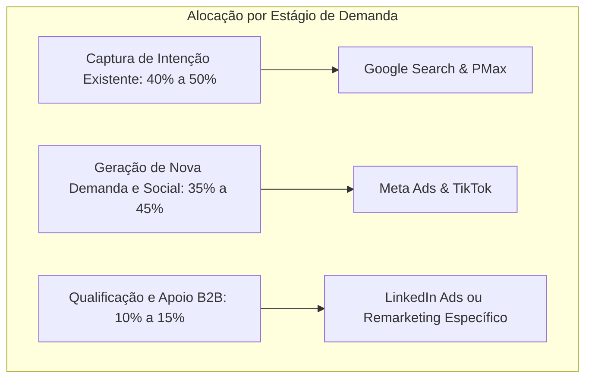

# Paid Media Analytics: Inteligência Financeira, Lances e Atribuição

O **Paid Media Analytics** é a skill técnica dedicada à governança de dados, alocação de capital, automação de regras e modelagem de atribuição para operações de tráfego pago multicanal. Ele atua como o **cérebro financeiro da mídia paga**, garantindo que cada centavo investido gere retorno mensurável e que desvios de custo (CPA/ROAS) sejam diagnosticados e corrigidos antes de comprometer o caixa do negócio.

---

## 1. Princípios e Heurísticas de Governança de Mídia

1. **Olhar para o MER (Marketing Efficiency Ratio), Não Apenas para o ROAS de Plataforma:** Cada gerenciador de anúncios reivindica os mesmos créditos de venda devido a janelas de atribuição sobrepostas (o Meta reporta 7 dias clique/1 dia view; o Google reporta DDA). A métrica soberana da saúde do negócio é o **MER Blended**:
   $$\text{MER} = \frac{\text{Receita Total Bruta}}{\text{Gasto Total em Mídia (Todas as Plataformas)}}$$
2. **A Árvore Diagnóstica do CPA:** O Custo por Aquisição (CPA) é uma métrica composta, governada matematicamente por duas variáveis:
   $$\text{CPA} = \frac{\text{CPC}}{\text{Taxa de Conversão da Landing Page (CR)}}$$
   - Se o CPA subiu: ou o CPC encareceu no leilão (problema de criativo ou concorrência), ou a taxa de conversão caiu no site (problema técnico, oferta ou lentidão).
3. **Escala Segura (A Regra dos 15%):** Escalar o orçamento diário de uma campanha em mais de 20% de uma só vez reseta o aprendizado algorítmico do Meta e do Google, disparando o CPA. Aumente no máximo 15% a 20% a cada 48 a 72 horas.
4. **Regras de Corte Automático São Inegociáveis:** Deixar anúncios ruins rodando na esperança de melhora queima até 30% do orçamento. Regras de auto-pause devem agir com base em dados frios.

---

## 2. Alocação de Orçamento Cross-Channel (O Mix Ideal)

A distribuição de capital entre canais depende da maturidade da marca e do tipo de demanda:



| Tipo de Demanda | Canal Prioritário | Justificativa Econômica | Métrica Alvo |
| :--- | :--- | :--- | :--- |
| **Demanda Ativa (Puxada)** | Google Search (Termos de Intenção) | O usuário já sabe o que quer e está pronto para comprar. Menor atrito no funil. | ROAS Direto e Taxa de Conversão |
| **Demanda Latente (Empurrada)** | Meta Ads & TikTok Ads | O usuário tem a dor mas não busca ativamente. O criativo visual desperta o desejo. | Blended CAC e Volume de Leads |
| **Contas Corporativas (B2B)** | LinkedIn Ads | Filtro estrito de ICP para proteger o tempo do time de vendas enterprise. | SQL (Sales Qualified Leads) e Tamanho de Deal |

---

## 3. Diagnóstico de Desperdício (Wasted Spend Finder)

O protocolo de caça a desperdícios deve ser rodado semanalmente para limpar ineficiências na conta:

### A Matriz de Poda em 4 Quadrantes

| Situação Identificada | Diagnóstico Técnico | Ação Operacional |
| :--- | :--- | :--- |
| **Gasto $\ge 2 \times \text{CPA Alvo}$ com zero conversões** | Ralo Financeiro Ativo | Pausar o anúncio ou negativar a palavra-chave imediatamente. |
| **CPC baixo, CTR alto, mas zero leads na página** | Desalinhamento Promessa-Página (*Clickbait*) | Ajustar o criativo para alinhar a expectativa com a oferta real da Landing Page. |
| **Conjuntos com Frequência $> 5.0$ e CPA subindo $> 30\%$** | Saturação Crítica de Audiência | Pausar ou injetar novo público amplo (Broad). |
| **Canibalização de Termos de Marca em campanhas genéricas** | Inflação Falsa de ROAS | Negativar termos institucionais na campanha genérica. |

---

## 4. Regras Automatizadas e Protocolo de Auto-Pause

Para proteger o orçamento contra variações anômalas, configure as seguintes regras automatizadas no Meta Ads e Google Ads:

```markdown
REGRA 1: AUTO-PAUSE DE CRIATIVOS RUINS (Nível: Anúncio)
SE: Gasto nos últimos 3 dias >= (1.5 * CPA_Alvo)
E: Conversões == 0
AÇÃO: Pausar Anúncio
NOTIFICAÇÃO: Enviar alerta no Slack/Email

REGRA 2: PROTEÇÃO CONTRA PICOS DE CPA (Nível: Conjunto de Anúncios)
SE: Gasto nos últimos 7 dias >= (3 * CPA_Alvo)
E: CPA Real >= (1.4 * CPA_Alvo)
AÇÃO: Reduzir orçamento diário em 20%
NOTIFICAÇÃO: Flag para revisão humana

REGRA 3: ESCALA AUTOMÁTICA DE VENCEDORES (Nível: Conjunto / Campanha)
SE: Conversões nos últimos 7 dias >= 15
E: CPA Real <= (0.85 * CPA_Alvo)
E: Frequência nos últimos 7 dias <= 1.8
AÇÃO: Aumentar orçamento diário em 15% (Máximo 1x a cada 48h)
```

---

## 5. Pacing Orçamentário e Projeção de ROAS

O monitoramento de Pacing evita que a conta esgote o orçamento na metade do mês ou faça gastos desordenados no final para cumprir meta de investimento.

### Fórmulas de Controle de Pacing

$$\text{Pacing Ratio} = \frac{\text{Gasto Acumulado Real}}{\text{Gasto Previsto no Período}}$$

- **Pacing Normal:** $0.95 \le \text{Ratio} \le 1.05$ (Operação em ritmo saudável).
- **Over-pacing ($\text{Ratio} > 1.05$):** Risco de esgotamento precoce. Reduzir lances ou orçamentos diários.
- **Under-pacing ($\text{Ratio} < 0.95$):** A conta não está conseguindo entregar o volume planejado. Alargar segmentações ou elevar lances máximos.

---

## 6. Modelos de Atribuição e Análise de Caminho de Conversão

| Modelo de Atribuição | Como Distribui o Crédito | Vantagem Principal | Risco / Ponto Cego |
| :--- | :--- | :--- | :--- |
| **Último Clique (Last Click)** | 100% do valor para o último ponto de contato antes da compra. | Simples de auditar e entender no CRM. | Mata canais de topo de funil (Meta, TikTok), supervalorizando Search e Brand. |
| **Primeiro Clique (First Click)** | 100% do valor para o canal que atraiu o usuário pela primeira vez. | Mede a capacidade real de geração de demanda. | Ignora todo o esforço de fechamento e remarketing. |
| **Data-Driven (DDA - Baseado em Dados)** | Algoritmo divide o crédito proporcionalmente entre todos os toques. | O modelo mais equilibrado para tomadas de decisão. | Funciona como uma caixa preta (depende do histórico do Google/Meta). |

---

## 7. Padrão de Nomenclatura e Gerador de Rastreamento UTM

Para manter os dados de CRM e GA4 100% auditáveis, adote uma taxonomia rigorosa de nomenclatura de campanhas e URLs:

### Padrão de Nomenclatura de Campanhas
`[PLATAFORMA]_[OBJETIVO]_[FUNIL]_[PÚBLICO]_[FORMATO]_[DATA]`  
*Exemplo:* `META_CONV_TOF_BROAD_UGC-V1_20261018`

### Padrão de Parâmetros UTM Obrigatórios
- `utm_source`: A plataforma de tráfego (`google`, `facebook`, `instagram`, `linkedin`, `tiktok`).
- `utm_medium`: O modelo de compra (`cpc`, `paid_social`, `cpm`).
- `utm_campaign`: O nome exato da campanha padronizada (`meta_conv_tof_broad`).
- `utm_content`: O identificador do criativo específico (`video_gancho1_desconto`).
- `utm_term`: A palavra-chave pesquisada (no Google) ou público segmentado (no Meta).

---

## 8. Guias por tipo de pergunta

Os guias estão em [`references/`](references/). Os de nome `NN-google-and-meta-...` analisam Google Ads e Meta Ads juntos, a partir de uma exportação em CSV colada na conversa. Os de prefixo `clawdbot-` supõem um MCP que puxa os dados da conta. O texto base é inglês.

### Quero decidir onde e quanto investir
- [ad-spend-optimizer.md](references/ad-spend-optimizer.md) — Alocação de verba entre canais por retorno marginal e atribuição (o guia mais completo).
- [32-google-and-meta-ad-spend-allocator.md](references/32-google-and-meta-ad-spend-allocator.md) — Redistribuição de verba com MER, ROAS marginal e a regra 70-20-10.
- [15-google-and-meta-channel-mix-optimizer.md](references/15-google-and-meta-channel-mix-optimizer.md) — Divisão ideal entre Search, PMax e Meta.
- [03-google-and-meta-budget-scenario-planner.md](references/03-google-and-meta-budget-scenario-planner.md) — Simula o que acontece com CPA e ROAS ao subir ou cortar orçamento.
- [19-google-and-meta-roas-forecasting.md](references/19-google-and-meta-roas-forecasting.md) — Projeta o ROAS dos próximos 30, 60 e 90 dias.
- [01-bid-budget-manager.md](references/01-bid-budget-manager.md) — Ajustes de lance e orçamento a partir de uma exportação de campanhas.
- [clawdbot-google-vs-meta-comparator.md](references/clawdbot-google-vs-meta-comparator.md) — Compara Google e Meta lado a lado e aponta onde mover verba.

### Quero entender por que o resultado piorou
- [01-google-and-meta-cpa-diagnostics.md](references/01-google-and-meta-cpa-diagnostics.md) — Decompõe uma alta de CPA em causas.
- [02-google-and-meta-wasted-spend-finder.md](references/02-google-and-meta-wasted-spend-finder.md) — Acha gasto sem retorno em termos, posições e públicos.
- [06-google-and-meta-anomaly-detection.md](references/06-google-and-meta-anomaly-detection.md) — Detecta mudanças incomuns em CPC, conversão e gasto.
- [04-performance-auditor.md](references/04-performance-auditor.md) — Auditoria de desempenho da conta de ponta a ponta.
- [17-google-and-meta-account-structure-review.md](references/17-google-and-meta-account-structure-review.md) — Revisa a estrutura de campanhas e conjuntos contra as metas.
- [16-google-and-meta-conversion-path-analysis.md](references/16-google-and-meta-conversion-path-analysis.md) — Mapeia o caminho do primeiro clique até a conversão.
- [26-google-and-meta-attribution-model-comparison.md](references/26-google-and-meta-attribution-model-comparison.md) — Compara os modelos de atribuição lado a lado.
- [12-google-and-meta-day-hour-performance-breakdown.md](references/12-google-and-meta-day-hour-performance-breakdown.md) — Desempenho por dia da semana e hora.
- [24-google-and-meta-geo-performance-analysis.md](references/24-google-and-meta-geo-performance-analysis.md) — Desempenho por localização.
- [25-google-and-meta-device-performance-split.md](references/25-google-and-meta-device-performance-split.md) — Desempenho por celular, desktop e tablet.
- [03-audience-architect.md](references/03-audience-architect.md) — Desempenho por público: saturação e segmentação.
- [clawdbot-audience-saturation-scanner.md](references/clawdbot-audience-saturation-scanner.md) — Variante do mesmo assunto: saturação, sobreposição de público e o que testar a seguir (veio de `persona-icp`, 2026-10-20).
- [29-google-and-meta-performance-benchmarking.md](references/29-google-and-meta-performance-benchmarking.md) — Compara as métricas com benchmarks do setor.

### Quero testar e comparar
- [28-google-and-meta-ab-test-setup-and-analysis.md](references/28-google-and-meta-ab-test-setup-and-analysis.md) — Desenha testes A/B válidos para anúncios, públicos e páginas.
- [31-google-and-meta-ab-test-analyzer.md](references/31-google-and-meta-ab-test-analyzer.md) — Calcula significância e tamanho de amostra de um teste.

### Quero vigiar o dia a dia
- [spend-pacing-tracker.md](references/spend-pacing-tracker.md) — Ritmo de gasto diário e mensal no Google e no Meta.
- [27-google-and-meta-pacing-monitor.md](references/27-google-and-meta-pacing-monitor.md) — Gasto diário contra a meta mensal, em versão curta.
- [clawdbot-roas-cpa-threshold-alert.md](references/clawdbot-roas-cpa-threshold-alert.md) — Alerta quando CPA ou ROAS passam do limite.
- [clawdbot-auto-pause-bad-ads.md](references/clawdbot-auto-pause-bad-ads.md) — Regras para pausar anúncios de baixo rendimento.
- [clawdbot-ads-crew.md](references/clawdbot-ads-crew.md) — Rotina semanal de segunda-feira da equipe de mídia.

### Quero relatar para o cliente ou a liderança
- [30-google-and-meta-weekly-account-summary.md](references/30-google-and-meta-weekly-account-summary.md) — Resumo semanal em linguagem simples.
- [05-google-and-meta-client-report-narratives.md](references/05-google-and-meta-client-report-narratives.md) — Resumo executivo em parágrafo a partir dos dados.

### Quero a estratégia e o público
- [ppc-advertising-deep.md](references/ppc-advertising-deep.md) — Guia completo de campanhas pagas em Google, Meta, LinkedIn, X e outras plataformas (substitui o antigo `paid-ads`).
- [paid-media-playbook.md](references/paid-media-playbook.md) — Playbook de mídia paga baseado em Google Ads, Meta Business e WordStream.
- [audience-targeting.md](references/audience-targeting.md) — Referência de segmentação de público.

### Quero nomear e rastrear
- [23-google-and-meta-campaign-naming-convention-builder.md](references/23-google-and-meta-campaign-naming-convention-builder.md) — Convenção de nomes de campanhas.
- [44-google-and-meta-utm-tracking-generator.md](references/44-google-and-meta-utm-tracking-generator.md) — UTM, eventos do GA4 e especificação de rastreio.

## 9. Por plataforma

| Plataforma | Onde ir |
|---|---|
| **Google Ads** | Configuração, auditoria, termos de pesquisa, lances e Quality Score: skill [ads-google](../ads-google/SKILL.md) |
| **Meta Ads** (Facebook e Instagram) | Estrutura, públicos, frequência e retargeting: skill [ads-meta](../ads-meta/SKILL.md) |
| **LinkedIn, TikTok, Reddit** | Skill [ads-multiplataforma](../ads-multiplataforma/SKILL.md) |
| **Google e Meta juntos, ou todos** | Os guias desta skill (seção 8) |
| **Campanha a montar** (brief, plano, playbooks) | Skill [revenue-campanhas](../revenue-campanhas/SKILL.md) |
