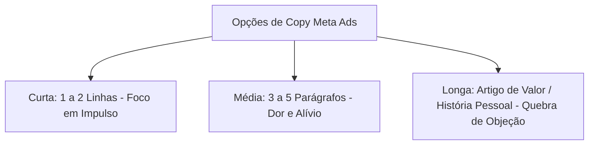

# Paid Ad Copywriter: Redação Persuasiva para Mídia Paga

O **Paid Ad Copywriter** é a skill técnica dedicada à criação de textos de anúncios de alta conversão para plataformas de mídia paga (Google Ads, Meta Ads, LinkedIn Ads, TikTok Ads). Diferente do copywriting orgânico ou institucional, o texto para tráfego pago opera sob restrições severas de espaço (limites de caracteres), filtros agressivos de atenção do usuário e concorrência direta no leilão.

---

## 1. Princípios e Heurísticas de Copywriting de Anúncios

1. **A Atenção É o Único Ativo:** O usuário não entra nas redes sociais ou nos motores de busca para ler anúncios. A copy deve justificar a interrupção nos primeiros 40 caracteres ou 3 segundos.
2. **Clareza Vence a Esperteza:** Em mídia paga, trocadilhos, metáforas complexas e frases poéticas aumentam o CPA. Promessas específicas, métricas tangíveis e benefícios diretos geram cliques qualificados.
3. **Harmonia Mensagem-Destino (Message Match):** A promessa central do anúncio DEVE ser a primeira frase que o usuário lê ao aterrissar na Landing Page. Descompasso entre anúncio e página gera taxa de rejeição imediata (>80%).
4. **Filtro Anti-Clichê de IA (Anti-Slop Obrigatório):** É estritamente proibido abrir anúncios com chavões como:
   - *"Você sabia que..."*
   - *"No cenário corporativo atual..."*
   - *"Descubra o segredo para revolucionar..."*
   - *"Potencialize seus resultados de forma simples..."*
   - Comece direto pelo fato concreto, pelo número ou pela dor crua do cliente.

---

## 2. Copywriting para Google Search (Responsive Search Ads - RSA)

O formato padrão do Google Search requer até **15 Títulos (Headlines)** de no máximo 30 caracteres e até **4 Descrições** de no máximo 90 caracteres.

### Matriz Estrutural dos 15 Títulos de Alta Intenção

Para alcançar classificação de eficácia do anúncio "Excelente" (Ad Strength: Excellent) e manter alto índice de qualidade:

| Posição / Categoria | Qtd | Objetivo da Linha | Exemplo Real (Nicho B2B/SaaS) | Regra de Pinning |
| :--- | :---: | :--- | :--- | :--- |
| **Palavra-Chave Exata** | 3 | Conexão imediata com a intenção de busca. | `Software de Gestão de Frota`, `Sistema para Transportadoras` | Pin na Posição 1 (opcional para controle estrito) |
| **Benefício / Solução** | 4 | Resolver a dor prática do tomador de decisão. | `Reduza 22% do Gasto de Combustível`, `Controle de Manutenção em Tempo Real` | Posição 1 ou 2 |
| **Prova Social / Credibilidade** | 3 | Reduzir o risco percebido da escolha. | `+1.200 Empresas Atendidas`, `Nota 4.9 no Reclame Aqui`, `Premiado em 2026` | Posição 2 ou 3 |
| **Chamada para Ação (CTA)** | 3 | Instruir o próximo passo com atrito zero. | `Faça um Teste Grátis de 14 Dias`, `Calcule sua Economia Agora`, `Agende uma Demonstração` | Pin na Posição 3 |
| **Diferencial Competitivo** | 2 | Exclusividade perante os concorrentes. | `Sem Contrato de Fidelidade`, `Suporte Humano em 5 Minutos` | Rotativo Livre |

### Estrutura das 4 Descrições (90 Caracteres)
1. **Descrição 1 (Dor + Solução):** *"Cansado de planilhas desatualizadas? Centralize rotas, consumo e manutenções em um só painel."*
2. **Descrição 2 (Métricas + Oferta):** *"Economize até R$ 850 por veículo todo mês. Teste sem compromisso e veja a diferença em 7 dias."*
3. **Descrição 3 (Prova + Garantia):** *"Utilizado por mais de 50.000 frotistas em todo o Brasil. Implantação rápida e sem taxa de adesão."*
4. **Descrição 4 (CTA Direto + Benefício):** *"Solicite um diagnóstico gratuito da sua operação com nossos especialistas hoje mesmo."*

---

## 3. Copywriting para Meta Ads (Facebook & Instagram)

O Meta Ads exige domínio de três comprimentos de texto primário (Primary Text) e headlines de alto impacto visual.



### 3.1. Formato Curto (Punchy Copy - Até 125 Caracteres)
Ideal para remarketing, e-commerce, ofertas irresistíveis e produtos de impulso.
> *Exemplo:*  
> "92% dos gestores perdem 6 horas por semana preenchendo relatórios manuais.  
> Esta ferramenta faz isso em 1 clique.  
> [Toque em 'Saiba Mais' e teste 14 dias grátis]."

### 3.2. Formato Médio (PAS Framework: Problema - Agitação - Solução)
Ideal para infoprodutos, serviços profissionais e SaaS mid-market.
> *Exemplo:*  
> **[Problema]** Você investe milhares de reais em anúncios todo mês e o telefone não toca.  
> **[Agitação]** O pior não é o dinheiro perdido: é a sensação de que o seu negócio é refém de agências que só mostram 'métricas de vaidade' enquanto o caixa seca.  
> **[Solução]** Criamos uma metodologia que audita 23 pontos cegos da sua conta de anúncios em menos de 1 hora.  
> Sem relatórios de 80 páginas. Apenas os 3 ajustes que você pode fazer hoje para diminuir seu CPA pela metade.  
> **[CTA]** Clique no botão abaixo e acesse a planilha de auditoria completa.

### 3.3. Headlines de Meta Ads (Abaixo do Criativo)
- Limite ideal: **40 caracteres** (para não truncar em telas mobile).
- Fórmulas de alta conversão:
  - `[Resultado Desejado] em [Tempo Curto]` $\rightarrow$ *Ex: "Reduza Custos de TI em 14 Dias"*
  - `[Ferramenta/Guia] Gratuito para [Público]` $\rightarrow$ *Ex: "Guia Fiscal 2026 para Médicos"*
  - `Pare de [Ação Dolorosa] Hoje` $\rightarrow$ *Ex: "Pare de Perder Vendas no WhatsApp"*

---

## 4. Copywriting para TikTok Ads & Reels (Roteiros em 3 Atos)

Para anúncios verticais em vídeo (9:16), a copy falada e legendada deve seguir o roteiro em 3 atos:

| Ato | Janela de Tempo | Objetivo | Técnica de Copywriting |
| :--- | :---: | :--- | :--- |
| **Ato 1: O Gancho (Hook)** | 0.0s – 3.0s | Parar o scroll e selecionar o público. | Pergunta incômoda, número bizarro ou demonstração de falha comum. Ex: *"O seu contador nunca te contou isso sobre impostos."* |
| **Ato 2: A Retenção (Core Body)** | 3.1s – 20.0s | Explicar o mecanismo sem enrolação. | 3 passos práticos ou antes vs depois veloz. Cortes a cada 2.5 segundos de fala. |
| **Ato 3: A Saída (Action CTA)** | 20.1s – 30.0s | Direcionar para a ação imediata. | Benefício de clicar agora + indicação física apontando para o botão da tela. |

---

## 5. Copywriting B2B para LinkedIn Ads

No LinkedIn Ads, o tom deve respeitar a persona corporativa (C-Level, Diretores, Heads), mantendo profissionalismo sem se tornar burocrático ou maçante.

- **Foco em ROI e Alívio de Risco:** Ninguém é demitido por contratar uma solução segura que comprovadamente reduz custos ou cumpre conformidade (compliance).
- **Thought Leadership Ads:** Transforme opiniões técnicas de executivos da empresa em anúncios nativos que parecem posts comuns do feed.
- **InMail / Message Ads Personalizados:** Máximo de 3 parágrafos curtos. Proposta de valor personalizada para a indústria do lead + pergunta de baixo atrito (*"Faria sentido eu te mandar um resumo de 2 minutos sobre como a Empresa X reduziu esse custo?"*).

---

## 6. Matriz Multivariada de Testes de Copy (Os 4 Ângulos)

Ao estruturar uma campanha para testes multivariados, gere pelo menos 4 variações de texto abordando os 4 ângulos fundamentais:

```markdown
1. ÂNGULO DA DOR (Foco na fuga do sofrimento):
   "Quanto tempo você perdeu esta semana refazendo trabalho que deveria ter sido automatizado?"

2. ÂNGULO DO DESEJO / GANHO (Foco na ambição e no resultado futuro):
   "Imagine chegar na sexta-feira com todas as metas de vendas batidas e o CRM 100% atualizado."

3. ÂNGULO DA PROVA SOCIAL (Foco no medo de ficar para trás / FOMO):
   "Mais de 4.800 empresas do setor de tecnologia migraram para este modelo nos últimos 6 meses."

4. ÂNGULO DA NOVIDADE / CURIOSIDADE (Foco no mecanismo exclusivo):
   "Por que a inteligência contextual está substituindo os antigos fluxos lineares de automação?"
```

---

## 7. Catálogo de Referências Técnicas Integradas

Esta skill preserva e se apoia nos guias especializados contidos na subpasta [`references/`](references/):

| Arquivo de Referência | Conteúdo Técnico & Casos Práticos |
| :--- | :--- |
| [`ad-copy-templates.md`](references/ad-copy-templates.md) | Biblioteca exaustiva de templates prontos de anúncios categorizados por estágio de funil (Topo, Meio e Fundo). |
| [`09-google-and-meta-ad-copy-variant-generator.md`](references/09-google-and-meta-ad-copy-variant-generator.md) | Gerador automatizado de variações de texto para testes de anúncios em Google e Meta. |
| [`.agent/workflows/ads-copy-de-anuncio.md`](../../workflows/ads-copy-de-anuncio.md) | Workflow de execução direta para geração sistemática de lotes de copy de anúncios com filtros anti-slop. |
