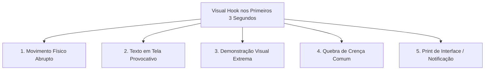

# Ad Creative Strategist: Engenharia de Criativos de Alta Performance

O **Ad Creative Strategist** é a skill especializada no desenvolvimento, teste, análise e otimização contínua de peças criativas para tráfego pago (Meta Ads, TikTok Ads, YouTube Ads, LinkedIn Ads e Display). Em um ecossistema de anúncios dominado por automação e algoritmos de lances inteligentes (Advantage+, Performance Max), o **criativo é a principal alavanca de segmentação e diferenciação de custos (CPA/ROAS)**.

---

## Quando usar / Quando NÃO usar

**Use** para conceber, testar e renovar criativos de anúncio (vídeo, estático, UGC), detectar fadiga e analisar anúncios de concorrentes.

**NÃO use** para escrever só o texto do anúncio por plataforma (use `ads-copy-de-anuncio`), para configurar e otimizar campanhas (use `ads-meta`, `ads-google` ou `ads-multiplataforma`), para métricas de mídia paga (use `ads-analise-de-desempenho`) nem para desmontar a página do concorrente (use `revenue-inteligencia-competitiva`).

---

## 1. Princípios e Heurísticas Fundamentais

1. **O Criativo É a Nova Segmentação:** Os algoritmos modernos analisam pixels, transcrição de áudio, texto na tela e comportamento do usuário nos primeiros 3 segundos para direcionar o anúncio à audiência ideal. Criativos genéricos atraem público desqualificado e elevam o CAC.
2. **A Regra dos Primeiros 3 Segundos (Hook First):** Se o espectador não for capturado visualmente ou verbalmente até o segundo 03, o anúncio falhou. A métrica prioritária de triagem inicial é o **Hook Rate (3s Video Views / Impressões)**.
3. **Equilíbrio 80/20 de Formatos:** 80% do orçamento deve rodar em formatos comprovados (Winner Creatives); 20% deve ser reservado estritamente para testes contínuos de novos conceitos, ângulos e ganchos.
4. **Fadiga Criativa É Inevitável:** Todo criativo vencedor entra em declínio conforme atinge saturação de frequência. A identificação antecipada do ponto de inflexão evita queima de verba.

---

## 2. A Pirâmide de Formatos Criativos

| Formato | Objetivo Primário | Estrutura Típica | Plataformas Recomendadas | Métrica-Chave |
| :--- | :--- | :--- | :--- | :--- |
| **UGC Autêntico (User-Generated)** | Conversão Direta / Prova Social | Gravação em smartphone, unboxing, relato de dor pessoal, demonstração prática e recomendação direta. | TikTok, Reels, Shorts | Hook Rate (>30%) e Hold Rate (>15%) |
| **Estático Editorial / Headline Card** | Retenção Rápida e Custo Baixo | Design minimalista simulando print de tweet, bloco de notas, gráfico comparativo ou headline jornalística. | Meta Feed, LinkedIn, Stories | CTR Único (>1.8%) e CPC |
| **Carrossel Patrocinado de Objeções** | Educação de Meio de Funil | Card 1 (Gancho visual forte) $\rightarrow$ Cards 2 a 4 (Destrinchamento de problema/solução) $\rightarrow$ Card Final (CTA e garantia). | Instagram Feed, LinkedIn Ads | Taxa de Swipe (>40%) e CTR |
| **Motion Design / Explainer Rápido** | Clareza de Produto SaaS/B2B | Animação em 2D/3D demonstrando o software em uso, interface, redução de tempo e resultado tangível. | Meta, YouTube, LinkedIn | VTR (View-Through Rate) e Taxa de Leads |
| **VSL Curto (Video Sales Letter)** | Venda Direta de Infoproduto | Roteiro estruturado: Gancho $\rightarrow$ Problema $\rightarrow$ Agitação $\rightarrow$ Revelação $\rightarrow$ Mecanismo Único $\rightarrow$ Oferta. | Meta, YouTube Ads, TikTok | Hold Rate de 50% e Conversão |

---

## 3. Taxonomia de Ganchos Visuais (Hooks)

Para quebrar o padrão de rolagem infinita do usuário (*Pattern Interrupt*), utilize um dos seguintes 5 modelos validados:

1. **Movimento Físico Abrupto:** Objeto caindo, zoom veloz na expressão facial, alguém derramando líquido ou interrompendo uma ação cotidiana.
2. **Texto em Tela Provocativo:** *"Pare de fazer [X] se você quer [Resultado Y]"* ou *"O maior erro que vi em 5 anos de [Nicho]"*.
3. **Demonstração Visual Extrema:** Comparativo lado a lado dividido na tela (Antes vs Depois / O jeito comum vs O jeito novo).
4. **Quebra de Crença Comum:** *"Tudo o que te falaram sobre [Tópico] é mentira por esta razão exata."*
5. **Print de Interface ou Notificação:** Simulação de mensagem direta (DM), tweet polêmico ou alerta de banco/dashboard com resultado real.

---

## 4. Diagnóstico e Combate à Fadiga Criativa (Creative Fatigue)

A fadiga do criativo ocorre quando a audiência já visualizou a peça múltiplas vezes, resultando em cegueira de banner e degradação de performance.

### Fórmula do Creative Fatigue Index (CFI)

$$\text{CFI} = \frac{\Delta \text{CTR}}{\Delta \text{Frequência}} \times \frac{\text{CPA Atual}}{\text{CPA Histórico}}$$

### Sinais Clínicos e Plano de Ação

| Sintoma Observado | Diagnóstico | Ação Imediata Recomendada |
| :--- | :--- | :--- |
| **Frequência semanal > 2.8 + CTR caindo > 25%** | Fadiga de Visualização | Pausar a peça e substituir por variação de gancho visual com o mesmo corpo de anúncio. |
| **CPA subindo > 35% com CPC constante** | Fadiga de Oferta / Mensagem | O anúncio chama atenção, mas a promessa esgotou no público. Testar novo ângulo de benefício. |
| **Hook Rate < 15% nas primeiras 48h** | Gancho Fraco (Hook Failure) | O conteúdo do vídeo pode ser bom, mas ninguém fica. Trocar apenas os primeiros 3 segundos. |
| **Hold Rate alto (>25%), mas CTR no link < 0.6%** | Fricção no CTA | O espectador assiste mas não sabe o que fazer. Adicionar indicação visual clara de clique e benefício do destino. |

---

## 5. Metodologia de Teste Criativo Modular (Dynamic Creative Testing)

Para não queimar orçamento testando peças aleatórias, teste **um elemento modular por vez**:

1. **Rodada 1 (Teste de Ganchos):** 1 mesmo corpo de vídeo com **4 ganchos diferentes de 3 segundos** (Hook A, Hook B, Hook C, Hook D).
2. **Rodada 2 (Teste de Ângulos de Copy):** O gancho vencedor combinado com **3 abordagens de texto primário** (Dor Aguda, Lógica Racional, Prova Social).
3. **Rodada 3 (Teste de Chamada para Ação):** O conjunto vencedor com **2 variações de CTA final** (Incentivo Imediato vs Garantia sem Risco).

---

## 6. Checklist de Validação Pré-Lançamento de Criativos

Antes de subir qualquer anúncio para veiculação paga, audite os seguintes itens:

- [ ] **Área Segura (Safe Zones):** Nenhum texto importante, botão ou elemento gráfico está encoberto pela legenda, botões laterais ou nome de perfil da rede (especialmente TikTok e Reels 9:16).
- [ ] **Legendas Obrigatórias:** 80%+ dos usuários em redes sociais assistem vídeos sem áudio inicial. Todas as falas contêm legendas dinâmicas legíveis com contraste adequado.
- [ ] **Resolução e Aspect Ratio Nativo:** 1:1 e 4:5 para Feeds; 9:16 para Stories/Reels/TikTok; 16:9 para YouTube Desktop e Display.
- [ ] **Políticas e Compliance de Mídia:** Sem promessas irrealistas, sem imagens apelativas de "antes e depois" drásticos em nichos de saúde, sem uso indevido de logos corporativos das plataformas.
- [ ] **Continuidade Visual com a Landing Page:** As cores primárias, a promessa central e a estética do criativo combinam imediatamente com a primeira dobra da página de destino.

---

## 7. Catálogo de Referências Técnicas Integradas

Esta skill preserva e se apoia nos guias especializados contidos na subpasta [`references/`](references/):

| Arquivo de Referência | Conteúdo Técnico & Casos Práticos |
| :--- | :--- |
| [`ad-creative.md`](references/ad-creative.md) | Guia mestre de arquitetura criativa, matrizes de formatos e frameworks de conversão visual. |
| [`ad-creative-variations.md`](references/ad-creative-variations.md) | Roteiros de variação modular de anúncios para testes A/B e escala horizontal de criativos. |
| [`video-ad-analysis.md`](references/video-ad-analysis.md) | Diagnóstico analítico de retenção de vídeo, curvas de abandono segundo a segundo e benchmarks. |
| [`generative-tools.md`](references/generative-tools.md) | Prompts, fluxos e ferramentas de IA generativa (Midjourney, Flux, Kling, Runway, ElevenLabs) para produção rápida de anúncios. |
| [`02-creative-analyst.md`](references/02-creative-analyst.md) | Procedimentos de auditoria analítica e categorização de criativos vencedores por ROAS. |
| [`13-meta-competitor-creative-analysis.md`](references/13-meta-competitor-creative-analysis.md) | Metodologia para desmontar anúncios concorrentes na Meta Ad Library e mapear vulnerabilidades. |
| [`clawdbot-ad-creative-test-monitor.md`](references/clawdbot-ad-creative-test-monitor.md) | Automação e regras de monitoramento diário de testes de novos criativos. |
| [`clawdbot-competitor-ad-spy.md`](references/clawdbot-competitor-ad-spy.md) | Protocolo de inteligência competitiva e raspagem ética de novas tendências visuais. |
| [`brief.md`](references/brief.md) | Roteiro guiado para gerar o briefing criativo de uma campanha. |
| [`calendar.md`](references/calendar.md) | Roteiro guiado para montar o calendário de conteúdo da campanha por canal e frequência. |

## Outras referências

- **[creative-fatigue-detector.md](references/creative-fatigue-detector.md)** — Analisa a performance de criativos, detecta fadiga e explica por que um anúncio funciona ou falha.

## Quando o assunto é outro

- Desmontar a **página** do concorrente (proposta de valor, hierarquia de mensagem, nota de 100 pontos): [competitor-page-teardown](../revenue-inteligencia-competitiva/references/competitor-page-teardown.md), em `revenue-inteligencia-competitiva`.
- Fadiga de criativos no Meta: a seção 4 acima e [creative-fatigue-detector.md](references/creative-fatigue-detector.md) cobrem; o guia curto de 30 linhas foi arquivado.
