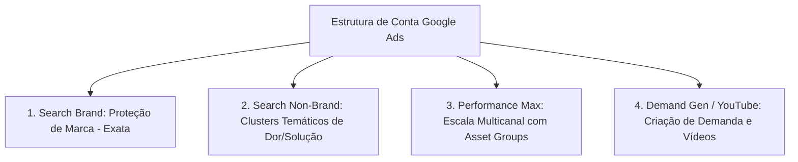

# Google Ads Specialist: Engenharia de Tráfego de Intenção e Performance Max

O **Google Ads Specialist** é a skill técnica dedicada à gestão avançada de anúncios no ecossistema do Google (Rede de Pesquisa, Performance Max, YouTube Ads, Rede de Display e Demand Gen). Diferente de canais baseados em interrupção social, o Google Ads opera prioritariamente sobre a **intenção ativa de busca e comportamento de compra**, exigindo precisão cirúrgica na escolha de correspondências de palavras-chave, controle de termos de pesquisa e maximização do Índice de Qualidade (*Quality Score*).

---

## 1. Princípios e Heurísticas Fundamentais

1. **Intenção Comercial É Soberana:** Palavras-chave informativas (*"o que é CRM"*) devem ser separadas de palavras-chave de intenção comercial ou transacional (*"melhor CRM para imobiliária preço"*). Misturar intenções infla o CPA e reduz a taxa de conversão.
2. **Quality Score (QS) É um Desconto Matemático:** O leilão do Google Ads calcula o Ad Rank como $\text{Ad Rank} = \text{Lance Máximo (CPC)} \times \text{Quality Score}$. Um anúncio com QS 10 paga até 50% menos por clique do que um concorrente com QS 5 para ocupar a mesma primeira posição.
3. **PMax Requer Sinais Fortes e Guardrails:** A campanha Performance Max é um motor de aprendizado por máquina. Sem sinais de audiência qualificados (listas de clientes e termos de alta intenção) e sem listas de exclusão de marca, a PMax tende a canibalizar tráfego orgânico e termos de marca para inflar artificialmente o ROAS reportado.
4. **Negativação Não É Opcional:** Uma conta sem rotina semanal de mineração de termos de busca perde entre 15% e 35% do orçamento em cliques irrelevantes.

---

## 2. Arquitetura Moderna de Conta (Intent Clusters & PMax)

A estrutura recomendada organiza as campanhas pela temperatura e tipo de intenção:

### 2.1. Campanha 1: Search Brand (Proteção de Marca)
- **Objetivo:** Garantir a 1ª posição absoluta para buscas pelo nome da sua empresa/produto, impedindo que concorrentes roubem o lead no topo da página.
- **Correspondência:** Exata e de Frase.
- **Estratégia de Lance:** Parcela de Impressões Alvo (Target Impression Share $\ge 95\%$ no topo absoluto).

### 2.2. Campanha 2: Search Non-Brand (Genérica por Clusters Temáticos)
- **Estrutura:** Agrupar palavras-chave por **temas estreitos de intenção** (máximo de 5 a 15 palavras por grupo de anúncios).
- **Tipos de Correspondência:** Frase (`"palavra chave"`) e Exata (`[palavra chave]`). Uso de Correspondência Ampla somente em conjunto com Smart Bidding maduro (mais de 30 conversões/mês no grupo).
- **Estratégia de Lance:** Maximizar Conversões com tCPA (Custo por Ação Alvo).

### 2.3. Campanha 3: Performance Max (PMax com Asset Groups Segmentados)
- **Organização:** 1 Grupo de Recursos (Asset Group) por categoria de produto/público.
- **Sinais de Audiência Obrigatórios:** Lista de Compradores VIP (Customer Match), Visitantes do Checkout e Termos de Busca dos Concorrentes (Custom Segments).
- **Exclusão de Marca:** Aplicar lista de exclusão de marca na PMax para forçar o algoritmo a buscar novos clientes em vez de computar vendas institucionais.

---

## 3. Mineração Contínua de Termos de Pesquisa (Search Term Mining)

A rotina de Search Term Mining analisa os termos exatos que os usuários digitaram no Google antes de clicar no seu anúncio.

### Protocolo de Auditoria Semanal em 3 Filtros

1. **Filtro de Desperdício (Negative Miner):**
   - Critério: Termos com gasto $> 1.5 \times \text{CPA Alvo}$ e **zero conversões**.
   - Ação: Negativar imediatamente a nível de campanha ou lista compartilhada.
2. **Filtro de Oportunidade (Keyword Expansion):**
   - Critério: Termos de pesquisa com $\ge 2$ conversões e CPA abaixo da meta que estão rodando em correspondência de frase ou ampla.
   - Ação: Promover o termo a palavra-chave oficial em correspondência Exata dentro do grupo mais relevante.
3. **Listas Compartilhadas de Negativas Universais:**
   - Termos educacionais/desqualificadores: `grátis`, `gratuito`, `crack`, `torrent`, `pdf`, `vagas`, `trabalhe conosco`, `estágio`, `salário`, `reclame aqui`.

---

## 4. Diagnóstico e Maximização do Quality Score (QS 1 a 10)

O Quality Score avalia 3 fatores pontuados como *Abaixo da Média*, *Na Média* ou *Acima da Média*:

| Componente Avaliado | O que Significa na Prática | Como Elevar para "Acima da Média" |
| :--- | :--- | :--- |
| **Taxa de Cliques Esperada (Expected CTR)** | Probabilidade de o anúncio receber clique quando exibido para a palavra-chave. | Inserir a palavra-chave exata no Título 1 (H1). Utilizar gatilhos de urgência, diferenciais numéricos e todos os 15 títulos do RSA. |
| **Relevância do Anúncio (Ad Relevance)** | O quão alinhado o texto do anúncio está com o termo pesquisado pelo usuário. | Criar grupos de anúncios tematicamente hiper-focados. Evitar colocar mais de 15 palavras-chave diversas no mesmo grupo. |
| **Experiência na Página de Destino (LP Experience)** | Rapidez, relevância, transparência e facilidade de navegação do site de destino. | Repetir a palavra-chave no título H1 da Landing Page. Garantir carregamento mobile $< 2.5\text{s}$ e navegação sem pop-ups invasivos. |

### Tabela de Impacto Financeiro do Quality Score

| Quality Score | Variação Estimada do CPC Pago | Status de Saúde da Palavra |
| :---: | :---: | :--- |
| **10 / 10** | **-50.0%** (Desconto Máximo) | Excelente. Proteger e manter. |
| **8 – 9 / 10** | **-20% a -35%** | Ótimo estado de competitividade. |
| **7 / 10** | **0.0%** (Benchmark neutro do Google) | Ponto de equilíbrio. Oportunidade de melhoria. |
| **5 – 6 / 10** | **+25% a +50%** de sobrecusto | Alerta. Anúncio ou página com fricção perceptível. |
| **$\le$ 4 / 10** | **+100% a +400%** de sobrecusto | Crítico. Pausar a palavra ou reestruturar a Landing Page. |

---

## 5. Prevenção de Canibalização de Palavras-Chave

Ocorre quando dois ou mais grupos de anúncios da mesma conta contêm palavras-chave que disputam o mesmo termo de pesquisa, elevando o CPC médio e diluindo dados de conversão.

### Regras de Desempate e Resolução de Conflitos
- **Palavra Exata Sempre Vence:** Se você tem `[software financeiro]` em um grupo e `"software financeiro"` em outro, garanta que a correspondência exata receba lance superior ou tenha orçamento garantido.
- **Negativação Cruzada Obrigatória:** Se você possui uma campanha para *"Termos Genéricos"* e outra para *"Termos de Marca"*, negative o nome da marca na campanha de termos genéricos.

---

## 6. Auditoria de Ativos e Extensões (Assets)

Um anúncio de pesquisa com ativos completos ocupa o dobro de espaço visual na tela do smartphone, elevando o CTR em até 15%.

- [ ] **Sitelinks (Mínimo 4 ativos):** Links diretos para seções relevantes (Ex: Preços, Demonstração, Cases de Sucesso, Sobre Nós) com duas linhas de descrição preenchidas em cada um.
- [ ] **Frases de Destaque (Callouts - Mínimo 4 ativas):** Benefícios curtos de 25 caracteres (Ex: *Atendimento 24/7*, *Implantação Grátis*, *Sem Mensalidade*).
- [ ] **Snippets Estruturados (Structured Snippets):** Listagem de serviços, modelos ou tipos atendidos.
- [ ] **Ativos de Imagem:** Pelo menos 3 imagens em alta definição (formato 1:1 e 1.91:1) com logo e contexto de uso real.
- [ ] **Recursos de Chamada e Localização:** Número de telefone e endereço cadastrado no Google Perfil de Empresa (quando houver operação física/local).

---

## 7. Estratégias de Lances Inteligentes (Smart Bidding)

| Maturidade da Conta | Estratégia de Lance Recomendada | Condição Técnica para Ativação |
| :--- | :--- | :--- |
| **Conta Nova (< 15 conversões/mês)** | Maximizar Cliques ou Maximizar Conversões sem limite | Fase inicial para atrair volume de dados e validar tráfego. |
| **Fase Intermediária (15 a 50 conversões/mês)** | Maximizar Conversões com **tCPA (Target CPA)** | Definir o tCPA com base na média dos últimos 30 dias (nunca definir um valor irrealista 50% menor que o histórico). |
| **Fase Avançada (> 50 conversões/mês com valores variáveis)** | Maximizar Valor da Conversão com **tROAS (Target ROAS)** | O tracking de conversão deve passar o valor real de receita em cada transação via tag/dataLayer. |

---

## 8. Catálogo de Referências Técnicas Integradas

Esta skill preserva e se apoia nos guias especializados contidos na subpasta [`references/`](references/):

| Arquivo de Referência | Conteúdo Técnico & Casos Práticos |
| :--- | :--- |
| [`google-ads-expert.md`](references/google-ads-expert.md) | Guia completo de arquitetura avançada, lances automatizados e escala no Google Ads. |
| [`google-ads.md`](references/google-ads.md) | Diretrizes operacionais e visão executiva de campanhas de intenção. |
| [`google-ads-report.md`](references/google-ads-report.md) | Modelo estruturado para confecção de relatórios técnicos de desempenho de Google Ads. |
| [`37-google-ads-audit.md`](references/37-google-ads-audit.md) | Procedimento e checklist de auditoria em 18 etapas para contas legadas ou sob diagnóstico. |
| [`07-google-search-term-mining.md`](references/07-google-search-term-mining.md) | Metodologia prática para extração e categorização de termos de pesquisa. |
| [`11-google-bid-strategy-recommendations.md`](references/11-google-bid-strategy-recommendations.md) | Matriz de escolha de estratégias de lances conforme o ciclo de vida do negócio. |
| [`14-google-quality-score-breakdown.md`](references/14-google-quality-score-breakdown.md) | Engenharia reversa dos fatores de Quality Score e plano de ação para elevar o índice. |
| [`20-google-keyword-cannibalization-check.md`](references/20-google-keyword-cannibalization-check.md) | Scripts e procedimentos para caçar conflitos internos de palavras-chave. |
| [`21-google-ad-extension-audit.md`](references/21-google-ad-extension-audit.md) | Auditoria diagnóstica de cobertura de ativos e sitelinks. |
| [`clawdbot-google-ads-daily-alert.md`](references/clawdbot-google-ads-daily-alert.md) | Sistema de monitoramento diário para prevenir disparada de CPCs ou esgotamento de orçamento antes das 12h. |
