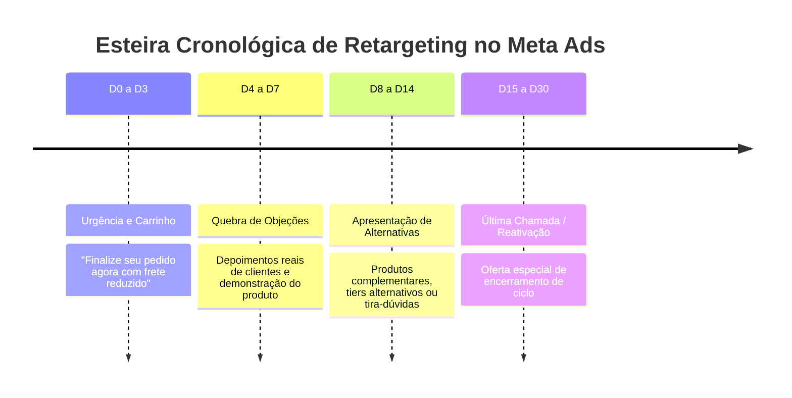

# Meta Ads Specialist: Gestão Estratégica e Escala no Facebook & Instagram

O **Meta Ads Specialist** é a skill técnica focada no planejamento, estruturação, auditoria e escala de campanhas de mídia paga dentro do ecossistema Meta (Facebook, Instagram, Messenger e Audience Network). Com as mudanças algorítmicas pós-iOS 14 e o advento das ferramentas automatizadas Advantage+, a gestão profissional de Meta Ads requer uma compreensão profunda da sinergia entre **estrutura de conta enxuta, segmentação orientada a dados e controle rigoroso de sobreposição e frequência**.

---

## 1. Princípios e Heurísticas de Operação no Meta Ads

1. **Estrutura Enxuta (Account Simplification):** Fragmentar o orçamento em 15 campanhas e dezenas de conjuntos de anúncios impede que o algoritmo saia da fase de aprendizado (*Learning Phase*, 50 eventos/semana). Menos campanhas com maior concentração de verba geram CPMs menores e aprendizado estável.
2. **Advantage+ vs Controle Manual:** Utilize Advantage+ Shopping Campaigns (ASC) e Advantage+ Leads para produtos com histórico consolidado de conversões. Utilize campanhas manuais (CBO/ABO) para controle granular de novos testes de criativos ou públicos ultra-segmentados B2B.
3. **Exclusões Recíprocas São Obrigatórias:** Nunca rode aquisição fria sem excluir explicitamente compradores dos últimos 30-180 dias e audiências quentes de remarketing. Caso contrário, sua campanha de topo de funil estará canibalizando vendas fáceis de fundo de funil.
4. **Frequência como Termômetro:** No Meta Ads, a frequência acumulada é o principal indicador de exaustão de audiência. Monitorar a frequência semanal evita queima desnecessária de verba.

---

## 2. Arquitetura de Conta Recomendada (O Modelo de 2 Níveis)

Para escalar com consistência, separe a operação em dois ambientes bem delimitados:

```mermaid
graph TD
    subgraph 1. Ambiente de Testes [ABO - Sandbox Criativo]
        T1[Conjunto: Teste Gancho 1]
        T2[Conjunto: Teste Gancho 2]
        T3[Conjunto: Teste Gancho 3]
    end

    subgraph 2. Ambiente de Escala [CBO / Advantage+]
        E1[Público Aberto Broad / Advantage+]
        E2[Público Lookalike 1-2% Compradores LTV]
        E3[Esteira de Retargeting D3-D14]
    end

    Ambiente de Testes -->|Criativo Validado por 48h-72h| Ambiente de Escala
```

### Nível 1: Campanha de Testes de Criativos (ABO - Ad Set Budget Optimization)
- **Orçamento:** 15% a 25% do investimento total diário.
- **Estrutura:** Orçamento definido no nível do conjunto para garantir distribuição igualitária. Cada conjunto testa 1 conceito/variação com 3 a 5 anúncios.
- **Regra de Graduação:** O criativo que sustenta CPA dentro da meta por 48 a 72 horas é promovido para a campanha de escala.

### Nível 2: Campanha de Escala Principal (CBO - Campaign Budget Optimization ou Advantage+)
- **Orçamento:** 75% a 85% do investimento total diário.
- **Estrutura:** CBO ativo com lances automáticos (Highest Volume) ou controle de custo (Cost Cap / Bid Cap para margens estreitas). Apenas criativos já validados rodam aqui.

---

## 3. Engenharia de Públicos e Segmentação

| Tipo de Público | Configuração Técnica | Quando Utilizar | Recomendação Estratégica |
| :--- | :--- | :--- | :--- |
| **Broad / Aberto (Advantage+ Audience)** | Apenas país, estado e faixa etária ampla. Sem interesses e sem lookalikes. | Escala máxima em e-commerce, infoprodutos e serviços de massa. | Deixe o criativo filtrar a audiência. Exige criativos com ganchos ultra-específicos. |
| **Lookalike de Alto LTV (1% a 2%)** | Gerado a partir de lista VIP de compradores com valor de compra > 80º percentil. | Escala com público qualificado e produtos de ticket médio-alto. | Atualizar a lista de origem a cada 30 dias via API de Conversões ou upload seguro. |
| **Públicos Personalizados de Alta Intenção** | Visualizadores de 75%+ de vídeos (últimos 30d), engajamento no Instagram/FB (últimos 60d). | Nutrição e meio de funil para ciclos de venda de 7 a 30 dias. | Excelente para ofertas de conteúdo aprofundado, cases e demonstrações. |
| **Retargeting Hiper-Quente** | Initiated Checkout / Add to Cart (últimos 7 a 14 dias), excluindo compradores (últimos 30d). | Fundo de funil com garantia, quebra de objeções e incentivo final de fechamento. | Frequência controlada entre 3.0 e 5.0 impressões/semana. |

---

## 4. Diagnóstico de Sobreposição de Audiências (Audience Overlap Matrix)

Quando múltiplos conjuntos de anúncios disputam os mesmos usuários dentro da mesma conta de anúncios, ocorre **auto-concorrência no leilão**, inflando o CPM e gerando ineficiência.

### Matriz de Diagnóstico e Limites de Tolerância

| Nível de Sobreposição Identificado | Impacto no Leilão | Solução Recomendada |
| :---: | :--- | :--- |
| **< 20% de Sobreposição** | Desprezível | Manter os conjuntos rodando separadamente sem alterações. |
| **20% a 40% de Sobreposição** | Moderado | Aplicar exclusões cruzadas explícitas (ex: Conjunto B exclui Público A). |
| **> 40% de Sobreposição** | Crítico (Auto-Leilão Ativo) | **Consolidar os públicos** em um único conjunto de anúncios com orçamento somado. |

---

## 5. Janelas Estratégicas de Retargeting

Diferentes tempos pós-visita exigem diferentes abordagens de mensagem para maximizar a taxa de fechamento:



---

## 6. Controle e Recomendações de Frequência (Frequency Capping)

| Estágio da Campanha | Frequência Semanal Segura | Sinal de Alerta (O que fazer) |
| :--- | :---: | :--- |
| **Prospecção Fria (Topo de Funil)** | **1.1 a 1.8** | Frequência > 2.2: O público está saturando. Ampliar a segmentação ou renovar ganchos visuais. |
| **Nutrição (Meio de Funil)** | **1.8 a 3.0** | Frequência > 3.5: Injetar novos ângulos de prova social ou variar formato de criativo. |
| **Retargeting (Fundo de Funil)** | **3.0 a 5.0** | Frequência > 6.0: Fadiga severa. Reduzir orçamento diário ou encurtar a janela de dias. |

---

## 7. Checklist de Auditoria Técnica de Contas Meta Ads

Ao analisar uma conta nova ou diagnosticar quedas de desempenho:

- [ ] **Pixel e API de Conversões (CAPI):** O Gateway do CAPI está configurado com taxa de correspondência de eventos (Event Quality Score) $\ge 8.0/10$?
- [ ] **Agregação de Eventos Web:** O domínio está verificado e os eventos prioritários (Purchase, Lead, CompleteRegistration) mapeados corretamente?
- [ ] **Fase de Aprendizado:** Mais de 70% do orçamento da conta está em conjuntos com status "Ativo" (fora de "Aprendizado Limitado")?
- [ ] **Exclusão de Compradores:** Todos os conjuntos de prospecção excluem compradores recentes?
- [ ] **Adequação de Posicionamentos:** Os criativos utilizam Advantage+ Placements ou personalização de criativo por posicionamento (1:1 Feed vs 9:16 Stories)?
- [ ] **Diversidade Criativa:** A conta possui pelo menos 3 formatos visuais distintos ativos simultaneamente (vídeo UGC, imagem estática e carrossel)?

---

## 8. Catálogo de Referências Técnicas Integradas

Esta skill preserva e se apoia nos guias especializados contidos na subpasta [`references/`](references/):

| Arquivo de Referência | Conteúdo Técnico & Casos Práticos |
| :--- | :--- |
| [`facebook-ads.md`](references/facebook-ads.md) | Playbook de estratégias de tráfego, tipos de objetivos de campanha e alavancas de conversão. |
| [`41-meta-ads-audit.md`](references/41-meta-ads-audit.md) | Checklist de auditoria completa em 15 passos para contas de anúncios no Meta Ads Manager. |
| [`08-meta-audience-overlap-analysis.md`](references/08-meta-audience-overlap-analysis.md) | Procedimento e fórmulas para mapeamento e resolução de auto-concorrência de públicos. |
| [`18-meta-frequency-cap-recommendations.md`](references/18-meta-frequency-cap-recommendations.md) | Matriz de decisão de limites de frequência por segmento de mercado e ticket médio. |
| [`22-meta-retargeting-window-analysis.md`](references/22-meta-retargeting-window-analysis.md) | Análise econométrica do decaimento de conversão por janela temporal de retargeting. |
| [`clawdbot-meta-ads-daily-alert.md`](references/clawdbot-meta-ads-daily-alert.md) | Sistema de monitoramento diário de anomalias em campanhas Meta (quedas bruscas de ROAS ou picos de CPM). |

## Outras referências

