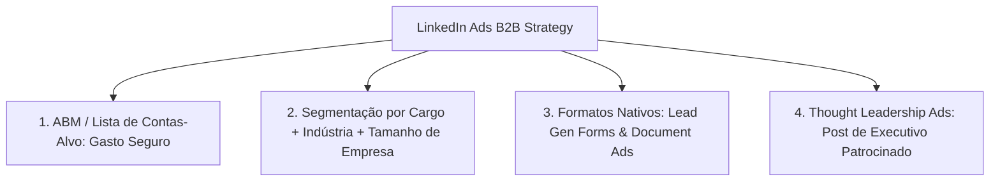

# Multi-Platform Ads: Redes B2B e Canais Emergentes

O **Multi-Platform Ads** é a skill técnica dedicada à expansão de mídia paga para além do duopólio tradicional de Google e Meta. Ela orquestra campanhas em canais de alto valor e perfis comportamentais específicos: **LinkedIn Ads** (o padrão-ouro para B2B e vendas complexas enterprise), **TikTok Ads** (o epicentro da viralidade e consumo de vídeo em formato vertical) e **Reddit Ads** (comunidades de hiper-nicho e discussões técnicas autênticas).

---

## 1. Matriz Comparativa de Plataformas

| Plataforma | Perfil Primário de Audiência | Modelo Mental do Usuário | Benchmark Médio de CPC | Indicado para |
| :--- | :--- | :--- | :---: | :--- |
| **LinkedIn Ads** | Tomadores de decisão B2B (C-Level, VPs, Gerentes, Especialistas). | Mentalidade profissional, desenvolvimento de carreira e busca de eficiência de negócios. | Alto ($5.00 a $15.00+ USD) | SaaS B2B, vendas complexas, consultorias enterprise e eventos corporativos de alto ticket. |
| **TikTok Ads** | Gen Z, Millennials e consumidores de conteúdo audiovisual veloz. | Entretenimento passivo e busca por novidades visuais. | Baixo a Médio ($0.30 a $1.20 USD) | E-commerce D2C, aplicativos móveis, produtos de impulso visual e marcas B2C. |
| **Reddit Ads** | Comunidades hiper-específicas (programadores, entusiastas de finanças, hardware). | Ceticismo agudo, busca de soluções técnicas reais e aversão a propagandas institucionais. | Baixo a Médio ($0.50 a $2.50 USD) | Ferramentas para desenvolvedores, software de nicho, produtos para entusiastas e B2B técnico. |

---

## 2. LinkedIn Ads para B2B e Account-Based Marketing (ABM)

O LinkedIn Ads possui o inventário de dados profissionais mais confiável do mundo. Como o CPC é elevado, a campanha deve ser estruturada com máxima precisão cirúrgica para evitar dispersão.

### 2.1. Métodos de Segmentação Recomendados
1. **Lista de Contas-Alvo (Matched Audiences / ABM):** Upload de lista contendo o domínio das 500 a 2.000 empresas que seu time comercial quer prospectar. Combine com filtro de Senioridade (Diretor, VP, C-Level) e Função de Trabalho (TI, Vendas, Financeiro).
2. **Segmentação por Cargo Específico:** Utilize títulos padronizados do LinkedIn. Atenção: evite criar públicos com menos de 50.000 membros para não inflar o CPM para valores proibitivos (> $80 USD).

### 2.2. Os Formatos Mais Eficientes no LinkedIn
- **Lead Gen Forms Nativos:** O formulário é pré-preenchido automaticamente com os dados do perfil do usuário (nome, cargo, empresa, email corporativo). Elimina o atrito de carregamento de páginas externas e costuma gerar **CPL 40% a 60% menor** que Landing Pages comuns.
- **Document Ads (Anúncios de Documento):** Permite ao usuário folhear um relatório, whitepaper ou apresentação em PDF diretamente no feed do LinkedIn. O download pode ser liberado com ou sem formulário de lead.
- **Thought Leadership Ads:** Impulsionamento de um post autêntico publicado no perfil pessoal do CEO, Diretor Técnico ou Especialista da empresa. Gera muito mais confiança e engajamento do que posts da Company Page oficial.

---

## 3. TikTok Ads: Retenção Dinâmica e Viralidade

A premissa máxima no TikTok Ads é: *"Don't make ads, make TikToks"*. Anúncios com cara de comercial de televisão ou estáticos pasteurizados têm taxa de rejeição instantânea.

### Heurísticas de Performance no TikTok Ads
1. **Formato Nativo Vertical (9:16) com Som Obrigatório:** 93% dos usuários no TikTok consom conteúdo com o áudio do aparelho ligado. Anúncios mudos perdem tração.
2. **Adoção de Spark Ads:** Sempre que possível, utilize **Spark Ads** (anúncios veiculados a partir de um post real postado na conta de um criador ou na conta oficial da marca, mantendo likes, comentários e compartilhamentos orgânicos).
3. **Métricas de Retenção Críticas:**
   - **Hook Rate (Visualizações de 2s / Impressões):** Meta saudável $> 30\%$.
   - **Engaged View Rate (Visualizações de 6s / Impressões):** Meta saudável $> 15\%$.
   - Se o Hook Rate for baixo, o criativo deve ser pausado nas primeiras 48 horas.

---

## 4. Reddit Ads: Estratégia de Comunidades e Antídoto ao Ceticismo

O público do Reddit é notoriamente cético em relação a marcas. Para ter sucesso sem sofrer boicotes ou downvotes em massa:

### Regras de Ouro para Reddit Ads
1. **Segmentação por Subreddits Específicos:** Em vez de segmentar por interesses genéricos, mire nos Subreddits onde sua persona discute problemas reais (Ex: `r/sysadmin`, `r/datascience`, `r/startups`).
2. **Texto Transparente e Autoral:** Escreva em primeira pessoa como fundador ou membro da comunidade. Exponha vulnerabilidades reais do produto e liste explicitamente para quem a solução NÃO serve.
3. **Gerenciamento de Comentários:**
   - Se sua equipe técnica estiver disponível para responder: **Mantenha os comentários abertos** e responda a todas as dúvidas com dados e profundidade técnica. Isso gera uma prova social imbatível.
   - Se não houver equipe dedicada à moderação rápida: **Desative os comentários** no gerenciador de anúncios para evitar comentários depreciativos não moderados.

---

## 5. Especificações Técnicas e Formatos Multiplataforma

| Plataforma | Aspect Ratio Obrigatório | Resolução Recomendada | Limite de Caracteres Recomendado | Formatos de Arquivo |
| :--- | :---: | :---: | :--- | :--- |
| **LinkedIn Ads** | 1:1 (Feed) / 16:9 (Vídeo) / 3:4 (Documento) | 1200 x 1200 px (Quadrado) ou 1920 x 1080 px | Texto introdutório: até 150 caracteres para não truncar; Título: até 70 caracteres. | JPG, PNG, MP4, PDF |
| **TikTok Ads** | 9:16 (Vertical Nativo) | 1080 x 1920 px | Texto da legenda: até 100 caracteres antes de truncar; Título: curto. | MP4, MOV, MPEG |
| **Reddit Ads** | 1:1 (Quadrado) ou 16:9 (Paisagem) | 1200 x 1200 px ou 1200 x 628 px | Título da thread: até 300 caracteres (recomendado: 100 a 160 caracteres). | JPG, PNG, MP4 |

---

## 6. Checklist de Implementação Multiplataforma

Antes de veicular campanhas fora de Google e Meta:

- [ ] **Instalação das Tags de Rastreamento:** LinkedIn Insight Tag, TikTok Pixel e Reddit Pixel instalados e disparando via Google Tag Manager (GTM).
- [ ] **Configuração de Conversões no Servidor:** Validação de conversões offline ou CAPI para cada plataforma quando aplicável.
- [ ] **Parâmetros UTM Padronizados:** Uso consistente de `utm_source=linkedin`, `utm_source=tiktok` e `utm_source=reddit` para permitir auditoria limpa no Google Analytics 4 e CRM.
- [ ] **Alinhamento de Margem e LTV:** O ticket médio ou LTV do produto é compatível com o CPM/CPC da rede escolhida (especialmente no LinkedIn Ads)?

---

## 7. Catálogo de Referências Técnicas Integradas

Esta skill preserva e se apoia nos guias especializados contidos na subpasta [`references/`](references/):

| Arquivo de Referência | Conteúdo Técnico & Casos Práticos |
| :--- | :--- |
| [`linkedin-ads.md`](references/linkedin-ads.md) | Playbook de criação e segmentação de campanhas corporativas no LinkedIn Campaign Manager. |
| [`40-linkedin-ads-audit.md`](references/40-linkedin-ads-audit.md) | Checklist de auditoria completa em 12 pontos para contas B2B no LinkedIn. |
| [`tiktok-ads.md`](references/tiktok-ads.md) | Guia de estruturação de campanhas, Spark Ads e boas práticas criativas no TikTok Ads Manager. |
| [`43-reddit-ads-audit.md`](references/43-reddit-ads-audit.md) | Procedimentos de auditoria, escolha de Subreddits e mitigação de risco em anúncios no Reddit. |
| [`platform-specs.md`](references/platform-specs.md) | Compilado exaustivo de dimensões, proporções, taxas de bits e limitações de mídia por rede. |
| [`platform-setup-checklists.md`](references/platform-setup-checklists.md) | Roteiros operacionais de configuração técnica de contas e rastreamento. |
