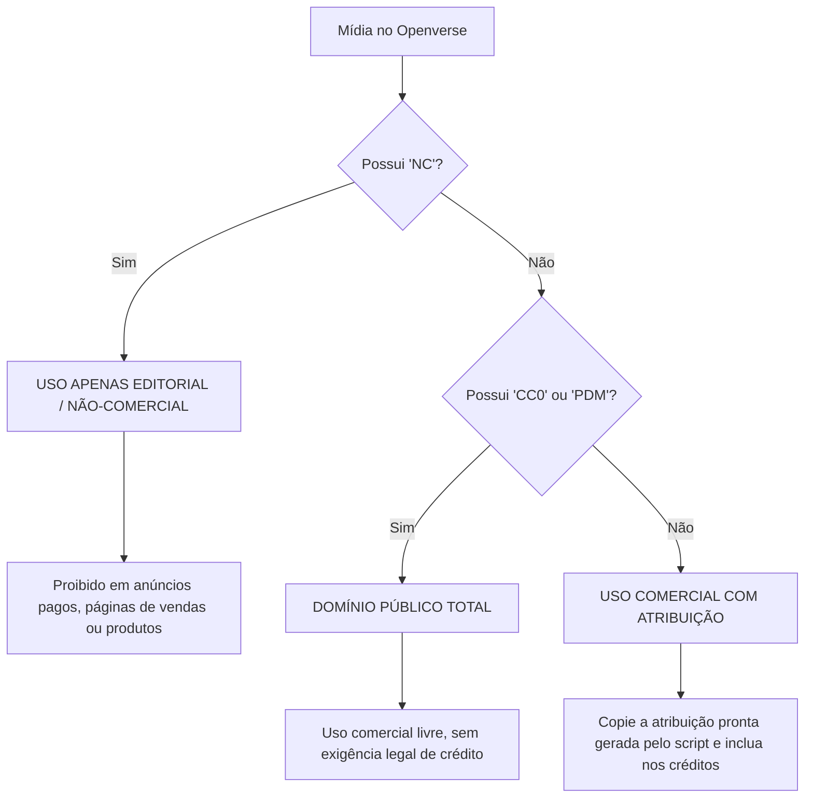

# Banco de Mídias Openverse (Skill & Helper CLI)

A skill **`audiovisual-banco-de-midias-openverse`** permite localizar e extrair imagens em alta resolução, vetores, ilustrações, efeitos sonoros, músicas e vídeos do ecossistema do **Openverse** ([WordPress/openverse](https://github.com/WordPress/openverse)) e seu maior provedor público, a **Wikimedia Commons**, indexando coletivamente centenas de milhões de ativos sob licenças **Creative Commons** e **Domínio Público**.

Conta com um script helper nativo em Python (`search_openverse.py`) com **zero dependências externas** (apenas biblioteca padrão do Python), suporte a proporções visuais (wide, square, tall), conformidade para uso comercial, fallback automático para alta disponibilidade e o texto exato de atribuição legal formatado para copy-paste.

---

## 🎯 Quando Usar

- **Anúncios Pagos & Mídia de Performance (`ads-criativos` / `ads-trafego-pago`)**:
  - Encontrar fotos autênticas, sem cara de banco de imagem artificial ou "IA slop".
  - Garantir licenças 100% liberadas para fins comerciais (`--commercial`).
- **Criativos para Redes Sociais (`social-carrossel` / `social-calendario-e-distribuicao`)**:
  - Formato vertical 9:16 para Reels e Stories (`--aspect-ratio tall`).
  - Formato quadrado 1:1 para Feed do Instagram/LinkedIn (`--aspect-ratio square`).
- **Landing Pages & Banners de Blog (`site-interface-de-conversao` / `conteudo-post-de-blog`)**:
  - Hero banners horizontais 16:9 (`--aspect-ratio wide`).
  - Ilustrações e ícones vetoriais SVG (`--extension svg` ou `--category illustration`).
- **Produção Audiovisual & Podcasts (`audiovisual-producao-de-video` / `audiovisual-podcast-e-audio`)**:
  - Efeitos sonoros e trilhas de fundo para vídeos e podcasts (`--type audio`).
- **Atribuição Legal Rigorosa (Compliance & LGPD)**:
  - Obter instantaneamente o texto oficial de crédito Creative Commons pronto para colar no rodapé de artigos ou descrições de vídeos.

---

## 🚫 Quando NÃO Usar

- **Geração Sintética de Imagens**: Se você precisa gerar imagens do zero via inteligência artificial com prompts fotorrealistas, utilize a skill `audiovisual-imagem-flux-api` ou `audiovisual-imagem-flux-prompts`.
- **Geração de Voz / TTS**: Se você precisa de dublagem ou clonagem de voz, utilize a skill `audiovisual-agentes-de-voz` (ElevenLabs).
- **Vídeos Longos e Renderização**: Para montagem de vídeos programáticos, utilize o projeto de edição de vídeo com Remotion.

---

## ⚡ Guia Rápido de Comandos CLI

O helper reside em `.agent/skills/audiovisual-banco-de-midias-openverse/scripts/search_openverse.py`. Execute a partir da raiz do workspace:

### 1. Imagem para Anúncios (Comercial + Horizontal 16:9)
```bash
python3 .agent/skills/audiovisual-banco-de-midias-openverse/scripts/search_openverse.py --query "coffee shop laptop" --commercial --aspect-ratio wide -n 3
```

### 2. Imagem Vertical para Reels / Stories (9:16)
```bash
python3 .agent/skills/audiovisual-banco-de-midias-openverse/scripts/search_openverse.py --query "urban architecture" --commercial --aspect-ratio tall -n 3
```

### 3. Imagem Quadrada para Feed do Instagram (1:1)
```bash
python3 .agent/skills/audiovisual-banco-de-midias-openverse/scripts/search_openverse.py --query "minimalist desk setup" --aspect-ratio square -n 3
```

### 4. Vetores e Ilustrações SVG (Para Logos, LP e Ícones)
```bash
python3 .agent/skills/audiovisual-banco-de-midias-openverse/scripts/search_openverse.py --query "technology cloud" --category illustration -n 3
```

### 5. Domínio Público (CC0 / PDM)
```bash
python3 .agent/skills/audiovisual-banco-de-midias-openverse/scripts/search_openverse.py --query "vintage botanical" --commercial -n 3
```
A flag `--commercial` deixa passar CC0, PDM, CC BY e CC BY-SA. Para a intenção de domínio público, confira o campo de licença de cada resultado: só CC0 e PDM dispensam crédito.

### 6. Vídeos Livres e Motion Graphics (CC0 / Creative Commons)
```bash
python3 .agent/skills/audiovisual-banco-de-midias-openverse/scripts/search_openverse.py --query "nature drone" --type video -n 2
```

### 7. Efeitos Sonoros ou Trilhas Musicais
```bash
python3 .agent/skills/audiovisual-banco-de-midias-openverse/scripts/search_openverse.py --query "ambient piano" --type audio -n 2
```

### 8. Exportar em JSON (Para Pipelines & Automações)
```bash
python3 .agent/skills/audiovisual-banco-de-midias-openverse/scripts/search_openverse.py --query "startup team" --commercial --format json
```

### 9. Download Automático dos Arquivos Originais em Alta Resolução
```bash
python3 .agent/skills/audiovisual-banco-de-midias-openverse/scripts/search_openverse.py --query "nature sunset" --commercial -n 3 --download-dir "content/downloads/sunset"
```

### 10. Pessoa nomeada direto no Wikimedia Commons
```bash
python3 .agent/skills/audiovisual-banco-de-midias-openverse/scripts/search_openverse.py --commons -q "Marie Curie" --format summary
```

### 11. Metadados de um arquivo específico do Commons (autor, licença, URL do original)
```bash
python3 .agent/skills/audiovisual-banco-de-midias-openverse/scripts/search_openverse.py --commons-file "File:Marie Curie c. 1920s.jpg" --format json
```

### 12. Capa de blog (16:9, comercial, largura mínima de 1200 px)
```bash
python3 .agent/skills/audiovisual-banco-de-midias-openverse/scripts/search_openverse.py -q "city skyline at dusk" --commercial --aspect-ratio wide --min-width 1200
```

---

## 📋 Parâmetros e Filtros Disponíveis

| Parâmetro | Valores / Exemplos | Descrição & Caso de Uso |
| :--- | :--- | :--- |
| Parâmetro | Valores / Exemplos | Descrição & Caso de Uso |
| :--- | :--- | :--- |
| `--query`, `-q` | `"minimalist workspace"` | Palavra-chave da busca (recomenda-se inglês para maior volume). Obrigatória, exceto com `--commons-file`. |
| `--type` | `image` (padrão), `audio`, `video` | Escolhe entre fotos e ilustrações, faixas de áudio ou vídeos. |
| `--commercial` | Flag booleana | Garante apenas mídias liberadas para fins comerciais (elimina licenças Não-Comerciais `NC`). |
| `--aspect-ratio` | `tall`, `wide`, `square` | `tall` (Stories/Reels 9:16), `wide` (Banners/YT 16:9), `square` (Feed 1:1). Vale também no fallback do Commons e com `--commons`. |
| `--category` | Imagem: `photograph`, `illustration`, `digitized_art`<br>Áudio: `music`, `sound_effect` | Segmenta o estilo visual ou o gênero de áudio desejado. |
| `--extension` | `jpg`, `png`, `svg` (imagem) / `mp3`, `ogg`, `wav` (áudio) | Formato do arquivo (ex: `svg` para ícones vetoriais). |
| `--page-size`, `-n` | Inteiro (padrão: 3) | Número de mídias retornadas na consulta. |
| `--format` | `markdown` (padrão), `json`, `summary` | `json` imprime só JSON no stdout (avisos vão para o stderr). `summary` mostra uma linha por item. |
| `--download-dir` | Caminho de pasta (ex: `content/...`) | Baixa o original em alta resolução, confere o tipo real pelos bytes e corrige a extensão (um `.jpg` que veio em WebP vira `.webp`). |
| `--commons` | Flag booleana | Pula o Openverse e busca direto no Wikimedia Commons. Útil para nomes de pessoas (ver seção própria). |
| `--commons-file` | `"File:<nome>"` | Mostra os metadados de um arquivo específico do Commons: autor, licença, tamanho e URL do original. |
| `--min-width` | Inteiro em px (ex: `1200`) | Descarta itens com largura menor que o valor indicado. |
| `--help`, `-h` | Flag booleana | Mostra a ajuda do script e sai. |

---

## 🔎 Busca por pessoa nomeada (Commons direto)

O Openverse não indexa todos os arquivos do Wikimedia Commons. Quando o termo é o nome de uma pessoa pública, a busca no Openverse costuma trazer fotos de eventos ligados ao assunto, e não retratos da pessoa. Nesse caso, o caminho mais curto é pular o Openverse e buscar direto no Commons.

1. **Busque pelo nome** com `--commons -q "<nome>"` (exemplo 10 acima). O resultado lista os títulos de arquivo encontrados.
2. **Escolha o título** que mais se parece com o retrato que você precisa (por exemplo, `File:Marie Curie c. 1920s.jpg`) e rode `--commons-file "File:<nome>"` (exemplo 11). Ele devolve o autor (`Artist`), a licença (`LicenseShortName`), o tamanho e a URL do original.

Sem o script, a mesma consulta funciona pela API do Commons:

Busca de arquivos (troque `<termo>` pelo nome):
```
https://commons.wikimedia.org/w/api.php?action=query&list=search&srnamespace=6&srsearch=Marie%20Curie&format=json
```

Metadados de um arquivo (troque `<nome>` pelo título, com espaços trocados por `_`):
```
https://commons.wikimedia.org/w/api.php?action=query&titles=File:Marie_Curie_c._1920s.jpg&prop=imageinfo&iiprop=url|size|extmetadata&format=json
```

Os campos `Artist` e `LicenseShortName` ficam dentro de `extmetadata`. O campo `Artist` vem em HTML, com tags como `<a>` e `<bdi>`. Limpe essas tags antes de usar o nome no crédito.

---

## ⚖️ Conformidade Legal & Licenças Creative Commons

O marketing digital exige rigor na utilização de ativos visuais de terceiros. Veja como interpretar as licenças retornadas:



### Resumo das Licenças Principais:
1. **CC0 / PDM (Public Domain)**: Liberdade total. Pode usar em vendas, anúncios e embalagens sem necessidade de citar o autor.
2. **CC BY**: Pode usar comercialmente e alterar, desde que cite a autoria com a linha de atribuição oficial.
3. **CC BY-SA**: Pode usar comercialmente, mas obras derivadas devem ser distribuídas sob a mesma licença.
4. **CC BY-NC / CC BY-NC-ND**: **PROIBIDO** para marketing comercial, vendas ou tráfego pago. O script helper bloqueia automaticamente quando você passa a flag `--commercial`.

---

## 🖼️ Escolha da imagem para capa (recomendações)

Estas recomendações saíram de um caso real, com capas de blog sobre temas sensíveis. Pese cada uma caso a caso. Não são regras fixas.

- **Rosto em tema sensível.** Em post sobre violência, golpe ou segurança, costuma valer evitar foto com rosto identificável de pessoa comum, porque a imagem pode sugerir que ela é vítima ou agressora. Mãos, objetos, multidões sem destaque ou a própria pessoa retratada no texto tendem a funcionar melhor.
- **Arquivo pequeno.** Uma imagem de 143×201 px não serve de capa 16:9. Vale buscar outra com `--min-width 1200` ou usar um placeholder.
- **Recorte e crédito.** Recortar é permitido em CC BY e CC BY-SA. Nesses casos, convém que o crédito diga que a imagem foi recortada, por exemplo: "… CC BY 2.0, recortada". Em CC BY-ND, o recorte pode contar como adaptação, que a licença não permite; na dúvida, prefira a imagem inteira.
- **Formato real.** Confira o formato do arquivo baixado com `file <arquivo>`. Em um caso real, um `.jpg` do rawpixel chegou em WebP. O `--download-dir` já corrige a extensão, e o `file` confirma o resultado.
- **Prancha de candidatas.** Monte uma prancha com as opções para escolher pelo conteúdo, e não só pela licença. Com ImageMagick (`brew install imagemagick`): `montage *.jpg -tile 3x -geometry 400x225+8+8 prancha.jpg`. Ajuste o glob se houver arquivos `.webp`. Com Node, o `sharp` faz a mesma montagem com `composite`. O script não ganha dependência nova para isso.

---

## 🤖 Integração com Agentes de Marketing

Quando um agente do repositório precisar de fotos ou referências visuais para um conteúdo:

1. **`brand-direcao-de-arte`**:
   - Utilize para encontrar referências de iluminação, composições fotográficas autênticas e acervos históricos de museus (Smithsonian, Met, Cleveland Museum).
2. **`ads-trafego-pago`**:
   - Execute sempre com `--commercial` para alimentar criativos de Google Ads e Meta Ads com segurança jurídica.
3. **`social-calendario-e-distribuicao`**:
   - Combine `--aspect-ratio tall` para Stories/Reels e `--aspect-ratio square` para carrosséis de feed.
4. **`conteudo-criacao-multiformato`**:
   - Incorpore o markdown gerado diretamente no arquivo de post, no destino da regra de resolução da skill `geral-arquitetura-de-projeto` (`content/<marca>/<canal>/YYYY-MM-DD - Demanda/` no 0 Mkt; `conteudos/<canal>/YYYY-MM-DD - Demanda/` em projeto próprio), incluindo a imagem e os créditos no rodapé.

---

## 🔧 Arquitetura do Helper (`scripts/search_openverse.py`)

- **Resiliência e Fallback Local**: A API pública do Openverse pode sofrer com latências no backend Elasticsearch ao calcular agregações em 800M+ registros. O script helper implementa timeout inteligente de 8 segundos com **fallback transparente** para filtragem em memória cliente e acionamento da API da Wikimedia Commons (maior provedor do Openverse), garantindo que o agente nunca fique bloqueado. O fallback do Commons respeita `--aspect-ratio` e `--min-width`. Com `--format json`, o stdout fica limpo para pipelines, e os avisos vão para o stderr.
- **Zero Instalações**: Não requer `pip install requests` nem dependências de terceiros; roda nativamente com `urllib.request` e `json` do Python 3.

---

## 🔗 Referências Oficiais do Projeto & GitHub

- **Repositório Principal no GitHub:** [WordPress/openverse](https://github.com/WordPress/openverse)
- **Django REST API (Backend):** [WordPress/openverse/api](https://github.com/WordPress/openverse/tree/main/api)
- **Frontend de Busca (Nuxt/Vue):** [WordPress/openverse/frontend](https://github.com/WordPress/openverse/tree/main/frontend)
- **Pipelines de Ingestão de Catálogo (Apache Airflow):** [WordPress/openverse/catalog](https://github.com/WordPress/openverse/tree/main/catalog)
- **Documentação Técnica Oficial:** [docs.openverse.org](https://docs.openverse.org)
- **Swagger / OpenAPI Reference:** [api.openverse.org/v1](https://api.openverse.org/v1/)
- **Site Público de Busca:** [openverse.org](https://openverse.org)

