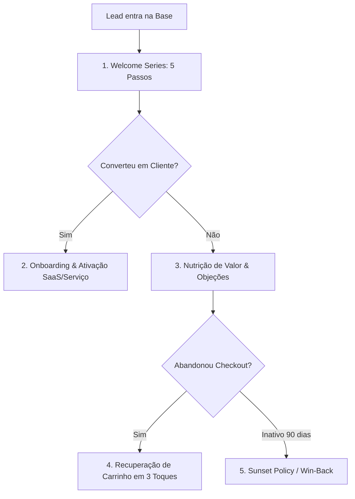

# Lifecycle Email Automator: Jornadas Automatizadas e Ciclo de Vida do Lead

O **Lifecycle Email Automator** é a skill técnica dedicada ao desenho, implementação e otimização de fluxos automáticos de email baseados em tempo e comportamento do usuário (*Event-Driven Automations*). Enquanto campanhas pontuais (*broadcasts*) dependem de esforço manual contínuo, as automações de ciclo de vida operam em segundo plano 24 horas por dia, nutrindo leads frios, ativando novos usuários de software e recuperando vendas perdidas com máxima precisão de timing.

---

## 1. Princípios e Heurísticas de Automação de Email

1. **O Timing Importa Mais que a Prosa:** Um email de recuperação de carrinho enviado 45 minutos após o abandono converte 5x mais do que o mesmo email enviado 48 horas depois. Automações vencem pela prontidão contextual.
2. **Eventos Vencem Delays Fixos:** Em produtos digitais e SaaS, disparar emails com base nas ações reais do usuário dentro da aplicação (ex: *Usuário fez upload do primeiro projeto* ou *Usuário logou mas não configurou a integração*) gera o dobro de retenção em comparação a sequências lineares cegas baseadas apenas em "esperar 3 dias".
3. **A Regra de Ouro do Descadastramento (Sunset Policy):** Enviar emails continuamente para quem não abre suas mensagens há mais de 90 dias reduz a pontuação do domínio nos provedores, prejudicando a entrega para quem quer ler. A limpeza automática de inativos é mandatória para a saúde do funil.
4. **Uma Única Ação Central por Email:** Cada mensagem de uma automação deve conduzir o leitor a **um único próximo passo claro**. Emails com 4 links para páginas diferentes diluem a atenção e reduzem a taxa de clique (CTR).

---

## 2. As 5 Esteiras Mestras de Automação



### 2.1. Welcome Series (Série de Boas-Vindas em 5 Passos)
A sequência com as maiores taxas de abertura de toda a base (frequentemente $> 50\%$):

| Passo | Momento de Disparo | Função Estratégica da Mensagem | Objetivo Tático |
| :---: | :---: | :--- | :--- |
| **Email 1** | Imediato (0 min) | **Entrega da Promessa + Micro-Compromisso:** Entrega o material prometido (e-book, template, link de acesso) e pede que o usuário responda com uma palavra simples ou mova o email para a caixa principal. | Garantir a entrega e treinar o provedor do lead de que o remetente é prioritário. |
| **Email 2** | +24 horas | **A História de Origem & Crenças:** A história autêntica de por que sua empresa foi criada e contra o que vocês lutam no mercado. | Construir afinidade emocional e filtrar curiosos desqualificados. |
| **Email 3** | +48 horas | **A Mudança de Paradigma:** Desmontar o maior mito ou erro comum que o cliente comete achando que está fazendo o certo. | Gerar o efeito "Aha!" e estabelecer autoridade técnica. |
| **Email 4** | +72 horas | **O Estudo de Caso Real:** Mostrar a jornada de um cliente real similar que enfrentava a mesma dor e alcançou o resultado desejado. | Reduzir o ceticismo com prova social concreta. |
| **Email 5** | +96 horas | **A Apresentação da Oferta Principal:** Conectar todas as dores abordadas à solução comercial definitiva, com chamada para ação clara. | Converter os leads mais quentes da safra. |

---

### 2.2. Onboarding e Ativação de Produto SaaS (Time-to-Value)
- **Foco Primário:** Conduzir o novo usuário até o primeiro momento de valor real (*Aha! Moment*) no menor tempo possível.
- **Lógica Condicional:**
  - `SE`: Usuário cadastrou mas **não completou o setup** em 24h $\rightarrow$ Enviar tutorial em vídeo de 90 segundos com botão de suporte humano via WhatsApp/Chat.
  - `SE`: Usuário utilizou a feature principal com sucesso $\rightarrow$ Enviar parabéns e apresentar a funcionalidade avançada mais recomendada para o perfil dele.

---

### 2.3. Recuperação de Carrinho e Checkout Abandonado
A esteira de maior retorno imediato em e-commerce e vendas de infoprodutos:
1. **Email 1 (Disparo em 45 a 60 minutos):** Tom de assistência técnica (*"Houve algum problema com seu pagamento ou conexão?"*), foto do produto e link direto para o checkout com os dados salvos.
2. **Email 2 (Disparo em 24 horas):** Quebra das 3 objeções mais comuns (formas de parcelamento, política de devolução sem risco e suporte).
3. **Email 3 (Disparo em 48 a 72 horas):** Escassez de encerramento de carrinho ou incentivo pontual com prazo de validade rígido de 24 horas.

---

### 2.4. Automação de Reengajamento e Política de Pôr-do-Sol (Sunset Policy)
Destinada a proteger a reputação do domínio retirando usuários zumbis da lista:
- **Gatilho de Entrada:** Contato não abre nenhum email nos últimos **60 a 90 dias**.
- **Sequência Win-Back:**
  - **Email 1:** Assunto direto: *"Ainda faz sentido continuarmos conectados?"*
  - **Email 2:** Envio do resumo dos 3 melhores conteúdos do ano em texto puro.
  - **Email 3 (O Aviso Final):** *"Estamos limpando nossa lista para respeitar sua caixa. Se você não clicar no botão abaixo nas próximas 48h, vamos remover seu email automaticamente."*
- **Ação do Sistema:** Se não houver clique, aplicar tag `STATUS_SUNSET_INATIVO` e excluir/desinscrever o contato dos envios regulares.

---

## 3. Arquitetura de Tags e Segmentação Comportamental no CRM

Para evitar a desordem em plataformas como ActiveCampaign, adote uma taxonomia padronizada de tags dividida em 4 categorias prefixadas:

```markdown
1. TAGS DE STATUS DO CONTATO (Exclusivas e Mutáveis):
   - STATUS_LEAD_FRIO
   - STATUS_LEAD_QUALIFICADO_MQL
   - STATUS_CLIENTE_ATIVO
   - STATUS_CHURN_CANCELADO

2. TAGS DE INTERESSE TEMÁTICO (Cumulativas):
   - INT_TRAFEGO_PAGO
   - INT_SEO_GEO
   - INT_COPYWRITING

3. TAGS DE ORIGEM / AQUISIÇÃO (Permanentes):
   - SRC_META_ADS_EBOOK2026
   - SRC_GOOGLE_SEARCH_TRIAL
   - SRC_ORGANICO_BLOG

4. TAGS DE CONTROLE DE FLUXO (Temporárias):
   - FLUXO_WELCOME_EM_ANDAMENTO
   - FLUXO_REENG_WINBACK_ATIVO
```

---

## 4. Checklist de Homologação de Novas Automações

Antes de ativar qualquer fluxo no ActiveCampaign ou ferramenta equivalente:

- [ ] **Mapeamento de Metas de Saída (Goals):** A automação possui meta configurada para interromper o envio de cobranças assim que o lead efetua a compra?
- [ ] **Intervalos de Fuso Horário:** Os disparos respeitam a janela de horário comercial local do destinatário (evitar disparos automáticos às 3h da manhã)?
- [ ] **Exclusão de Clientes:** A sequência promocional exclui automaticamente contatos que já possuem a tag `STATUS_CLIENTE_ATIVO`?
- [ ] **Links de Teste Verificados:** Todos os botões e links personalizados com tags de rastreamento e UTMs foram clicados em ambiente de teste?

---

## 5. Catálogo de Referências Técnicas Integradas

Esta skill preserva e se apoia no acervo de guias especializados contidos na subpasta [`references/`](references/):

| Arquivo de Referência | Conteúdo Técnico & Casos Práticos |
| :--- | :--- |
| [`email-sequence.md`](references/email-sequence.md) | Manual mestre de arquitetura de sequências de email, drip campaigns e fluxos de ciclo de vida. |
| [`lead-nurturing-workflows.md`](references/lead-nurturing-workflows.md) | Fluxogramas detalhados de nutrição para leads de topo, meio e fundo de funil. |
| [`nurture-sequences.md`](references/nurture-sequences.md) | Biblioteca de templates de nutrição segmentada por perfil e temperatura de compra. |
| [`sequence-templates.md`](references/sequence-templates.md) | Modelos prontos de onboarding, ativação e retenção. |
| [`sequence-design.md`](references/sequence-design.md) | Princípios de design de esteiras, cadência temporal e regras de transição. |
| [`automation.md`](references/automation.md) | Estruturação de lógicas booleanas (IF/THEN), webhooks e pontuação de leads (Lead Scoring). |
| [`segmentation.md`](references/segmentation.md) | Estratégias de segmentação comportamental por recência, frequência e engajamento. |
| [`customer-io.md`](references/customer-io.md) | Guia de integração do Customer.io: autenticação, identificar cliente, enviar evento, disparar broadcast, e-mail transacional, SDK JavaScript e limites de taxa. |
| [`activecampaign.md`](references/activecampaign.md) | Guia completo de recursos, pipelines, negócios (deals), tags e webhooks no ActiveCampaign. |
| [`36-google-and-meta-email-sequence-writer.md`](references/36-google-and-meta-email-sequence-writer.md) | Roteiro de transição de leads adquiridos via tráfego pago para esteiras de nutrição por email. |

## Qual abrir primeiro (sequências que aparecem em vários arquivos)

Os arquivos tratam das mesmas sequências com profundidade diferente (medido: nenhum tem mais de 8% do texto coberto pelos outros, exceto `lifecycle` e `sequence`, que se parecem entre si em cerca de 15%). Escolha pelo que precisa entregar:

| Preciso de | Abra | Observação |
| :--- | :--- | :--- |
| **Esqueleto de 1 página** (dia, e-mail, objetivo) | [`sequence-design.md`](references/sequence-design.md) | Boas-vindas, nutrição, carrinho, reengajamento, pós-compra |
| **Texto pronto de cada e-mail** | [`sequence-templates.md`](references/sequence-templates.md) | Boas-vindas, onboarding de teste, nutrição, reengajamento; inclui benchmarks e horários |
| **Exemplo completo, de ponta a ponta** | [`welcome-sequence-template.md`](references/welcome-sequence-template.md) | 5 e-mails em 14 dias, teste A/B e métricas |
| **Manual mestre e checklist de auditoria** | [`email-sequence.md`](references/email-sequence.md) | Longo (955 linhas); leia só a seção que precisa |
| **Nutrição por temperatura do lead** | [`lead-nurturing-workflows.md`](references/lead-nurturing-workflows.md) | Liga com `vendas-crm` |
| **Nutrição "recurso, caso, insight, convite"** | [`nurture-sequences.md`](references/nurture-sequences.md) | Texto em francês |
| **Fluxo vindo de anúncio (Google e Meta)** | [`36-google-and-meta-email-sequence-writer.md`](references/36-google-and-meta-email-sequence-writer.md) | Nutrição de 5 dias |

Para assuntos e benchmarks de e-mail, veja a tabela "Qual abrir primeiro" em [`email-copy`](../email-copy/SKILL.md).

## Roteiros guiados (vindos do kit AgentKits)

Roteiros que fazem perguntas ao usuário antes de entregar. O texto base é inglês.

- **[lifecycle.md](references/lifecycle.md)** — Roteiro guiado para gerenciar as transições de estágio do ciclo de vida do contato.

## Exemplos prontos

- **[welcome-sequence-template.md](references/welcome-sequence-template.md)** — Exemplo completo de sequência de boas-vindas (5 e-mails em 14 dias, com teste A/B e métricas), feito para um produto de software; use como modelo de estrutura (veio de `email-copy`).
