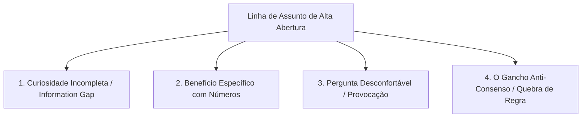

# Email Copywriting Master: Redação Persuasiva e Conversão na Caixa de Entrada

O **Email Copywriting Master** é a skill técnica dedicada à redação de emails que conquistam a abertura, prendem a atenção do leitor e geram cliques intencionais para ofertas comerciais, lançamentos e campanhas de relacionamento. Diferente de artigos de blog ou posts sociais, o email é um ambiente **íntimo e conversacional de 1-para-1**, onde a artificialidade corporativa é punida com o esquecimento ou com o botão de descadastramento.

---

## 1. Princípios e Heurísticas de Copywriting para Email

1. **A Função da Linha de Assunto É Apenas Vender a Abertura:** A linha de assunto não deve explicar a oferta, nem tentar vender o produto. Seu único objetivo matemático é fazer o destinatário clicar e abrir a mensagem.
2. **Escreva de um Humano para Outro Humano:** Emails que parecem comunicados de imprensa do departamento de relações públicas têm taxas de clique medíocres. Escreva como se estivesse enviando uma mensagem para um colega inteligente de trabalho.
3. **A Regra do Clique Único (One Single Focus):** Cada email deve ter **um único objetivo de ação**. Ter links para o blog, para o podcast, para o Instagram e para a página de vendas na mesma mensagem gera paralisia de escolha (Paradoxo da Escolha) e derruba o CTOR.
4. **Filtro Anti-Slop de Abertura:** É estritamente proibido abrir o corpo do email com saudações corporativas vazias como:
   - *"Espero que este email o encontre bem."*
   - *"Venho por meio deste apresentar..."*
   - *"No competitivo mercado de hoje..."*
   - Abra diretamente no meio da ação (*In Media Res*), na pergunta ou na história.

---

## 2. Engenharia de Linhas de Assunto (Subject Lines de 30 a 50 Caracteres)

Em telas mobile (onde ocorrem mais de 65% das aberturas), linhas de assunto com mais de 50 caracteres são truncadas. Utilize uma das seguintes 4 fórmulas consagradas:



| Fórmula de Assunto | Mecanismo Psicológico | Exemplo Real (Mobile-Friendly) |
| :--- | :--- | :--- |
| **Curiosidade Incompleta (Information Gap)** | A mente humana não tolera histórias abertas sem desfecho. | `O que aprendemos perdendo R$ 42k` / `O erro do slide 4` |
| **Benefício Específico & Números** | Clareza absoluta de retorno tangível e credibilidade. | `14 novos clientes em 28 dias (sem anúncios)` |
| **Pergunta Provocativa** | Obriga o cérebro do leitor a formular uma resposta interna. | `Você assinaria este contrato hoje?` / `Seu time ainda faz isso manual?` |
| **Anti-Consenso / Quebra de Regra** | Choca o leitor ao atacar um dogma aceito pelo mercado. | `Por que paramos de postar no feed todos os dias` |

### O Preheader / Preview Text como Extensão Obrigatória
O texto de pré-visualização (primeiros 50 a 80 caracteres exibidos abaixo do assunto na caixa de entrada) **nunca deve repetir o assunto** nem conter frases técnicas como *"Não consegue visualizar? Clique aqui"*.
- **Assunto:** `O erro do slide 4`
- **Preheader Ideal:** `Quase nos custou a conta do cliente mais antigo.`

---

## 3. Frameworks Narrativos de Conversão

### 3.1. Framework Story-Lesson-Offer (SLO)
O modelo mais eficiente para emails cotidianos e newsletters de alta conversão:

```markdown
1. A HISTÓRIA (Story - 2 a 4 parágrafos):
   Comece com uma observação cotidiana, um diálogo real ou um desafio recente vivido pela equipe.
   Ex: "Ontem pela manhã, estava revisando a planilha de custos de marketing com nosso financeiro..."

2. A LIÇÃO (Lesson - 2 a 3 parágrafos):
   Extraia um princípio prático universal da história que se aplique diretamente à vida do leitor.
   Ex: "Percebi que 80% do tempo gasto em relatórios servia apenas para justificar erros que poderiam
   ter sido evitados no setup inicial..."

3. A OFERTA (Offer - 1 a 2 parágrafos + Link):
   Faça uma transição suave e sem atrito da lição aprendida para a solução comercial.
   Ex: "Se você também não aguenta mais perder horas montando dashboards manuais, criamos um template
   automatizado que resolve isso em 10 minutos. [Toque aqui para baixar o template]."
```

### 3.2. The Soap Opera Sequence (Sequência em Capítulos)
Desenvolvida para lançamentos e esteiras de conversão de 5 dias, onde cada email termina com um gancho (*cliffhanger*) que força a abertura do email do dia seguinte:
- **Capítulo 1:** Abertura dramática do cenário atual.
- **Capítulo 2:** A jornada de frustração e a revelação do mecanismo.
- **Capítulo 3:** O momento "Aha!" e a descoberta da solução.
- **Capítulo 4:** Benefícios ocultos e prova social massiva.
- **Capítulo 5:** A chamada final urgente e encerramento de inscrições.

---

## 4. Plain Text vs HTML: A Batalha dos Formatos

| Critério | Formato Plain Text / Rich Text Leve | Formato HTML Corporativo / Banner Pesado |
| :--- | :--- | :--- |
| **Entregabilidade (Inbox Placement)** | **Altíssima.** O algoritmo identifica como mensagem pessoal entre amigos/colegas. | Média a Baixa. Frequentemente cai na aba "Promoções" ou pasta de spam. |
| **Taxa de Resposta / Diálogo** | Excelente. Estimula respostas diretas de leads. | Perto de zero. Parece uma mala direta corporativa impessoal. |
| **Experiência Mobile** | Carregamento instantâneo, sem quebras de layout ou fontes microscópicas. | Pode exigir zoom manual ou quebrar em telas de larguras diferentes. |
| **Quando Utilizar** | Consultorias, SaaS, B2B, criadores de conteúdo e vendas de alto ticket. | E-commerce de moda/varejo onde a exibição de fotos de produtos é indispensável. |

---

## 5. Métricas de Saúde e Benchmarks de Performance

Com o lançamento do Apple Mail Privacy Protection (MPP), que abre pixels de rastreamento automaticamente em dispositivos iOS, a Taxa de Abertura (*Open Rate*) tornou-se uma métrica inflada. Monitore os indicadores reais de engajamento:

$$\text{CTOR (Click-to-Open Rate)} = \frac{\text{Cliques Únicos}}{\text{Aberturas Únicas}} \times 100$$

| Indicador de Performance | Benchmark Médio de Mercado | Meta de Alta Performance | Ação se Abaixo da Meta |
| :--- | :---: | :---: | :--- |
| **Click-to-Open Rate (CTOR)** | $8.0\% \text{ a } 10.0\%$ | **$\ge 14.0\%$** | Melhorar o gancho da história e destacar o CTA como benefício claro. |
| **Taxa de Cliques (CTR Geral)** | $1.5\% \text{ a } 2.5\%$ | **$\ge 3.5\%$** | Reduzir o número de links concorrentes e usar texto de link descritivo. |
| **Taxa de Descadastro (Unsubscribe)** | $0.2\% \text{ a } 0.4\%$ | **$\le 0.15\%$** | Alinhar expectativa de frequência de envio ou filtrar melhor a entrada. |
| **Taxa de Reclamação de Spam** | $< 0.10\%$ | **$< 0.03\%$** | Tornar o botão de cancelamento visível no topo ou rodapé em destaque. |

---

## 6. Checklist de Validação Pré-Disparo de Email

- [ ] **Linha de Assunto Curta:** Contém entre 30 e 48 caracteres e não repete o texto do preheader?
- [ ] **Sem Spam Words Clássicas:** O texto evita excessos de termos como *GRÁTIS*, *URGENTE*, *100% GARANTIDO*, *CLIQUE AQUI* e excesso de pontos de exclamação (!!!)?
- [ ] **Links Parametrizados:** Todos os links possuem parâmetros UTM corretos (`utm_source=email`, `utm_medium=broadcast` ou `lifecycle`) e abrem em nova aba (`target="_blank"`)?
- [ ] **Link de Cancelamento Funcional:** O rodapé contém endereço físico válido e link claro de descadastro em 1 clique?
- [ ] **Envio de Teste:** O email de teste foi enviado para um endereço pessoal e lido em um smartphone real?

---

## 7. Catálogo de Referências Técnicas Integradas

Esta skill preserva e se apoia no acervo de guias especializados contidos na subpasta [`references/`](references/):

| Arquivo de Referência | Conteúdo Técnico & Casos Práticos |
| :--- | :--- |
| [`email-subject-lines.md`](references/email-subject-lines.md) | Biblioteca completa de padrões de assuntos para diferentes objetivos de campanha e funil. |
| [`email-writing-guide.md`](references/email-writing-guide.md) | Guia de e-mail marketing, de assuntos a sequências (boas-vindas, nutrição, vendas, reengajamento). |
| [`email-marketing.md`](references/email-marketing.md) | Playbook estratégico de campanhas promocionais e transmissões regulares (tipos de e-mail, benchmarks, anatomia, fórmulas de assunto). |
| [`email-marketing-bible.md`](references/email-marketing-bible.md) | Base de conhecimento ampla: lista, segmentação, fluxos, texto, design, entregabilidade, conformidade, 19 playbooks por setor. |
| [`email-marketing-playbook.md`](references/email-marketing-playbook.md) | Benchmarks, tipos de e-mail, assuntos, design, CTA, segmentação, testes e métricas. |
| [`email-sequence.md`](../email-automacao/references/email-sequence.md) | Compilado de formatos de e-mail comercial (seção "Email Types Reference"), checklist de auditoria e diretrizes de texto (a antiga `copy-guidelines`). Fica na skill email-automacao. |


## Qual abrir primeiro (assuntos que aparecem em vários arquivos)

Os arquivos abaixo tratam dos mesmos assuntos com redações diferentes (medido: nenhum tem mais de 8% do texto coberto pelos outros). Abra o da primeira coluna; os demais só se precisar de mais exemplos.

| Assunto | Abra primeiro | Depois, se precisar |
| :--- | :--- | :--- |
| **Assuntos de e-mail (exemplos por tipo de envio)** | [`email-subject-lines.md`](references/email-subject-lines.md) | Fórmulas e palavras de poder em [`email-writing-guide.md`](references/email-writing-guide.md); e-mail frio em [`subject-lines.md`](../vendas-cold-email/references/subject-lines.md) |
| **Benchmarks de e-mail (abertura, clique, descadastro)** | Tabela por tipo e métricas em [`email-marketing-playbook.md`](references/email-marketing-playbook.md), mais a seção "Benchmarks" por setor ao final de [`email-marketing-bible.md`](references/email-marketing-bible.md) | E-mail frio: [`benchmarks.md`](../vendas-cold-email/references/benchmarks.md) |
| **Estratégia geral de campanha** | [`email-marketing.md`](references/email-marketing.md) (curto, bom para começar) | [`email-marketing-bible.md`](references/email-marketing-bible.md) para o aprofundamento |
| **Escrever um e-mail do zero (briefing, tom, exemplos)** | [`email-writing-guide.md`](references/email-writing-guide.md) | — |
| **Sequências (boas-vindas, nutrição, reengajamento)** | Ver a tabela em [`email-automacao`](../email-automacao/SKILL.md) | — |

**Atenção aos números:** a tabela de [`email-marketing.md`](references/email-marketing.md) é mais permissiva (descadastro abaixo de 1% como "aceitável" e bounce abaixo de 5%) que a do `email-marketing-playbook` e a da `email-marketing-bible` (descadastro acima de 0,5% já é ruim ou sinal de alerta). Use a faixa mais exigente como meta. Desde o Apple Mail Privacy Protection a taxa de abertura é só indicativa (aviso na `email-marketing-bible`); dê peso ao clique. Os valores são de fontes dos autores dos guias, não medidos por nós.

## Foi para outras skills

- **E-mail frio** (`benchmarks`, `frameworks`, `subject-lines`): agora em [`vendas-cold-email`](../vendas-cold-email/SKILL.md).
- **Newsletter** (`email-playbook`, `kit-convertkit-guide`): agora em [`email-newsletter`](../email-newsletter/SKILL.md).
- **Sequência de boas-vindas** (`welcome-sequence-template`): agora em [`email-automacao`](../email-automacao/SKILL.md).
