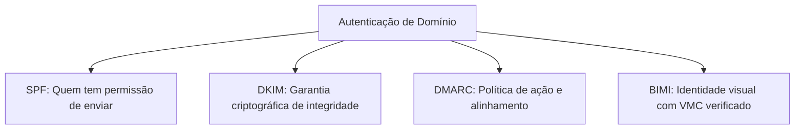

# Email Deliverability Guardian: Infraestrutura, Autenticação e Reputação

O **Email Deliverability Guardian** é a skill técnica focada na física invisível do envio de emails e na garantia de que as mensagens alcancem a **caixa de entrada primária (*Inbox Placement*)** dos principais provedores (Google Workspace/Gmail, Microsoft 365/Outlook, Yahoo, Apple Mail). A melhor estratégia de copywriting e o funil mais sofisticado tornam-se inúteis se os disparos caírem na pasta de spam ou forem rejeitados na camada de transporte (*SMTP Drop*).

---

## 1. Princípios e Heurísticas de Entregabilidade

1. **Reputação É Cumulativa e Frágil:** A reputação de um domínio leva meses para ser construída com envios consistentes e engajamento real, mas pode ser destruída em 48 horas através de disparos massivos para listas desatualizadas.
2. **A Nova Ordem dos Provedores (Google & Yahoo Requirements):** Desde 2024, tanto Google quanto Yahoo exigem autenticação obrigatória de **SPF, DKIM e DMARC** para remetentes em massa, além de manter a **taxa de reclamação de spam estritamente abaixo de 0.10%** (com limite absoluto de tolerância de 0.30%).
3. **Engajamento Determina o Posicionamento:** Provedores modernos analisam se os destinatários abrem, respondem, movem a mensagem para pastas ou clicam em links. Emails que recebem respostas sinalizam aos filtros que o remetente é legítimo e confiável.
4. **Alinhamento do Cabeçalho "From":** O domínio exibido no campo `From:` deve coincidir exatamente com o domínio autenticado no SPF e assinado no DKIM (*DMARC Alignment*).

---

## 2. O Quarteto de Autenticação de DNS

A base técnica da entregabilidade exige a configuração correta de quatro protocolos no painel de DNS do domínio:

### 2.1. SPF (Sender Policy Framework)
- **Registro DNS:** TXT no apex do domínio (`@`).
- **Exemplo Real:** `v=spf1 include:_spf.google.com include:sendgrid.net ~all`
- **Regra Crítica do Limite de Lookups:** O protocolo SPF permite no máximo **10 consultas DNS (*DNS Lookups*)**. Ultrapassar esse limite gera o erro `PermError: SPF Permanent Error`, fazendo com que os servidores de destino ignorem o registro por completo. Se você utiliza múltiplos provedores, utilize soluções de *SPF Flattening*.

### 2.2. DKIM (DomainKeys Identified Mail)
- **Registro DNS:** TXT ou CNAME no seletor especificado (ex: `google._domainkey`).
- **Segurança Criptográfica:** Utilize obrigatoriamente **chaves de 2048 bits**. Chaves antigas de 1024 bits são consideradas inseguras e rejeitadas por filtros corporativos rigorosos.
- **Rotação:** Recomenda-se rotacionar as chaves DKIM a cada 6 meses.

### 2.3. DMARC (Domain-based Message Authentication, Reporting and Conformance)
- **Registro DNS:** TXT em `_dmarc.seudominio.com`.
- **A Jornada Progressiva de Políticas:**
  1. **Fase 1 (Monitoramento):** `v=DMARC1; p=none; rua=mailto:dmarc-reports@seudominio.com; pct=100;`  
     *Permite auditar relatórios diários de quem está enviando em seu nome sem bloquear entregas.*
  2. **Fase 2 (Quarentena):** `v=DMARC1; p=quarantine; rua=mailto:...; pct=100;`  
     *Emails não autorizados são direcionados para a pasta de spam do destinatário.*
  3. **Fase 3 (Rejeição Máxima - Proteção Total):** `v=DMARC1; p=reject; rua=mailto:...; aspf=r; adkim=r;`  
     *Emails que falham na autenticação são bloqueados e descartados antes de chegar ao usuário.*

### 2.4. BIMI (Brand Indicators for Message Identification)
- Exibe o logotipo oficial da sua marca ao lado do nome do remetente na caixa de entrada do Gmail e Apple Mail.
- **Pré-requisitos Obrigatórios:** DMARC ativo com política `p=quarantine` (pct=100) ou `p=reject`, logotipo em formato SVG Tiny 1.2 e Certificado de Marca Verificada (VMC) emitido por autoridade certificadora (DigiCert ou Entrust).

---

## 3. Protocolo de Warm-Up Gradual de Caixas (Cronograma de 21 Dias)

Ao conectar um domínio novo ou uma nova caixa postal corporativa, **nunca inicie com volumes normais de envio**. O aumento deve ser exponencial e gradual:

| Período | Volume Diário por Caixa | Tipologia de Envio | Comportamento Requerido |
| :--- | :---: | :--- | :--- |
| **Dias 1 a 3** | 5 emails / dia | Apenas contatos internos ou amigos conhecidos. | 100% de respostas e aberturas garantidas. |
| **Dias 4 a 7** | 10 a 15 emails / dia | Início de ferramentas automáticas de warm-up (Mailreach, Warmup Inbox). | Troca de mensagens curtas e arquivamento de conversas. |
| **Dias 8 a 14** | 20 a 30 emails / dia | Warm-up contínuo + primeiros 5 disparos manuais de teste. | Monitorar se os emails caem na pasta de Promoções ou Primária. |
| **Dias 15 a 21** | 35 a 50 emails / dia | Operação outbound real iniciando em ritmo moderado. | Manter volume fixo sem picos repentinos de 200 emails no mesmo dia. |

---

## 4. Higiene Rigorosa de Listas e Gestão de Bounces

A presença de endereços inválidos destrói a pontuação de reputação do remetente junto aos algoritmos dos provedores.

### Categorias de Problemas e Ação Imediata

| Ocorrência | Definição | Limite Tolerável | Ação Operacional Obrigatória |
| :--- | :--- | :---: | :--- |
| **Hard Bounce** | Email inexistente, domínio inválido ou servidor permanentemente offline. | **$< 1.0\%$** | **Remoção e supressão imediata** da base de contatos. Nunca tentar reenviar. |
| **Soft Bounce** | Caixa cheia temporariamente ou servidor indisponível momentaneamente. | $< 2.0\%$ | Tentar reenviar por até 3 vezes em um intervalo de 72 horas; se persistir, mover para inativo. |
| **Spam Complaint** | Destinatário clicou no botão "Marcar como Spam". | **$< 0.10\%$** | Investigar a origem do lead, facilidade de opt-out e pertinência do conteúdo enviado. |
| **Spam Traps** | Endereços-isca criados por provedores para caçar spammers (prístinas e recicladas). | **ZERO** | Passar a base completa por ferramentas de validação (ZeroBounce, NeverBounce) antes de qualquer envio. |

---

## 5. Ferramentas e Métricas de Monitoramento Contínuo

- **Google Postmaster Tools:** Painel essencial para quem envia para endereços `@gmail.com`. Acompanhe semanalmente:
  - **Domain Reputation:** Deve permanecer em nível **High (Alta)**. Se cair para Medium ou Low, reduza o volume de envio imediatamente em 50%.
  - **Spam Rate:** Deve permanecer abaixo de $0.10\%$.
  - **SPF/DKIM/DMARC Success Rate:** Deve ser $100\%$.
- **Microsoft SNDS (Smart Network Data Services):** Avaliação de reputação de IPs junto aos serviços Outlook.com e Hotmail.
- **Mail-Tester.com:** Teste prévio de disparos isolados. A pontuação deve ser estritamente **10 / 10** antes de subir campanhas de grande porte.

---

## 6. Checklist de Auditoria Técnica de Entregabilidade

Ao auditar um domínio com problemas de taxa de abertura baixa (< 15%):

- [ ] **Validação de Sintaxe DNS:** O registro SPF contém menos de 10 lookups e termina com `~all` ou `-all`?
- [ ] **Chave DKIM 2048-bit:** O seletor responde corretamente e a chave pública é de 2048 bits?
- [ ] **Alinhamento DMARC:** O domínio do `From:` é idêntico ao do `Return-Path` e da assinatura DKIM?
- [ ] **Presença em Blacklists:** O domínio ou IP de envio consta em alguma RBL pública (Spamhaus, Barracuda, SORBS)?
- [ ] **Cabeçalho List-Unsubscribe:** A mensagem inclui o cabeçalho técnico `List-Unsubscribe: <mailto:...>, <https://...>` e suporta cancelamento com um único clique (One-Click Unsubscribe RFC 8058)?
- [ ] **Proporção Texto vs Imagem:** O corpo do email mantém pelo menos 60% de texto puro e no máximo 40% de área visual, sem links encurtados (bit.ly, rebrandly) que disparam filtros heurísticos?

---

## 7. Catálogo de Referências Técnicas Integradas

Esta skill preserva e se apoia nos guias especializados contidos na subpasta [`references/`](references/):

| Arquivo de Referência | Conteúdo Técnico & Casos Práticos |
| :--- | :--- |
| [`deliverability.md`](references/deliverability.md) | Guia completo de conceitos de entregabilidade, reputação de IPs dedicados vs compartilhados e boas práticas. |
| [`deliverability-checker.md`](references/deliverability-checker.md) | Diagnóstico manual de MX, SPF, DKIM e DMARC com `dig`: como rodar, como ler o resultado, includes de SPF e seletores de DKIM por provedor. |

Validação de lista (bounces, spam traps, e-mails descartáveis): a referência `email-validator` foi arquivada porque era só a chamada a um programa inexistente. Os cuidados de higiene de lista estão em [`deliverability.md`](references/deliverability.md).

## Outras referências

- **[dns-zonefile-config.md](references/dns-zonefile-config.md)** — Configuração de zonas DNS para entregabilidade (SPF, DKIM, DMARC). Texto em francês.
- **[postmark-setup.md](references/postmark-setup.md)** — Configuração do Postmark.
