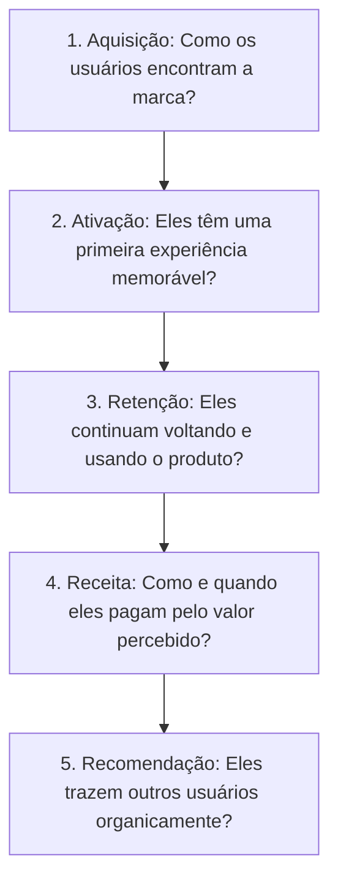

# Growth Frameworks Strategist - Diretrizes Operacionais

Esta skill orienta o planejamento estratégico e a execução de iniciativas de crescimento sustentável para negócios digitais e SaaS, combinando frameworks de métricas (AARRR, Startup Metrics), motores de tração perpétua (Growth Loops, PLG) e modelos mentais executivos para tomada de decisão sob incerteza.

---

## 🎯 Quando Usar
- Ao estruturar o modelo de crescimento e KPIs norteadores (*North Star Metric*) de uma startup ou escala de negócio.
- Ao auditar o funil em busca de alavancas de crescimento no framework AARRR (Pirate Metrics).
- Ao desenhar loops de crescimento compostos (virais, de conteúdo ou pagos) para substituir funis lineares.
- Ao planejar estratégias de expansão de receita baseadas no produto (Product-Led Growth).
- Ao modelar novos modelos de negócio via Lean Canvas.
- Ao aplicar modelos mentais estruturados (Pensamento de Segunda Ordem, Decisões Reversíveis, High Output Management).
- Ao monitorar sinais de risco e gerenciar protocolos de resposta rápida a crises de reputação.

## 🚫 Quando NÃO Usar
- Para validação e entrevistas de descoberta com clientes reais (use `persona-descoberta-de-clientes`).
- Para análise detalhada de coortes e micro-quedas de onboarding (use `data-funil-e-coortes`).
- Para planejamento tático de mídia paga (use `ads-analise-de-desempenho`).

---

## 🏴‍☠️ 1. O Framework AARRR (Pirate Metrics)

### 1.1. As Métricas Chave por Etapa
- **Aquisição**: CAC por canal, Volume de visitantes únicos qualificados, Taxa de cliques orgânica.
- **Ativação**: Percentual de usuários que atingem o momento "Aha!" nas primeiras 24 horas.
- **Retenção**: N-Day Retention (D1, D7, D30), Net Revenue Retention (NRR $> 110\%$).
- **Receita**: MRR, ARPU (Average Revenue Per User), LTV, Payback de CAC.
- **Recomendação**: Coeficiente Viral ($K$-factor $> 1.0$), Net Promoter Score (NPS).

---

## 🔁 2. Growth Loops vs. Funis Lineares Tradicionais

Funis lineares geram clientes apenas na proporção do dinheiro ou esforço injetado no topo. **Growth Loops** são sistemas fechados onde o output de um ciclo se torna o input do próximo:

$$\text{Novo Usuário} \longrightarrow \text{Ação de Valor} \longrightarrow \text{Geração de Ativo Público} \longrightarrow \text{Novo Usuário}$$

### 2.1. Os 3 Loops Principais
1. **Loop Viral / Conexão (ex: Calendly, Figma, Slack)**: Usar o produto exige convidar ou interagir com um terceiro, que é automaticamente exposto à marca.
2. **Loop de Conteúdo Gerado pelo Usuário (ex: Pinterest, Quora, Notion)**: Cada usuário cria páginas públicas indexadas pelo Google, atraindo mais tráfego orgânico.
3. **Loop Reinvestido de Caixa**: O lucro gerado por um cliente adquirido paga imediatamente os anúncios para adquirir 2 novos clientes.

---

## 🧠 3. Modelos Mentais de Liderança e Decisão

### 3.1. Decisões Tipo 1 vs. Tipo 2 (Jeff Bezos)
- **Tipo 1 (Portas de Via Única)**: Decisões irreversíveis ou de impacto existencial (mudança de precificação radical, venda da empresa). Exigem deliberação lenta, dados robustos e aprovação colegiada.
- **Tipo 2 (Portas de Via Dupla)**: Decisões reversíveis (testes de landing page, novos formatos de conteúdo, contratação de ferramentas). Devem ser tomadas rapidamente por indivíduos autônomos com ~70% das informações necessárias.

### 3.2. Pensamento de Segunda Ordem (Second-Order Thinking)
Sempre pergunte: *"E depois?"*.
- *Primeira ordem*: Diminuir o preço aumenta as vendas no mês (imediato).
- *Segunda ordem*: Atrai clientes com menor LTV, sobrecarrega o suporte e dilui o posicionamento de marca (médio prazo).

---

---

## ⚖️ 5. Frameworks de Priorização de Experimentos (RICE vs. ICE)

Ao gerenciar um backlog de hipóteses de crescimento, aplique a pontuação RICE para decidir o que testar primeiro:

$$	ext{RICE Score} = rac{	ext{Reach (Alcance)} 	imes 	ext{Impact (Impacto)} 	imes 	ext{Confidence (Confiança)}}{	ext{Effort (Esforço)}}$$

### 5.1. Critérios de Ponderação
- **Reach (Alcance)**: Quantos usuários únicos serão impactados no período (ex: 5.000 usuários/mês).
- **Impact (Impacto)**: Impacto relativo na conversão ($3 = 	ext{massivo}$, $2 = 	ext{alto}$, $1 = 	ext{médio}$, $0.5 = 	ext{baixo}$).
- **Confidence (Confiança)**: Quão seguros estamos com base em evidências anteriores ($100\% = 	ext{alta/dados claros}$, $80\% = 	ext{média/pesquisa qualitativa}$, $50\% = 	ext{baixa/aposta}`).
- **Effort (Esforço)**: Pessoas-semanas necessárias para projetar, desenvolver e testar (ex: 2 semanas = 2).

### 5.2. Diagnóstico de Fadiga de Canal (Channel Saturation)
Todo canal de aquisição segue a *Lei do Rendimento Decrescente dos Canais* (Andrew Chen). Monitore os 3 sintomas de esgotamento:
1. **Aumento Contínuo de CAC**: Custo de aquisição subindo mais de 20% trimestre a trimestre no mesmo público.
2. **Queda de CTR e Conversão**: Públicos saturados ignoram mensagens repetitivas.
3. **Piora na Qualidade da Safra**: Leads originados no canal saturado apresentam LTV menor e churn mais precoce.

---

## 📚 4. Biblioteca de Referências Operacionais

Aprofunde-se nos manuais da subpasta [`references/`](references/):

| Arquivo de Referência | Conteúdo Técnico & Casos Práticos |
|---|---|
| [`aarrr-metrics.md`](references/aarrr-metrics.md) | Guia completo de cálculo, diagnóstico e governança das métricas piratas em SaaS. |
| [`growth-loops.md`](references/growth-loops.md) | Engenharia de sistemas de crescimento perpétuo, fórmulas de K-factor e cadências de loop. |
| [`growth-fundamentos.md`](references/growth-fundamentos.md) | Guia de bolso: North Star, funil AARRR com benchmarks, loops virais e K-factor, ativação, retenção, ICE, experimentos, canais com faixa de CAC e formato de entrega. Fusão de `growth-hacking` e `growth-strategy` (2026-10-20). |
| [`product-led-growth.md`](references/product-led-growth.md) | Princípios de PLG: monetização orientada ao produto, freemium vs free-trial e expansão de contas. |
| [`startup-metrics.md`](references/startup-metrics.md) | Métricas financeiras e de tração para investidores: Burn Multiple, Quick Ratio e Rule of 40. |
| [`demand-gen.md`](references/demand-gen.md) | Geração de demanda ativa vs captura de demanda, canais de distribuição e programas de autoridade. |
| [`distribution-engine.md`](references/distribution-engine.md) | Construção de motores de distribuição proprietários e parcerias estratégicas. |
| [`lean-canvas.md`](references/lean-canvas.md) | Modelagem de negócio em 1 página: problema, segmento de clientes, proposta de valor e canal. |

## Referências adicionais

**Estratégia e base de marketing**
- [marketing-fundamentals.md](references/marketing-fundamentals.md) — Conceitos, psicologia e frameworks centrais: funil, jornada do cliente, posicionamento e proposta de valor. É o conteúdo que vários arquivos do acervo chamam de "marketing-fundamentals".
- [marketing-strategy-essentials.md](references/marketing-strategy-essentials.md) — Essenciais de estratégia de marketing (HubSpot, Gartner, McKinsey).
- [marketing-tactics-library.md](references/marketing-tactics-library.md) — Biblioteca de táticas (GrowthHackers, Demand Curve, Reforge).
- [marketing-ideas-collection.md](references/marketing-ideas-collection.md) — Ideias de marketing e crescimento para SaaS.

**Escala**
- [scale-game-framework.md](references/scale-game-framework.md) — Como a estratégia de marketing se comporta em escala.

**Ferramentas gratuitas como marketing**
- [free-tool-strategy.md](references/free-tool-strategy.md) — Planejar, avaliar e construir ferramentas gratuitas para geração de leads, SEO e marca.
- [engineering-marketing-guide.md](references/engineering-marketing-guide.md) — Guia de "engenharia como marketing" para ferramentas gratuitas.
- [roteiro-guiado-ferramenta-gratuita.md](references/roteiro-guiado-ferramenta-gratuita.md) — Roteiro guiado do kit AgentKits (veio de `revenue-gtm-e-posicionamento`, 2026-10-20): faz perguntas e entrega o plano de uma ferramenta gratuita ou calculadora. Texto base em inglês.

## Para onde foram os outros assuntos

- **Saúde de clientes, previsão de churn e sinais de expansão:** skill [growth-retencao-e-churn](../growth-retencao-e-churn/SKILL.md).
- **Crise de reputação (detectar, responder, recuperar):** skill [pr-assessoria-de-imprensa](../pr-assessoria-de-imprensa/SKILL.md).
- **Psicologia do consumidor, vieses e persuasão:** skill [revenue-psicologia](../revenue-psicologia/SKILL.md).
- **Modelos mentais e decisão (segunda ordem, decisões reversíveis, inversão, conselho de fundador):** skill [revenue-modelos-mentais](../revenue-modelos-mentais/SKILL.md).
- **Gestão de equipe (Grove, Radical Candor, Shape Up) e a lista curta de 139 ideias:** arquivados em `.agent/skills/_arquivo/mescladas/r1-growth/`.
