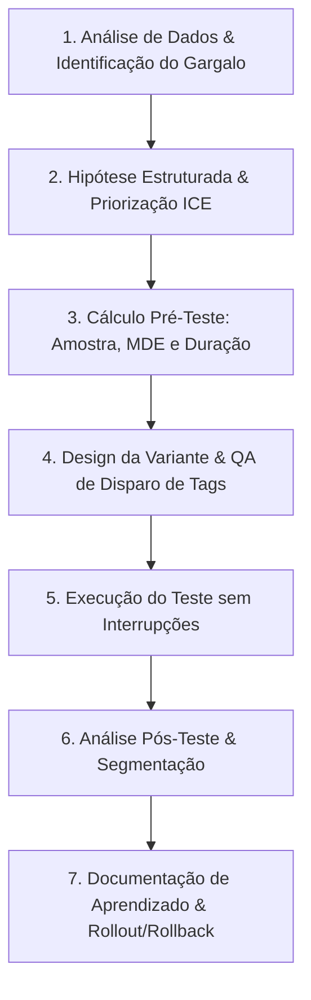

# AB Testing Strategist - Diretrizes Operacionais

Esta skill orienta o planejamento, cálculo estatístico, formulação de hipóteses e governança científica de testes A/B, testes com múltiplas variantes (A/B/n) e testes multivariados (MVT) para páginas web, fluxos de produto e funis de marketing.

---

## 🎯 Quando Usar
- Ao estruturar programas contínuos de experimentação e otimização de conversão.
- Ao formular hipóteses científicas baseadas em dados quantitativos ou pesquisas qualitativas.
- Ao calcular tamanho amostral, poder estatístico e duração mínima necessária antes de ligar qualquer teste.
- Ao auditar resultados estatísticos para evitar falsos positivos (*peeking problem*, variância inicial, sazonalidade).
- Ao documentar aprendizados de testes em um repositório central de experimentação.

## 🚫 Quando NÃO Usar
- Para auditoria qualitativa ou heurística de páginas sem foco estatístico (use `site-cro`).
- Para arquitetura de tags, dataLayer ou configuração de GA4/GTM (use `data-web-ga4`).
- Para análise de coortes e retenção de produto (use `data-funil-e-coortes`).

---

## 🧠 1. Framework de Formulação e Priorização de Hipóteses

### 1.1. Fórmula Científica de Hipótese
Toda hipótese de teste deve seguir a estrutura:
> **"Baseado em [evidência/dado], acreditamos que [mudança na variante] para [público-alvo] resultará em [impacto esperado na métrica primária], porque [razão comportamental/gatilho psicológico]."**

### 1.2. Modelos de Priorização: ICE vs. PIE

| Dimensão | ICE Framework (1 a 10) | PIE Framework (1 a 10) |
|---|---|---|
| **Impacto (I) / Potential (P)** | Quão grande será o aumento de conversão se a hipótese for validada? | Quanto de potencial de melhoria existe na página/fluxo? |
| **Confiança (C) / Importance (I)** | Quão seguro estamos com base em dados anteriores e testes similares? | Quão valioso/crítico é o tráfego que passa por essa etapa? |
| **Facilidade (E) / Ease (E)** | Quão rápido e barato é implementar o teste (design + código)? | Quão fácil é tecnicamente implementar a variação? |
| **Score Final** | `(Impacto + Confiança + Facilidade) / 3` | `(Potencial + Importância + Facilidade) / 3` |

---

## 📊 2. Estatística e Rigor Metodológico

### 2.1. Parâmetros Obrigatórios de Validação

```
┌─────────────────────────────────────────────────────────────┐
│ 1. Nível de Significância (α): 5% (Confiança Estatística: 95%)│
│ 2. Poder Estatístico (1 - β): 80% mínimo (ideal: 90%)       │
│ 3. MDE (Minimum Detectable Effect): Entre 5% e 15%          │
│ 4. Duração Mínima: 2 ciclos comerciais completos (14 dias) │
│ 5. Número Mínimo de Conversões: 350 a 400 por variante      │
└─────────────────────────────────────────────────────────────┘
```

### 2.2. Fórmula de Cálculo de Tamanho Amostral (Por Variante)
$$n = \frac{2 \cdot (Z_{\alpha/2} + Z_{\beta})^2 \cdot p \cdot (1 - p)}{\Delta^2}$$

Onde:
- $Z_{\alpha/2} = 1.96$ para confiança de 95%.
- $Z_{\beta} = 0.84$ para poder de 80% (ou $1.28$ para 90%).
- $p$ = taxa de conversão basal atual (baseline conversion rate).
- $\Delta$ = efeito mínimo detectável em valor absoluto ($p \cdot \text{MDE}$).

### 2.3. Prevenção de Erros Comuns e Vieses
- **Peeking Problem (Checagem Prematura)**: Nunca declare um vencedor antes de atingir o tamanho amostral planejado e a duração mínima de 14 dias, mesmo que o p-valor pareça significativo no dia 3.
- **Efeito Novidade (Novelty Effect)**: Usuários frequentes clicam em novidades nos primeiros dias; monitore a estabilização ao longo de duas semanas completas.
- **Sazonalidade e Efeito Dia da Semana**: O comportamento de compra em segundas-feiras diverge de finais de semana. Testes devem cobrir dias completos de ciclo semanal.
- **Correção para Testes com Múltiplas Variantes (A/B/C/D)**: Aplicar correção de Bonferroni ou False Discovery Rate (FDR) quando houver mais de uma variante competindo contra o controle:
  $$\alpha_{\text{ajustado}} = \frac{\alpha}{k}$$
  (onde $k$ é o número de comparações simultâneas).

### 2.4. Monitoramento de Métricas Guardrail (Guardrail Metrics)
Nunca avalie apenas a métrica primária de conversão. Toda variante deve ser monitorada contra métricas de proteção:
- **Performance Técnica**: Variação de latência ou LCP (Largest Contentful Paint) > 200ms na variante é critério de desqualificação imediata.
- **Qualidade do Lead/Venda**: Aumento de cancelamentos, estornos (*chargebacks*) ou devoluções dentro do ciclo de 30 dias.
- **Suporte ao Cliente**: Volume de chamados via chat ou tickets abertos relacionados ao fluxo testado.

---

## 🔄 3. Ciclo de Execução de Experimentos



### 3.1. Checklist de QA Pré-Disparo
- [ ] O tráfego está dividido em 50/50 de forma balanceada e com persistência de cookie?
- [ ] As tags de conversão disparam exatamente na mesma condição no Controle e na Variante?
- [ ] O teste foi validado em Mobile, Desktop, Chrome, Safari e iOS WebView?
- [ ] Não há sobreposição com outros testes ativos na mesma URL que causem poluição cruzada?

### 3.2. Matriz de Decisão Pós-Teste

| Cenário Estatístico | Ação Operacional | Próximo Passo |
|---|---|---|
| **Vencedor Significativo ($p < 0.05$ & Lift Positivo)** | Rollout definitivo (100% de tráfego na variante) | Documentar aprendizado comportamental e desenhar teste de iteração sobre a variante vencedora. |
| **Inconclusivo / Flat ($p \ge 0.05$)** | Manter controle ou desligar variante | Analisar segmentações (mobile vs desktop, novos vs recorrentes). Se não houver lift real, registrar que a mudança não move o ponteiro. |
| **Perdedor Significativo ($p < 0.05$ & Lift Negativo)** | Rollback imediato para 100% no controle | Investigar por que o modelo mental do usuário rejeitou a hipótese; extrair aprendizado anti-padrão. |

### 3.3. Governança e Repositório Central de Experimentos
Todo experimento concluído deve ser catalogado com a seguinte taxonomia:
```markdown
### EXP-2026-042: Otimização de CTA da Hero (Plinq B2B)
- **Status:** [Concluído / Vencedor]
- **Hipótese:** Mudança de "Fale com um Especialista" para "Ver Demonstração Interativa (2 min)".
- **Baseline Conversion:** 2.4% | **Variante Conversion:** 3.1% (+29.1% lift relativo).
- **Amostra:** 14.200 sessões por variante | **P-valor:** 0.012 (Confiança 98.8%).
- **Métricas Guardrail:** Qualificação de SQL permaneceu estável em 64%.
- **Aprendizado-Chave:** Usuários técnicos preferem autonomia imediata à fricção de reunião síncrona.
```

---

## 📚 4. Biblioteca de Referências Operacionais

Aprofunde-se nos guias detalhados presentes na pasta `references/`:

| Arquivo de Referência | Conteúdo Principal & Uso Prático |
|---|---|
| [`ab-test-setup.md`](references/ab-test-setup.md) | Checklist detalhado de setup técnico, split de tráfego e configuração de ferramentas (VWO, Optimizely, PostHog, GrowthBook). |
| [`sample-size-guide.md`](references/sample-size-guide.md) | Tabelas prontas de tamanho amostral por baseline conversion rate (1% a 20%) e regras de parada. |
| [`statistical-guide.md`](references/statistical-guide.md) | Teoria aprofundada de inferência bayesiana vs. frequentista em testes A/B de marketing. |
| [`ab-test-dashboard.md`](references/ab-test-dashboard.md) | Template de dashboard de acompanhamento, alertas de anomalia e relatório visual de progresso. |
| [`test-templates.md`](references/test-templates.md) | Modelos de documentação de testes, briefings para times de engenharia/design e ata de encerramento. |

## Scripts de cálculo

Programa em Python que faz a conta de teste A/B (origem: pacote `@clawfu/mcp-skills`, licença MIT; revisado e testado em 2026-10-20). Rode a partir da raiz do projeto, com o ambiente `.venv` (precisa só de `click`):

```bash
.venv/bin/python .agent/skills/growth-testes-ab/scripts/ab_test_stats.py significance --control 1000,50 --variant 1000,65
.venv/bin/python .agent/skills/growth-testes-ab/scripts/ab_test_stats.py sample-size --baseline 0.05 --mde 0.02
.venv/bin/python .agent/skills/growth-testes-ab/scripts/ab_test_stats.py duration --traffic 1000 --baseline 0.05 --mde 0.02
.venv/bin/python .agent/skills/growth-testes-ab/scripts/ab_test_stats.py rate-ci -c 50 -v 1000
```

- `significance` (teste z de duas proporções), `sample-size` e `duration` conferem com a conta manual (5% → 7%, confiança 95% e poder 80%: 2.214 por variante). Aceitam qualquer nível de confiança e de poder.
- **Alterado em relação ao original:** o programa usava o z de 90% de poder quando o pedido era 80% (superestimava 34%) e só conhecia cinco níveis de confiança; foi corrigido em 2026-10-20. Para conferir contra tabelas, veja [sample-size-guide.md](references/sample-size-guide.md).
