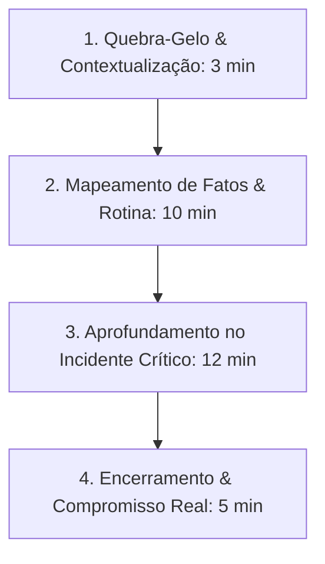

# Customer Discovery & Validator - Diretrizes Operacionais

Esta skill orienta a condução científica de pesquisas de mercado com clientes, estruturação de entrevistas de validação de hipóteses imunes a vieses (seguindo a metodologia *The Mom Test* de Rob Fitzpatrick), mapeamento de dores reais no *Product Discovery* e refinamento cirúrgico do Perfil de Cliente Ideal (ICP).

---

## 🎯 Quando Usar
- Antes de construir ou lançar um novo produto, funcionalidade ou posicionamento de mercado.
- Ao conduzir entrevistas de descoberta de problemas (*Problem Interviews*) com prospects frios.
- Ao validar propostas de solução (*Solution Interviews*) sem induzir respostas positivas falsas.
- Ao recrutar, agendar e orquestrar conversas de descoberta remotas ou presenciais.
- Ao transformar insights qualitativos e transcrições de entrevistas em matrizes acionáveis de ICP.
- Ao evitar o erro fatal de perguntar se as pessoas "comprariam sua ideia no futuro".

## 🚫 Quando NÃO Usar
- Para elaboração de personas criativas para conteúdo e mídias sociais (use `persona-icp`).
- Para análise estatística quantitativa de tráfego e comportamento em larga escala (use `data-web-ga4`).
- Para redação de discursos de vendas e reuniões comerciais ativas (use `vendas-metodologias-b2b`).

---

## 🤫 1. As 3 Regras de Ouro do "The Mom Test"

Pessoas mentem para proteger seus sentimentos ou porque são educadas. O *The Mom Test* estabelece perguntas imunes a opiniões falsas:

```
┌─────────────────────────────────────────────────────────────┐
│ Regra 1: Fale sobre a vida deles, NÃO sobre a sua ideia.    │
│ Regra 2: Pergunte sobre fatos PASSADOS, nunca promessas     │
│          de comportamento FUTURO.                           │
│ Regra 3: Fale menos e ouça mais (proporção 20/80).          │
└─────────────────────────────────────────────────────────────┘
```

### 1.1. Comparativo Prático de Perguntas

| Pergunta Ruim (Viés Garantido) | Pergunta "Mom Test" (Fatos & Evidências) | Por que a Pergunta Boa Funciona? |
|---|---|---|
| *"Você acha que usaria um software para gerenciar isso?"* | *"Como você resolve esse problema hoje na prática?"* | Revela o comportamento real e ferramentas atuais, sem promessas hipotéticas. |
| *"Quanto você pagaria por essa ferramenta?"* | *"Quanto você já gastou ou investiu no último ano tentando consertar isso?"* | Descobre se o cliente já aloca orçamento para a dor ou se é apenas uma queixa superficial. |
| *"Você gostaria se tivéssemos a funcionalidade X?"* | *"Quando foi a última vez que isso aconteceu? O que você fez logo em seguida?"* | Âncora a conversa em um episódio cronológico específico e verificável. |

---

## 🧭 2. O Roteiro de Entrevista em 4 Fases



### 2.1. O Teste do Compromisso Real (Skin in the Game)
Ao final de uma entrevista de validação, nunca peça apenas "feedback". Solicite uma destas 3 moedas de compromisso:
1. **Tempo**: Agendar 1 hora na próxima semana para testar o protótipo com os dados da empresa dele.
2. **Reputação**: Apresentar o fundador a um colega decisor ou ao diretor da área.
3. **Dinheiro**: Fazer uma carta de intenção (LOI), adiantamento ou pré-reserva com desconto.

---

## 🎯 3. Da Entrevista ao ICP Cirúrgico (ICP Matching)

```
Dados Qualitativos (Transcrições) ──> Extração de Verbatim (Dores em Citações Literais)
   ↓
Identificação de Padrões:
   • Quais características os entrevistados mais desesperados compartilham?
   • Qual o gatilho externo que torna a dor urgente (legislação, auditoria, demissão)?
   ↓
Scorecard de ICP: Matriz de Pontuação de Fit (0 a 100) para qualificação inbound/outbound.
```

---

---

## ✉️ 5. Modelos de Abordagem para Recrutamento de Entrevistados

Para recrutar tomadores de decisão corporativos sem parecer um vendedor:

### 5.1. Cold Outreach no LinkedIn (Taxa de Resposta Típica: 25% a 35%)
```text
"Olá [Nome], vi sua atuação como diretor de [Área] na [Empresa] e achei impressionante sua trajetória com [Projeto/Tópico].

Estamos conduzindo uma pesquisa setorial sem fins comerciais com lideranças do mercado sobre os maiores desafios operacionais na gestão de [Tema/Dor]. 

Não tenho nada para vender — estamos apenas mapeando os gargalos reais do setor. Você teria 15 minutos na próxima semana para uma conversa rápida de troca de insights? Se fizer sentido, posso compartilhar os achados anônimos do estudo com você depois."
```

### 5.2. Matriz de Tabulação de Insights de Entrevista
Ao transcrever as entrevistas, agrupe os apontamentos em 4 colunas de decisão:
1. **Dores Críticas (Top 3)**: Problemas que o entrevistado já tentou resolver ativamente nos últimos 6 meses.
2. **Workarounds Atuais**: Planilhas manuais, processos gambiarra ou ferramentas caras mal aproveitadas.
3. **Vocabulário Próprio (Verbatims)**: Termos e gírias exatas que o cliente usa para descrever a frustração (usar em copies futuras).
4. **Disposição para Próximo Passo**: Nível de compromisso oferecido ao final da chamada.

---

### 5.3. Checklist Pós-Entrevista (Síntese Imediata em 15 Minutos)
- [ ] Registrar as 3 maiores dores expressas de forma não provocada.
- [ ] Anotar os valores monetários ou de tempo perdidos citados pelo entrevistado.
- [ ] Validar se o perfil atende rigorosamente a todos os critérios eliminatórios do ICP.
- [ ] Enviar mensagem de agradecimento com 1 insight chave compartilhado pelo entrevistado.

---

## 📚 4. Biblioteca de Referências Operacionais

Consulte os guias práticos presentes na subpasta [`references/`](references/):

| Arquivo de Referência | Conteúdo Técnico & Casos Práticos |
|---|---|
| [`customer-discovery.md`](references/customer-discovery.md) | Playbook mestre de descoberta de clientes baseado na metodologia Customer Development de Steve Blank. |
| [`mom-test.md`](references/mom-test.md) | Guia prático de aplicação do The Mom Test: detecção de elogios falsos, perguntas de ouro e cadência. |
| [`problem-interview.md`](references/problem-interview.md) | Roteiro estruturado de entrevista focado exclusivamente no diagnóstico de dores e alternativas atuais. |
| [`solution-interview.md`](references/solution-interview.md) | Protocolo de teste de protótipos e apresentação de conceitos sem indução de viés positivo. |
| [`product-discovery.md`](references/product-discovery.md) | Práticas contínuas de descoberta de produto de Teresa Torres (Opportunity Solution Trees). |
| [`discovery-interviews-surveys.md`](references/discovery-interviews-surveys.md) | Metodologias avançadas de surveys, questionários de validação e entrevistas contínuas de produto. |
| [`design-sprint.md`](references/design-sprint.md) | Design Sprint de 5 dias (Google Ventures): do problema ao protótipo testado com 5 usuários. Veio de `site-interface-de-conversao` na R16b (é método de descoberta de produto). |

## Para onde foram os outros assuntos

- **Perfil de cliente ideal (ICP) e cruzamento de contas com o ICP:** skill [persona-icp](../persona-icp/SKILL.md).
- **Gravação remota de entrevista com qualidade de estúdio (técnica double-ender):** [remote-interview.md](../audiovisual-podcast-e-audio/references/remote-interview.md), em `audiovisual-podcast-e-audio`. O arquivo estava aqui, mas trata de gravação para podcast e mídia, não de entrevista de validação.
- O `interview-scheduler` (cronograma de entrevistas para contratar um engenheiro) foi arquivado em `.agent/skills/_arquivo/mescladas/r10-vendas/`.
