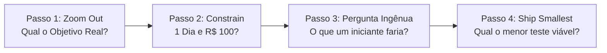

# When Stuck Protocol: Desbloqueio Tático de Campanhas e Projetos de Marketing

> **Skill:** [revenue-campanhas](../SKILL.md)  
> **Finalidade:** Desbloquear times, campanhas e tomadas de decisão paralisadas por sobrecarga de opções, perfeccionismo ou análise excessiva.

---

## 🛑 O Padrão de Bloqueio (The Stuckness Trap)

### Sintomas Comuns
- Reuniões intermináveis discutindo os mesmos pontos sem decisão tomada.
- Paralisia por análise: "Precisamos de mais dados antes de decidir".
- Perfeccionismo: Esperar o plano, copy ou funil "perfeito" antes de publicar.
- Complexidade excessiva: Ferramentas e variáveis demais impedem o primeiro passo.
- Desalinhamento da equipe: Discussão sobre canais e ferramentas em vez de foco no objetivo de negócio.

**Resultado:** Progresso zero, oportunidades de mercado perdidas e desgaste de energia da equipe.

---

## ⚡ O Protocolo de 4 Passos para Desbloqueio Imediato

---

### Passo 1: Zoom Out (Alavanca de Escopo)
**Pergunta Chave:** *"Qual é o OBJETIVO REAL deste projeto/campanha?"*

- **O Problema:** O time se perde em detalhes táticos (ex: qual software de automação usar, que cor de botão testar) e esquece o resultado de negócio pretendido.
- **Como Aplicar:**
  1. Interrompa imediatamente a discussão de ferramentas e táticas.
  2. Escreva o objetivo final mensurável em linguagem de negócios (ex: *"Conseguir 10 clientes para o novo serviço"* em vez de *"Montar um fluxo de 8 emails no Mautic"*).
  3. Questione: *"Se alcançássemos essa meta amanhã por mágica, como ela se pareceria?"*
  4. Reconecte apenas as táticas indispensáveis a esse objetivo central.

---

### Passo 2: Constrain (Alavanca de Recursos)
**Pergunta Chave:** *"O que faríamos se tivéssemos apenas 1 DIA e R$ 100 de orçamento?"*

- **O Problema:** O excesso de opções gera paralisia de escolha. A imposição de restrições radicais força a clareza e elimina desperdícios.
- **Como Aplicar:**
  1. Imagine uma limitação drástica de tempo (24 horas) e verba (mínimo indispensável).
  2. Liste o que seria feito nessas condições estritas.
  3. Esse plano reduzido é o seu **MVP da Campanha (Minimum Viable Plan)**.
  4. Execute esse plano enxuto primeiro; elabore sofisticações apenas com validação real do mercado.

---

### Passo 3: Pergunta Ingênua (Naïve Question)
**Pergunta Chave:** *"O que alguém completamente iniciante e leigo faria nessa situação?"*

- **O Problema:** Especialistas tendem a complicar processos simples e criar barreiras conceituais desnecessárias.
- **Como Aplicar:**
  1. Abandone jargões técnicos e sofisticações teóricas.
  2. Pergunte qual seria a ação mais óbvia e direta.
  3. Desafie as objeções do time: muitas vezes o que parece "simples demais" gera tração imediata enquanto funis complexos continuam no papel.
  - *Exemplo:* Em vez de passar 3 semanas montando um lead magnet de 40 páginas para captar emails, envie uma mensagem direta ou crie um post perguntando quem quer receber o modelo.

---

### Passo 4: Ship Smallest (Menor Validação de Hipótese)
**Pergunta Chave:** *"Qual é o teste ABSOLUTAMENTE MÍNIMO para validar nossa hipótese?"*

- **O Problema:** Construir uma solução gigantesca antes de saber se a audiência tem interesse real.
- **Como Aplicar:**
  1. Isole a hipótese única a ser testada (ex: *"Nossa audiência responde a vídeos curtos no LinkedIn"*).
  2. Defina o menor experimento possível para validar (ex: gravar 1 vídeo no celular hoje e postar em 2 horas).
  3. Publique hoje mesmo. Meça o sinal. Aprenda e só então escale o investimento.

---

## 🔍 Matriz de Diagnóstico de Bloqueio

| Tipo de Bloqueio | Sintoma Típico | Ação do Protocolo Recomendada |
| :--- | :--- | :--- |
| **Paralisia por Análise** | "Ainda faltam dados para escolher entre a opção A e B" | Rodar teste mínimo de 24h para coletar dados reais de mercado. |
| **Perfeccionismo** | "Ainda não está pronto, precisamos lapidar mais" | Aplicar a restrição de 1 dia: o que pode ser publicado até às 18h de hoje? |
| **Sobrecarga de Variáveis** | "São muitas frentes ao mesmo tempo, não sei por onde começar" | Fazer Zoom Out para o objetivo número 1 e cortar 80% das tarefas acessórias. |
| **Desalinhamento do Time** | "Cada integrante defende uma abordagem diferente" | A pergunta ingênua revela o caminho de menor atrito e consenso imediato. |
| **Excesso de Planejamento** | "Precisamos fechar a estratégia trimestral completa antes de agir" | Reduzir para a menor entrega validável nesta semana. |

---

## 🚫 Anti-Padrões a Evitar Quando Estiver Bloqueado

- ❌ *"Vamos marcar outra reunião amanhã para continuar debatendo."* → Tome a decisão no próprio call; ação imperfeita supera planejamento perfeito.
- ❌ *"Precisamos pesquisar o que os concorrentes internacionais estão fazendo antes de decidir."* → Valide seu mercado local com sua base real hoje.
- ❌ *"E se nós também adicionássemos X, Y e Z à campanha?"* → Restrinja o escopo, nunca expanda quando houver paralisia.
- ❌ *"Vamos esperar a aprovação final de todas as áreas antes de rodar o primeiro teste."* → Teste em escala micro com riscos controlados.

---

## ✅ Checklist de Desbloqueio Imediato

Se você ou a equipe responderem a estas 4 perguntas, estão automaticamente desbloqueados para agir:
- [ ] **Zoom Out:** O objetivo real e concreto de negócio está claro para todos?
- [ ] **Constrain:** Definimos qual é a versão de 1 dia e baixo orçamento?
- [ ] **Pergunta Ingênua:** Sabemos qual é a ação mais simples e óbvia que um iniciante tomaria?
- [ ] **Ship Smallest:** O menor teste possível está pronto para ser lançado nas próximas 24 horas?

> **Regra de Ouro:** *Ação supera análise. Entregue supera perfeito. Aprendizado com dados reais supera hipótese no papel.*
