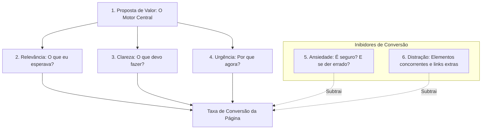

# CRO Page Auditor: Otimização Heurística de Conversão e Eliminação de Atrito

O **CRO Page Auditor** é a skill técnica dedicada à análise qualitativa, auditoria comportamental e otimização sistemática de páginas de destino (Landing Pages, Homepages, Páginas de Preços/Planos e Checkout). O objetivo central do CRO não é atrair mais tráfego, mas **extrair a máxima receita e leads qualificados do tráfego já existente**, identificando e removendo bloqueios cognitivos, fricção técnica e ansiedade do usuário.

---

## 1. O Modelo Heurístico LIFT (A Física da Conversão)

Criado por Chris Goward (WiderFunnel), o **Modelo LIFT** avalia seis fatores universais que determinam se um visitante converte ou abandona a página:

$$\text{Potencial de Conversão} = \text{Proposta de Valor} \times (\text{Relevância} + \text{Clareza} + \text{Urgência}) - (\text{Ansiedade} + \text{Distração})$$

### Os 6 Fatores em Detalhe:
1. **Proposta de Valor (Value Proposition):** O custo-benefício percebido. A resposta clara para: *"Por que devo comprar de você e não do concorrente ou não fazer nada?"*
2. **Relevância (Relevance):** Congruência entre o criativo/anúncio de origem e a primeira dobra da página (*Message Match* visual e textual).
3. **Clareza (Clarity):** Hierarquia visual limpa, tipografia legível e contraste evidente no botão de ação principal.
4. **Urgência (Urgency):** Razões legítimas para agir hoje (vagas limitadas, bônus temporal, prazo real).
5. **Ansiedade (Anxiety):** Dúvidas sobre segurança, medo de spam, falta de clareza sobre cancelamento ou termos ocultos.
6. **Distração (Distraction):** Menus de navegação extensos, links para redes sociais no topo, animações gratuitas que desviam os olhos do CTA.

---

## 2. Otimização de Formulários (Form CRO)

Formulários são o ponto crítico de atrito em B2B e geração de leads. Cada elemento desnecessário reduz a conversão:

### Heurísticas Fundamentais de Formulário
- **A Regra do Campo Essencial:** Para cada campo solicitado, pergunte: *"O time comercial ou o sistema realmente precisa desse dado no primeiro contato?"* Reduzir de 7 para 4 campos frequentemente eleva a conversão em **20% a 35%**.
- **Validação em Tempo Real (Inline Validation):** Forneça feedback instantâneo enquanto o usuário digita (ícones verdes de confirmação e mensagens de erro específicas e amigáveis ao lado do campo). Não espere o clique no botão "Enviar" para acusar erro genérico no topo.
- **Formulários Multi-Etapas (Multi-Step Forms):** Para cadastros complexos, divida em 2 ou 3 passos lógicos aplicando o princípio psicológico do *"Pé na Porta"* (Foot-in-the-Door).
  - *Passo 1 (Fácil):* Pergunta de preferência ou objetivo de negócio (sem pedir dados pessoais).
  - *Passo 2:* Nome e Empresa.
  - *Passo 3:* Email corporativo e telefone para envio do resultado/diagnóstico.
- **Máscaras Dinâmicas:** Aplique máscaras automáticas para Telefone/WhatsApp, CPF/CNPJ e CEP para evitar erros de digitação.

---

## 3. Popups e Modais Estratégicos (Exit-Intent)

Popups mal configurados enfurecem os visitantes e aumentam a taxa de rejeição. Popups de alta conversão operam sob regras estritas de intenção:

| Tipo de Disparo | Quando Disparar | Casos de Uso Recomendados | Cuidados Obrigatórios |
| :--- | :--- | :--- | :--- |
| **Intenção de Saída (Exit-Intent)** | Quando o cursor do mouse se move em direção à barra de abas/fechar (desktop). | Oferta especial de última chance, convite para newsletter ou calculadora gratuita. | Não disparar se o usuário já converteu ou se preencheu o formulário da página. |
| **Profundidade de Rolagem (Scroll-Triggered)** | Quando o leitor ultrapassa **60% da página** de um artigo ou case de estudo. | Download de checklist complementar, material rico em PDF ou inscrição no canal. | Não cobrir o texto inteiro; usar caixas laterais flutuantes (*Slide-in*). |
| **Atraso Temporal (Time Delay)** | Após no mínimo **30 a 45 segundos** de permanência ativa na página. | Assistência de chat proativo ou tirar dúvidas frequentes. | Proibido disparar antes de 10 segundos de visita. |

> [!WARNING]
> **Mobile Interstitials Penalty:** O Google penaliza páginas mobile que exibem popups invasivos cobrindo o conteúdo logo na aterrissagem. Em dispositivos móveis, utilize apenas banners discretos no rodapé (*Sticky Footers*) com botão de fechar acessível.

---

## 4. Otimização de Fluxos de Cadastro (Signup Flow CRO)

Para produtos SaaS, aplicativos e plataformas digitais:

1. **Elimine a Repetição de Senha:** Substitua o campo "Confirmar Senha" por um ícone de olho (*Show/Hide Password*). Isso reduz erros de digitação e atrito mobile em 15%.
2. **Social Login em 1 Clique:** Ofereça autenticação com Google e Apple/Microsoft. Mais de 50% dos usuários mobile preferem login social para não criar nova senha.
3. **Onboarding Imediato com Ativação Tardia:** Permita que o usuário explore o ambiente do produto imediatamente após o cadastro antes de exigir a confirmação de link por email (*Email Verification Wall*).

---

## 5. Benchmarks de Elementos de Conversão

> **Ordem de grandeza, sem fonte primária.** Tabela única e comentada em [element-benchmarks.md](references/element-benchmarks.md). Não prometa ganho exato ao cliente: use faixas.

| Elemento da Página | Benchmark Típico de Mercado | Meta de Alta Conversão (Top 10%) | Alavanca de Otimização |
| :--- | :---: | :---: | :--- |
| **Botão de CTA Primário** | CTR de $1.2\% \text{ a } 2.0\%$ | **$\ge 3.5\%$** | Contraste de cor isolado, texto focado em benefício (*"Começar Gratuitamente"* vs *"Cadastrar"*). |
| **Primeira Dobra (Hero Section)** | Dwell Time de 8s a 15s | **$\ge 25\text{s}$** | Headline direta sem abstrações, imagem real do produto em uso e subtítulo esclarecedor. |
| **Página de Preços / Tabela** | Visualização $\rightarrow$ Checkout: $4\%$ | **$\ge 8.5\%$** | Destaque visual do plano mais popular (*Most Popular Badge*), toggle Mensal/Anual com desconto claro. |
| **Taxa de Conversão de Formulário** | $8\% \text{ a } 12\%$ | **$\ge 22\%$** | Redução de campos, etiquetas flutuantes e micro-cópia de segurança (*"Sem spam. Cancele quando quiser."*). |

---

## 6. Checklist de Auditoria Heurística de CRO em 15 Pontos

Ao auditar uma Landing Page com baixa conversão:

- [ ] **Velocidade de Carregamento:** O LCP (*Largest Contentful Paint*) ocorre em menos de **2.5 segundos** no mobile?
- [ ] **Clareza do H1:** O visitante consegue entender o que a empresa faz nos primeiros **5 segundos** de leitura?
- [ ] **CTA Visível sem Rolar (Above the Fold):** Existe um botão de ação com alto contraste visível na tela inicial?
- [ ] **Hierarquia de Cores:** A cor do botão primário de conversão é exclusiva (não é utilizada em títulos comuns ou fundos)?
- [ ] **Eliminação de Menus Distratores:** A Landing Page removeu o menu de navegação institucional superior (*Leak Removal*)?
- [ ] **Prova Social Relevante:** Os depoimentos contêm nomes reais, fotos, cargos, empresas e métricas quantificáveis de resultado?
- [ ] **Sinais de Confiança e Segurança:** Selos de criptografia SSL, garantias incondicionais e conformidade visíveis próximos ao formulário?
- [ ] **Congruência de Mensagem (Message Match):** A promessa do anúncio ou link de origem bate 100% com o título e subtítulo da página?
- [ ] **Legibilidade Mobile:** A fonte de leitura do corpo de texto possui tamanho mínimo de 16px com espaçamento entre linhas (line-height) adequado ($\ge 1.5$)?
- [ ] **Alvos de Toque (Tap Targets):** Os botões e links interativos no mobile possuem área clicável de 48x48px (44px é o mínimo aceitável)?
- [ ] **Clareza de Microcópia no Botão:** O botão comunica o benefício específico da ação em vez de termos genéricos como "Enviar" ou "Clique aqui"?
- [ ] **Direcionamento Visual (Directional Cues):** Há elementos visuais sutis (olhar de pessoas na foto, setas, linhas) guiando a atenção para o CTA?
- [ ] **Eliminação de Jargões Excessivos:** O texto usa vocabulário centrado na dor e no linguajar cotidiano do cliente, sem termos corporativos vagos?
- [ ] **Garantia de Reversibilidade do Risco:** A página explicita garantias de satisfação, cancelamento sem multa ou período de teste sem compromisso?

---

## 7. Qual abrir primeiro

Os guias estão em [`references/`](references/). Texto base em inglês. Cinco métodos de auditoria convivem de propósito, cada um com saída diferente; escolha pelo que você precisa entregar:

| Preciso de... | Abra |
|---|---|
| **Auditoria completa com nota** (6 seções com peso, reescrita de título, matriz impacto × esforço) | [homepage-audit.md](references/homepage-audit.md) |
| **Página de campanha:** anúncio × página, nota /100, matadores | [landing-page-audit.md](references/landing-page-audit.md) |
| **Método de 7 dimensões e ideias de experimento** por tipo de página | [page-cro.md](references/page-cro.md) |
| **Checklist longo** com benchmarks por tipo de página | [cro-checklist-master.md](references/cro-checklist-master.md) |
| **Checagem rápida** | o checklist de 15 pontos da seção 6 deste arquivo |

### Números de referência
- [element-benchmarks.md](references/element-benchmarks.md): **tabela única** de números por elemento (velocidade, título, CTA, formulário, confiança, imagem, preço, amostra de teste).

### Formulários, popups e cadastro (dois guias de cada, que se completam)
O "-cro" é o método de trabalho (princípios, campo a campo, gatilhos e regras); o outro traz benchmarks, modelos e medidas.
- Formulário: [form-cro.md](references/form-cro.md) (método) e [form-optimization-guide.md](references/form-optimization-guide.md) (benchmarks e modelos).
- Popups e modais: [popup-cro.md](references/popup-cro.md) e [popup-best-practices.md](references/popup-best-practices.md). Valores únicos do hub: tempo 30 a 45 s (nunca antes de 10 s), rolagem 50 a 60%, sem intersticial no celular, recusa neutra.
- Cadastro e registro: [signup-flow-cro.md](references/signup-flow-cro.md) e [signup-optimization-guide.md](references/signup-optimization-guide.md).

## Para onde foram os outros assuntos

- **Funis de vendas de Russell Brunson (`dotcom-secrets-funnels`):** skill [copy-metodos-classicos](../copy-metodos-classicos/SKILL.md).
- **Gatilhos mentais (Cialdini, vieses):** [revenue-psicologia](../revenue-psicologia/SKILL.md). **Priorização ICE/PIE e teste A/B:** [growth-testes-ab](../growth-testes-ab/SKILL.md).
- Arquivados em `.agent/skills/_arquivo/mescladas/r16b-design/cro-page-auditor/`: `cro.md` (comando do kit), `conversion-optimization.md`, `conversion-principles.md` e os dois `*-google-and-meta-landing-page-audit.md` (fundidos em `landing-page-audit.md`).
