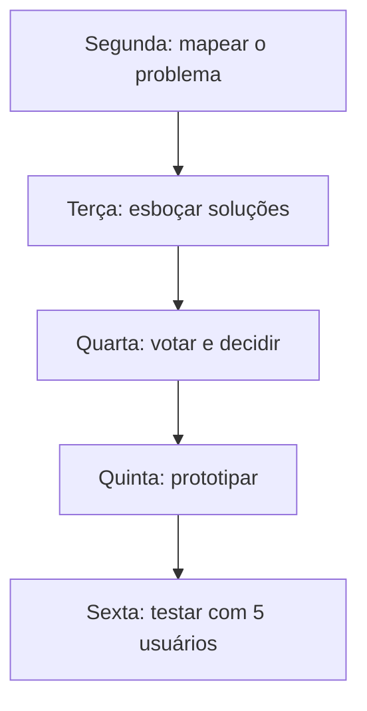

# UI & UX Conversion Designer

Orienta o design de interfaces elegantes, funcionais e orientadas a conversão: princípios visuais, acessibilidade e celular. A identidade da marca (`_brands/<marca>/style-guide.md`, e `design-system/tokens.json` quando existir) **vence** qualquer regra genérica daqui.

## Quando usar

- Ao desenhar uma landing page, página de captura ou interface de produto web com foco em conversão.
- Ao definir hierarquia visual, paleta com contraste, escala tipográfica e espaçamento de uma página.
- Ao revisar um layout contra o checklist de acessibilidade e celular (seção 3).
- Ao conduzir um Design Sprint (guia abaixo).

## Quando NÃO usar

Ver a descrição no cabeçalho. Resumo: estrutura e URLs do site → [site-arquitetura](../site-arquitetura/SKILL.md); auditoria de conversão → [site-cro](../site-cro/SKILL.md); copy → [copy-landing-page](../copy-landing-page/SKILL.md); marca → [brand-visual-direction](../brand-visual-direction/SKILL.md) e [brand-design-system](../brand-design-system/SKILL.md); código → [site-tailwind-design-system](../site-tailwind-design-system/SKILL.md).

## 1. Princípios do design de conversão

```
1. Hierarquia estrita: um foco primário por tela
2. Contraste WCAG AA: 4,5:1 para texto normal; 3:1 para texto grande, componentes e CTAs
3. Layouts modulares com espaçamento consistente (grade de 8 pontos)
4. Micro-interações curtas: hover, foco e transições até 200 ms
5. Escala tipográfica modular (razão 1,25)
```

**Cor 60-30-10:** 60% base, 30% estrutura (cartões, bordas, texto secundário), 10% acento reservado **exclusivamente** a CTA, links críticos e alertas.

## 2. Design Sprint em 5 dias



Regra dos 5 usuários (Jakob Nielsen): testar com 5 pessoas representativas encontra a maioria dos problemas graves de usabilidade. Roteiro completo em [design-sprint.md](../persona-descoberta-de-clientes/references/design-sprint.md) (skill `persona-descoberta-de-clientes`).

## 3. Checklist de acessibilidade e celular (WCAG AA)

Antes de aprovar qualquer layout:

- [ ] **Contraste:** texto normal ≥ 4,5:1; texto grande (≥ 24 px, ou ≥ 18,66 px em negrito) e elementos gráficos ≥ 3:1
- [ ] **Alvos de toque: 48 × 48 px** (44 px é o mínimo aceitável) e 8 px entre alvos
- [ ] **Títulos semânticos:** um só `<h1>` por página, sem pular níveis
- [ ] **Foco visível** (`:focus-visible`) em todo elemento interativo
- [ ] **Sem rolagem horizontal** em 375, 768, 1024 e 1440 px
- [ ] **Corpo de texto ≥ 16 px** no celular, com linha de 1,5 a 1,6

**Tokens (CSS/Tailwind):** cores em variáveis (`--color-primary`, `--color-surface`, `--color-accent`); espaçamento em degraus de 4 px (4, 8, 12, 16, 24, 32, 48, 64); raio de 8 px em cartões e campos, 9999 px em botões de ação e tags. Se a marca tem `tokens.json`, use os valores dela.

## 4. Guias por pergunta

Em [`references/`](references/). Texto base em inglês, exceto onde indicado.

### Desenhar a página
- [principios-de-pagina-de-conversao.md](references/principios-de-pagina-de-conversao.md) (português) — Anatomia da LP, hierarquia, cor, tipografia, espaço, componentes, movimento, celular e acessibilidade, num só lugar.
- [ai-design-workflows-2026.md](references/ai-design-workflows-2026.md) (português) — Geração de interface com IA (v0, aura.build) e "vibe design".

### Planejar e testar uma ideia
- [design-sprint.md](../persona-descoberta-de-clientes/references/design-sprint.md) — Método de 5 dias do Google Ventures: roteiro diário e dinâmicas (guia na skill `persona-descoberta-de-clientes`, onde moram os métodos de descoberta).

### Direção visual e tendências
- [design-trends-2026.md](../brand-visual-direction/references/design-trends-2026.md) — Tendências de design gráfico de 2026 (movida para a skill `brand-visual-direction`, onde serve à direção visual de marca).

## Para onde foram os outros assuntos

- **Arquitetura de site** (mapa, URLs, navegação, links internos, modelos por tipo de site, diagramas Mermaid): skill [site-arquitetura](../site-arquitetura/SKILL.md).
- **Trechos de HTML com Tailwind** para páginas de marketing: [tailwind-patterns.md](../site-tailwind-design-system/references/tailwind-patterns.md), na skill `site-tailwind-design-system`.
- **Identidade visual de marca:** [brand-visual-direction](../brand-visual-direction/SKILL.md) e [brand-design-system](../brand-design-system/SKILL.md).
- **Para construir a página inteira** (marca, copy, design, código, teste): workflow [site-construcao-de-landing-page](../../workflows/site-construcao-de-landing-page.md).
- Arquivados em `.agent/skills/_arquivo/mescladas/`: `visual-identity`, `data-visualizer`, `hooks-guide` e um post de LinkedIn em vietnamita (`r13-cro/`); `frontend-design.md` e `ui-ux-pro-max.md` (fundidos em `principios-de-pagina-de-conversao.md`, em `r16b-design/`).
- **Animação e vídeo em Remotion:** a skill `remotion` vive no projeto de edição de vídeo (`Compartilhado/Edição de Vídeo com IA`).
