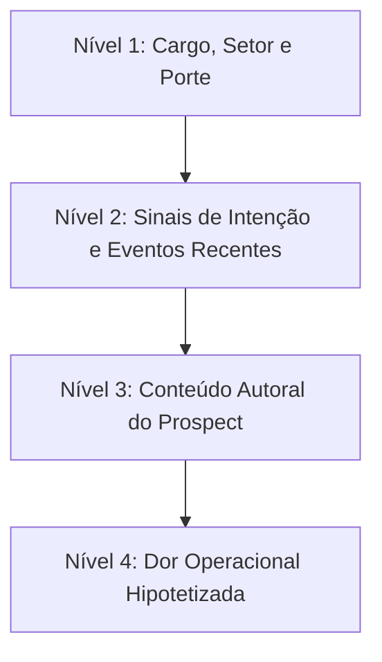

# Cold Outreach Specialist: Prospecção Ativa B2B de Alta Resposta

O **Cold Outreach Specialist** é a skill técnica dedicada ao planejamento, redação e estruturação de cadências de prospecção fria (*Cold Email*) para o mercado corporativo (B2B, Enterprise e Mid-Market). Em um cenário saturado de automações genéricas e filtros corporativos agressivos, esta skill prioriza **relevância contextual, concisão extrema e foco no interesse do tomador de decisão**, transformando contatos frios em conversas comerciais qualificadas.

---

## 1. Princípios e Heurísticas de Cold Outreach

1. **Relevância Supera Personalização Cosmética:** Inserir `{{first_name}}` ou mencionar a faculdade em que o lead se formou há 15 anos é visto como manipulação rasa. Personalização real é falar sobre a **dor específica que o cargo dele enfrenta esta semana**.
2. **A Regra das 75 a 125 Palavras:** Executivos C-Level e Diretores leem emails pelo smartphone entre reuniões. Emails com mais de 150 palavras são arquivados ou deletados sem leitura.
3. **Interest CTA Vence Time CTA:** Nunca peça "30 minutos na agenda" no primeiro contato. O atrito de compromisso de tempo é gigantesco. Peça interesse conceitual (*"Vale a pena te enviar um vídeo de 2 minutos mostrando como fizemos isso?"*).
4. **Proibição Absoluta de Passivo-Agressividade:** Frases como *"Sei que você está muito ocupado, mas..."* ou *"Imagino que você tenha ignorado meu email anterior..."* destroem a autoridade e geram antipatia imediata. O follow-up deve sempre **agregar um novo ângulo de valor**.

---

## 2. Taxonomia de Personalização em 4 Níveis

Para escalar a prospecção sem perder a autenticidade humana, estruture a personalização em camadas:



| Nível de Personalização | O que Pesquisar / Gatilho | Exemplo Prático de Gancho (Icebreaker) | Escalabilidade |
| :--- | :--- | :--- | :---: |
| **Nível 1: Firmográfico** | Indústria, número de funcionários e tecnologia instalada (via Wappalyzer/BuiltWith). | *"Notei que a [Empresa] utiliza o Salesforce para gerenciar uma equipe de mais de 50 vendedores..."* | Alta (100% automatizável) |
| **Nível 2: Sinais de Intenção (Triggers)** | Vagas abertas recentes, captação de rodada de investimento ou expansão geográfica. | *"Vi que vocês abriram 4 vagas para executivos de contas enterprise no último mês..."* | Alta a Média (via Apollo/LinkedIn) |
| **Nível 3: Conteúdo Autoral** | Post técnico recente no LinkedIn, participação em podcast ou palestra do lead. | *"Li seu post de terça sobre a dificuldade de retenção no onboarding de novos clientes B2B..."* | Média (Semi-manual) |
| **Nível 4: Dor Operacional Específica** | Gargalo mensurável típico do momento atual da empresa. | *"Com a equipe de CS crescendo 3x, normalmente o tempo de primeira resposta ao cliente sobe para 4 horas..."* | Alta para nichos verticais |

---

## 3. Anatomia do Cold Email Perfeito em 4 Blocos

O template estrutural deve ser enxuto e cumprir 4 funções obrigatórias:

```markdown
[BLOCO 1: O GANCHO / ICEBREAKER - 1 a 2 linhas]
Conecte diretamente à realidade do lead sem rodeios ou apresentações genéricas.
Ex: "Notei que sua equipe está expandindo a operação de vendas outbound este trimestre."

[BLOCO 2: O PROBLEMA & MECANISMO - 2 a 3 linhas]
Descreva a dor oculta e o mecanismo que sua empresa utiliza para resolvê-la.
Ex: "Muitos VPs de Vendas no setor de SaaS percebem que os SDRs gastam 40% do dia pesquisando
dados em vez de falar com clientes qualificados."

[BLOCO 3: A PROVA SOCIAL CIRÚRGICA - 1 linha]
Cite um cliente similar ou métrica concreta de resultado.
Ex: "Desenvolvemos um fluxo que reduziu esse tempo para 10 minutos na [Empresa Similar],
gerando 35% mais reuniões agendadas no primeiro mês."

[BLOCO 4: O CTA DE BAIXO ATRITO - 1 linha]
Uma pergunta simples de 'sim' ou 'não' baseada em interesse.
Ex: "Faria sentido te enviar um resumo de 2 minutos mostrando como fizemos isso?"
```

---

## 4. Cadência de Follow-Up em 4 Toques

Estudos comprovam que **70%+ das respostas em outbound acontecem entre o segundo e o quarto toque**. A cadência ideal combina intervalos estratégicos e novos ângulos de valor:

| Toque | Janela Temporal | Ângulo da Mensagem | Objetivo Tático |
| :---: | :---: | :--- | :--- |
| **Toque 1** | Dia 1 | O email inicial estruturado em 4 blocos. | Apresentar o problema e testar o interesse inicial. |
| **Toque 2** | Dia 4 (+3 dias) | **O Novo Ângulo / Caso Prático:** *"Esqueci de mencionar um detalhe: a Empresa X tinha a mesma dúvida sobre integração com o CRM legado e resolveu em 48h..."* | Eliminar a objeção mais comum sem pressionar. |
| **Toque 3** | Dia 8 (+4 dias) | **O Ativo de Valor:** *"Produzi uma planilha com os benchmarks de produtividade de SDRs para 2026. Achei que poderia ser útil para o seu planejamento trimestral [Link curto]."* | Entregar valor gratuito e construir reciprocidade. |
| **Toque 4** | Dia 14 (+6 dias) | **O Breakup Elegante:** *"Presumo que este projeto não seja prioridade para vocês agora, e não quero encher sua caixa. Se fizer sentido conversar no futuro, basta me avisar por aqui. Sucesso na operação!"* | Disparar o gatilho de perda (FOMO). Costuma ser o email com maior taxa de resposta. |

---

## 5. Regras de Ouro de Infraestrutura e Proteção Anti-Spam

- **Caixas Secundárias Dedicadas:** Nunca envie prospecção fria a partir do seu domínio principal (`suaempresa.com.br`). Registre domínios irmãos (`suaempresa.io`, `getsuaempresa.com`, `usesuaempresa.com`) e redirecione o tráfego web para o domínio principal.
- **Teto Rigoroso de Envios:** Limite o envio a no máximo **30 a 50 emails por caixa/dia**, com intervalo aleatório de 3 a 8 minutos entre disparos.
- **Proibição de Links no Primeiro Toque:** Evite links, imagens pesadas, anexos e assinaturas corporativas cheias de HTML no primeiro email. Isso previne que o algoritmo do Google Workspace/Outlook classifique a mensagem como promocional.

---

## 6. Checklist de Validação Pré-Disparo de Campanha Outbound

Antes de iniciar os disparos de uma sequência no Apollo, Smartlead ou Instantly:

- [ ] **Limpeza da Lista:** A base de emails passou por um verificador (NeverBounce, Zerobounce ou similar) com taxa de rejeição estimada $< 2\%$?
- [ ] **Contagem de Palavras:** O corpo do email tem entre 75 e 120 palavras?
- [ ] **Leitura Mobile:** A mensagem cabe em uma única tela de smartphone sem necessidade de rolagem?
- [ ] **Aderência ao Tom Humano (Anti-Slop):** O texto soa como uma mensagem escrita por um profissional sênior para outro profissional sênior?
- [ ] **CTA de Baixo Atrito:** O fechamento convida a uma conversa de baixo compromisso em vez de forçar um agendamento imediato?

---

## 7. Catálogo de Referências Técnicas Integradas

Esta skill preserva e se apoia nos guias especializados contidos na subpasta [`references/`](references/):

| Arquivo de Referência | Conteúdo Técnico & Casos Práticos |
| :--- | :--- |
| [`cold-email.md`](references/cold-email.md) | Princípios fundamentais de cold email, fórmulas de ganchos e modelos de abordagem B2B. |
| [`cold-outreach-sequence.md`](references/cold-outreach-sequence.md) | Playbook de estruturação de sequências completas de outbound multitoque. |
| [`outbound-sequencer.md`](references/outbound-sequencer.md) | Mapeamento de regras de transição de status, cadências multicanal (Email + LinkedIn) e automações. |
| [`follow-up-sequences.md`](references/follow-up-sequences.md) | Biblioteca de roteiros de follow-up para contatos que abriram e não responderam. |
| [`personalization.md`](references/personalization.md) | Metodologia para personalização dinâmica em escala através de variáveis contextuais. |

## Outras referências

- **[benchmarks.md](references/benchmarks.md)** — Taxas de resposta, reuniões marcadas, funil realista e erros comuns de e-mail frio (veio de `email-copy`).
- **[frameworks.md](references/frameworks.md)** — Fórmulas de redação de e-mail frio: PAS, BAB, AIDA, Mouse Trap e outras (veio de `email-copy`).
- **[subject-lines.md](references/subject-lines.md)** — Dados de assunto para e-mail frio: 2 a 4 palavras, minúsculas, camuflagem interna (veio de `email-copy`).

## Antes do primeiro e-mail

Achar decisores, montar e enriquecer a lista, verificar e-mails e monitorar sinais de compra (Apollo, `buying-signals-monitoring`, `lead-gen-scraper`) ficam na skill [vendas-prospeccao-de-leads](../vendas-prospeccao-de-leads/SKILL.md) desde 2026-10-20.

## Relacionadas

- SDR de voz (agente que liga e qualifica leads por telefone): `audiovisual-agentes-de-voz`.
