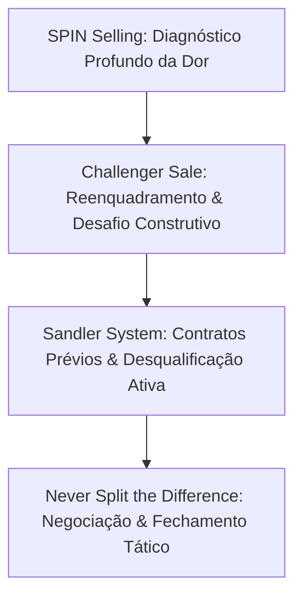

# B2B Sales Methodologies - Diretrizes Operacionais

Esta skill orienta a condução científica de ciclos de vendas consultivas B2B de alto ticket, aplicando as 4 metodologias mais comprovadas do mercado para qualificar, diagnosticar dor, desafiar o status quo do cliente e conduzir negociações de alto impacto.

---

## 🎯 Quando Usar
- Em vendas consultivas complexas envolvendo múltiplos tomadores de decisão (comitês de compra).
- Ao estruturar roteiros de diagnóstico e reuniões de descoberta focadas em implicações financeiras.
- Ao treinar executivos de contas (AEs) e SDRs para desafiarem construtivamente as premissas do prospect.
- Ao conduzir negociações duras de preço, escopo e termos contratuais com compras/procurement.
- Ao estruturar a narrativa comercial e pitches executivos de vendas corporativas.

## 🚫 Quando NÃO Usar
- Para automação técnica de pipeline, pontuação de leads ou higiene de CRM (use `vendas-pipeline`).
- Para redação de cold emails e sequências de prospecção fria (use `vendas-cold-email`).
- Para copywriting de páginas de vendas e landing pages (use `copy-conversao` ou `copy-landing-page`).

---

## 🧭 1. As 4 Metodologias Mestras de Vendas B2B



---

## ⚔️ 2. The Challenger Sale (Ensinar, Adaptar, Assumir o Controle)

### 2.1. O Perfil do Vendedor Challenger
Diferente do *Relationship Builder* (que foca em agradar), o *Challenger*:
1. **Ensina para Diferenciação (Teach for Differentiation)**: Entrega insights de negócio que revelam pontos cegos operacionais e custos ocultos.
2. **Adapta para Ressonância (Tailor for Resonance)**: Conecta o impacto econômico à dor específica de cada membro do comitê (CFO foca em fluxo de caixa, CMO em ROAS, CIO em conformidade).
3. **Assume o Controle (Take Control)**: Lidera a conversa sobre preço e ritmo da negociação sem recuar diante de pressão.

### 2.2. A Coreografia de Reenquadramento Comercial (Commercial Choreography)
```
1. The Warmer: Demonstrar compreensão empática do cenário da indústria do cliente.
2. The Reframe: Conectar a dor superficial a uma causa raiz oculta e mais destrutiva.
3. Rational Drowning: Quantificar financeiramente o custo do erro e da inação.
4. Emotional Impact: Mostrar o impacto diário e pessoal do problema na liderança.
5. A New Way: Apresentar a categoria de solução necessária (sem citar seu produto ainda).
6. Our Solution: Demonstrar como suas capacidades proprietárias resolvem o problema.
```

---

## 🔍 3. SPIN Selling: A Engenharia de Perguntas de Alto Impacto

| Tipo de Pergunta | Objetivo Tático | Exemplo de Aplicação Prática |
|---|---|---|
| **S - Situação** | Mapear contexto básico sem entediar o prospect (usar pesquisa prévia). | *"Como está estruturada hoje a integração entre o CRM e a mensuração de mídia?"* |
| **P - Problema** | Identificar insatisfações explícitas e atritos operacionais atuais. | *"Quais gargalos seu time enfrenta na atribuição de leads originados no Meta Ads?"* |
| **I - Implicação** | Expandir a dor: mostrar quanto o problema custa em dinheiro, tempo e risco. | *"Se 25% dos leads continuarem não atribuídos, qual o impacto no budget aprovado pelo conselho?"* |
| **N - Necessidade de Solução** | Fazer o cliente articular o valor e os benefícios da resolução. | *"Como ajudaria seu time se a conciliação de receita ocorresse em tempo real no dashboard?"* |

---

## ⚓ 4. Sandler Selling System: Contratos Prévios e Controle

### 4.1. Up-Front Contracts (UFC)
Nunca inicie uma reunião sem pactuar um contrato prévio de 4 partes:
1. **Tempo**: *"Temos 30 minutos agendados hoje. Esse tempo ainda está de pé?"*
2. **Objetivo do Cliente**: *"Quais as principais dúvidas que você quer ver sanadas hoje?"*
3. **Objetivo do Vendedor**: *"Vou fazer algumas perguntas para entender se realmente faz sentido trabalharmos juntos."*
4. **Desfecho Claro**: *"No final dos 30 min, combinamos que se não fizer sentido, podemos dizer 'não' abertamente sem constrangimento; e se fizer, combinamos o próximo passo exato. Combinado?"*

---

## 🧠 5. Never Split the Difference (Negociação Tática de Chris Voss)

### 5.1. Ferramentas Táticas de Empatia e Fechamento
- **Espelhamento (Mirroring)**: Repetir as últimas 3 palavras (ou a palavra mais crítica) com tom inquisitivo para induzir elaboração espontânea.
- **Rotulagem Emocional (Labeling)**: Nomear a hesitação ou medo do cliente (*"Parece que você está preocupado com o prazo de implementação..."*).
- **Perguntas Calibradas (Como / O que)**: Substituir perguntas fechadas por *“Como posso fazer isso funcionar dentro das restrições atuais da sua diretoria?”*.
- **Desarmar a Acusação (Accusation Audit)**: Antecipar e listar todas as queixas antes que o cliente as faça (*"Você vai achar que nosso preço é o mais alto do mercado e que nossa implantação exige muito do time..."*).

---

---

## 💬 6. Roteiro Prático de Abertura de Reunião (Challenger + Sandler)

### 6.1. Script de Entrada (Primeiros 3 Minutos)
```text
"Olá [Nome], obrigado pelo tempo hoje. Antes de abrirmos qualquer apresentação, temos 30 minutos agendados. Nosso tempo continua de pé? 

Perfeito. Nas nossas conversas com outros diretores de [Indústria], temos visto que muitos estão enfrentando [Dor Oculta / Causa Raiz], o que geralmente drena de 15% a 30% da margem operacional sem que a equipe perceba de imediato.

Meu objetivo hoje não é empurrar software, e sim entender se vocês também estão vivenciando essa mesma dinâmica. Se ao final da conversa percebermos que não somos o parceiro ideal para vocês, podemos encerrar por aqui sem nenhum constrangimento; e se fizer sentido, combinamos uma validação técnica mais profunda. Parece justo?"
```

### 6.2. Matriz de Resposta Tática a Objeções de Fechamento

| Objeção do Cliente | Diagnóstico Subjacente | Resposta Calibrada (Never Split the Difference) |
|---|---|---|
| *"Seu preço está muito acima do orçamento da diretoria."* | Medo de assumir risco pessoal pelo investimento. | *"Parece que o valor surpreendeu você. O que exatamente nós precisaríamos ajustar no escopo para viabilizar isso dentro do conselho?"* |
| *"Precisamos pensar internamente e te avisamos semana que vem."* | Falta de urgência ou hesitação não expressa. | *"Geralmente quando me dizem isso, significa que a solução não convenceu totalmente ou que existe outro impedimento. O que ficou faltando para você se sentir 100% seguro?"* |
| *"Nosso fornecedor atual faz basicamente a mesma coisa."* | Comodismo com o status quo. | *"Como vocês estão medindo hoje o impacto das discrepâncias de mensuração que o sistema atual não captura?"* |

---

## 📚 6. Biblioteca de Referências Operacionais

Consulte os guias aprofundados na subpasta [`references/`](references/):

| Arquivo de Referência | Conteúdo Técnico & Casos Práticos |
|---|---|
| [`challenger-sale.md`](references/challenger-sale.md) | Playbook integral do Challenger Sale: coreografia em 6 passos, perfis de clientes e scripts de reenquadramento. |
| [`spin-selling.md`](references/spin-selling.md) | Manual mestre de perguntas de implicação, cálculo de custo de inação e esteiras de diagnóstico consultivo. |
| [`sandler-system.md`](references/sandler-system.md) | Técnicas do Sandler Submarine: dor profunda, orçamento, processo de decisão e reversão de papéis. |
| [`never-split-difference.md`](references/never-split-difference.md) | Roteiro de negociação de Chris Voss: Black Swans, âncoras extremas de preço, calibração e auditoria de acusação. |
| [`sales-narrative.md`](references/sales-narrative.md) | Storytelling comercial B2B: estrutura de apresentação de vendas para conselho e comitê executivo. |
