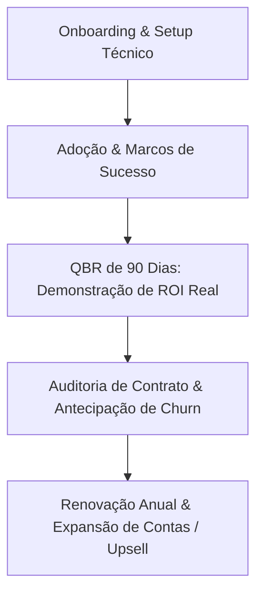

# Sales Pipeline Orchestrator - Diretrizes Operacionais

Esta skill orienta a gestão sistemática do funil de vendas B2B, governança de dados no CRM, frameworks de qualificação para contas enterprise (MEDDIC/BANT), modelos preditivos de fechamento (Forecasting), auditoria de riscos em negócios abertos e alinhamento de RevOps. QBR e renovações contratuais ficam com `growth-retencao-e-churn`.

---

## 🎯 Quando Usar
- Ao estruturar ou auditar critérios de passagem entre estágios do pipeline no CRM.
- Ao aplicar scorecards formais de qualificação MEDDIC em negócios complexos ou BANT em vendas transacionais.
- Ao calcular previsões de receita ponderadas (Commit vs. Best Case vs. Pipeline Coverage).
- Ao mapear e mitigar riscos de negócios estagnados no funil (*Deal Risk Scoring*).
- Ao modelar planos de comissão e cenários de remuneração de vendas (OTE, aceleradores, cota).
- Ao preparar uma reunião comercial ou de descoberta (agenda por tipo de call, perguntas de diagnóstico, briefing).
- Ao definir a passagem de Vendas para Sucesso do Cliente, registrar um negócio perdido ou montar os indicadores de vendas.

## 🚫 Quando NÃO Usar
- Para deck, case de sucesso, depoimento, script de demo, mapa de objeções e resposta a RFP (use `vendas-materiais-de-venda`).
- Para QBR e renovação de contrato (use `growth-retencao-e-churn`).
- Para técnicas de conversação, oratória e psicologia de vendas (use `vendas-metodologias-b2b`).
- Para automação de email marketing e réguas de nutrição (use `email-automacao`).
- Para modelos de atribuição financeira de marketing (use `data-atribuicao-e-relatorios`).

---

## 📐 1. Framework de Qualificação: MEDDIC vs. BANT

| Critério | MEDDIC (Vendas Complexas / ACV > R$ 50k) | BANT (Vendas Rápidas / ACV < R$ 20k) |
|---|---|---|
| **M** | **Metrics**: Retorno financeiro quantificável exigido pelo cliente (ROI, redução de custos). | **Budget**: Orçamento explicitamente aprovado e disponível. |
| **E** | **Economic Buyer**: Pessoa com poder de assinar cheques sem pedir autorização a terceiros. | **Authority**: Se o interlocutor tem autonomia de decisão. |
| **D** | **Decision Criteria**: Matriz de pesos técnicos, de segurança e financeiros do cliente. | **Need**: A necessidade identificada do cliente. |
| **D** | **Decision Process**: Os passos formais (jurídico, TI, compras) até a assinatura. | **Timeline**: Prazo de implementação pretendido. |
| **I** | **Identify Pain**: A dor de negócio que sangra caixa diariamente. | - |
| **C** | **Champion**: O aliado interno com influência e acesso ao Economic Buyer. | - |

---

## 🔮 2. Governança de Previsão de Pipeline (Sales Forecasting)

### 2.1. Categorias Padrão de Previsão
```
┌─────────────────────────────────────────────────────────────┐
│ 1. Closed/Won: Negócios com contrato assinado.               │
│ 2. Commit: Negócios com validação jurídica e aprovação C-level│
│    (Taxa de conversão histórica esperada: >= 90%).          │
│ 3. Best Case: Negócios com proposta em negociação avançada    │
│    (Taxa de conversão histórica esperada: 50% a 70%).       │
│ 4. Pipeline: Negócios qualificados em fase de diagnóstico     │
│    (Taxa de conversão histórica esperada: 20% a 30%).       │
└─────────────────────────────────────────────────────────────┘
```

### 2.2. Índice de Cobertura de Pipeline (Pipeline Coverage Ratio)
$$\text{Pipeline Coverage} = \frac{\text{Valor Total do Pipeline Aberto Qualificado no Período}}{\text{Meta de Receita do Período}}$$
- **Crítico (< 2.5x)**: Risco elevado de não bater a meta.
- **Saudável (3.0x a 4.0x)**: Cobertura equilibrada para absorver perdas normais.
- **Superdimensionado (> 5.0x)**: Pipeline inflado com leads desqualificados ("fantasmas").

---

## 🚨 3. Auditoria de Risco de Negócios (Deal Risk Scoring)

Sinais de alerta obrigatórios que rebaixam um negócio de estágio:
- **Estagnação Temporal**: Sem alteração de estágio por mais de 1.5x o ciclo médio de vendas da empresa.
- **Ausência do Economic Buyer**: Contato exclusivo com analistas/usuários sem reunião confirmada com o patrocinador executivo.
- **Single-Threaded**: Dependência de um único ponto de contato na empresa cliente (se a pessoa mudar de cargo, a venda morre).
- **Sem Próximo Passo Agendado**: Negócio no CRM sem reunião ou marco temporal futuro no calendário.

---

## 🔄 4. O Ciclo de RevOps: QBR e Renovações Contratuais

> Visão geral do ciclo. Os guias de QBR e renovação estão em [growth-retencao-e-churn](../growth-retencao-e-churn/SKILL.md).



---

---

## 📋 6. Checklist de Passagem de Estágio no CRM (Stage Gates)

Para evitar inflar o pipeline com previsões falsas, nenhum negócio avança sem cumprir 100% dos critérios do estágio:

### Do Estágio 1 (Descoberta) para Estágio 2 (Diagnóstico / Validação Técnica):
- [ ] Confirmada a existência de uma dor de negócio quantificável financeiramente.
- [ ] Mapeado o perfil técnico do Champion interno.
- [ ] Reunião de diagnóstico aprofundado aceita e agendada no calendário.

### Do Estágio 2 para Estágio 3 (Validação Executiva / Economic Buyer):
- [ ] Reunião com o Economic Buyer realizada ou formalmente confirmada com presença dele.
- [ ] Critérios de decisão (Decision Criteria) documentados no CRM com pesos relativos.
- [ ] Custo de inação validado formalmente pelo cliente.

### Do Estágio 3 para Estágio 4 (Proposta / Negociação Final):
- [ ] Proposta comercial entregue com escopo, SLA e preço ancorado.
- [ ] Processo formal de compras/jurídico mapeado (Decision Process) com prazos claros.
- [ ] Champion confirmou verbalmente que nossa proposta é a escolha prioritária da equipe.

---

## 📚 5. Biblioteca de Referências Operacionais

Aprofunde-se no acervo integrado presente em [`references/`](references/):

| Arquivo de Referência | Conteúdo Técnico & Casos Práticos |
|---|---|
| [`lead-qualification-meddic.md`](references/lead-qualification-meddic.md) | Guia completo de aplicação prática do MEDDIC em ciclos de vendas enterprise. |
| [`meddic-scorecard.md`](references/meddic-scorecard.md) | Planilha e critérios de pontuação objetiva de maturidade do deal por pilar. |
| [`lead-qualification-bant.md`](references/lead-qualification-bant.md) | Checklist operacional de BANT para triagem rápida de inbound e outbound. |
| [`pipeline-forecasting.md`](references/pipeline-forecasting.md) | Metodologias de projeção de receita ponderada e gestão de acurácia de forecast. |
| [`forecast-scenarios.md`](references/forecast-scenarios.md) | Modelagem de cenários de vendas (Otimista, Base, Pessimista) para diretoria. |
| [`deal-risk-scoring.md`](references/deal-risk-scoring.md) | Algoritmo heurístico para detectar negócios com risco oculto de perda no funil. |
| [`commission-intelligence.md`](references/commission-intelligence.md) | Modelagem de planos de comissionamento de vendas (OTE, aceleradores, split). |
| [`sales-meeting-prep.md`](references/sales-meeting-prep.md) | Preparação de reuniões comerciais: agendas por tipo de call (Discovery, Alinhamento de Conta, Sessão Estratégica, Parcerias), banco de perguntas de diagnóstico e modelo de briefing pré-reunião. |
| [`handoffs-metricas-e-delegacao.md`](references/handoffs-metricas-e-delegacao.md) | Pacote e prazo de passagem de Vendas para Sucesso do Cliente, campos da análise de negócio perdido, indicadores de atividade, pipeline e resultado, e quais agentes do projeto acionar em cada tarefa comercial. Prazos e metas são exemplos, não referência validada. |

## Para onde foram os outros assuntos

- **Deck, one-pager, pitch, script de demo, mapa de objeções, case de sucesso, depoimento e resposta a RFP:** skill [vendas-materiais-de-venda](../vendas-materiais-de-venda/SKILL.md).
- **QBR e renovação de contrato:** skill [growth-retencao-e-churn](../growth-retencao-e-churn/SKILL.md).
- **Operação de CRM** (pontuação de leads, roteamento, higiene de dados, automações de CRM, RevOps): skill [vendas-crm](../vendas-crm/SKILL.md).
- **Geração de leads, enriquecimento de bases e sinais de compra:** skill [vendas-prospeccao-de-leads](../vendas-prospeccao-de-leads/SKILL.md). Texto do e-mail frio e cadência: [vendas-cold-email](../vendas-cold-email/SKILL.md).
- **Revisão de contratos:** skill [geral-conformidade-lgpd](../geral-conformidade-lgpd/SKILL.md).
