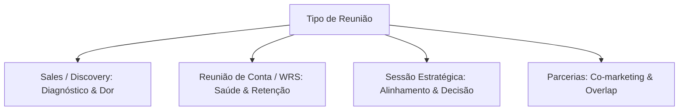

# Sales Meeting Prep & Client Discovery (Guia Operacional)

> **Skill:** [vendas-pipeline](../SKILL.md)  
> **Finalidade:** Preparação estratégica de reuniões comerciais, agendas estruturadas por tipo de call, bancos de perguntas de diagnóstico profundo e template de briefing executivo.

---

## 🎯 1. Protocolo de Preparação Pré-Reunião (Pre-Call Intelligence)

Nenhum call comercial ou reunião de alinhamento com cliente deve ser realizado sem preparação prévia mínima. O tempo de call é de altíssimo valor e deve focar em diagnóstico, geração de valor e fechamento de próximos passos.

### Checklist de Levantamento Prévio (Intake)
Antes do call, confirme e registre os dados essenciais:
1. **Participantes & Papéis:** Nome completo, cargo/título na empresa, nível de influência no comitê de compras (Decisor Econômico, Champion, Usuário, Blocker).
2. **Contexto & Histórico:** Como o lead/cliente chegou, histórico de interações no CRM, conversas ou notas anteriores, propostas passadas e compromissos pendentes.
3. **Tipo de Reunião:** Defina claramente a tipologia (Discovery, Apresentação de Solução, Alinhamento de Conta, Negociação de Proposta).
4. **Objetivo Único (Desired Outcome):** Qual é o resultado concreto e mensurável que define o sucesso do call em uma única frase?
5. **Próximo Passo Proposto:** Qual ação específica será proposta ao final do call (ex: *"Agendar demo técnica na quinta-feira com o CTO"*, *"Enviar minuta contratual até as 18h"*).

---

## 📋 2. Matriz de Agendas por Tipo de Reunião



### 2.1. Reunião de Descoberta / Sales Discovery (25-30 min)
- **Objetivo:** Compreender a causa raiz da dor, qualificar fit (BANT/MEDDIC) e avançar para demonstração/proposta.
- **Agenda Típica:**
  1. *Context Setting (2 min):* Alinhar objetivo do call e motivo pelo qual o prospect buscou contato.
  2. *Cenário Atual & Dores (10 min):* Mapear rotina, gargalos, ferramentas atuais e impactos operacionais.
  3. *Tentativas Prévias (5 min):* O que já tentaram resolver? O que funcionou e o que falhou?
  4. *Cenário Ideal (5 min):* O que significa "resolvido" em termos financeiros e operacionais?
  5. *Aderência & Próximo Passo (5 min):* Validar fit da solução e pactuar data para apresentação da proposta.
- **Sinais de Atenção (Watch For):** Sinais reais de urgência vs curiosidade passageira; real autoridade orçamentária; timeline realista; quais outras partes precisam aprovar.
- **Pergunta Chave:** *"O que fez você priorizar resolver esse problema agora em vez de há 6 meses atrás?"*

### 2.2. Reunião de Conta / Alinhamento de Cliente (WRS) (20 min)
- **Objetivo:** Avaliar a saúde do relacionamento, reportar entregas e alinhar prioridades do próximo ciclo.
- **Agenda Típica:**
  1. *Vitórias Rápidas (2 min):* Ganhos imediatos e métricas alcançadas desde o último encontro.
  2. *Status do Projeto (5 min):* Andamento das entregas e marcos acordados.
  3. *Bloqueadores & Dependências (5 min):* O que a equipe precisa do cliente para destravar o fluxo.
  4. *Prioridades do Próximo Ciclo (5 min):* Foco das ações da próxima quinzena/mês.
  5. *Ajustes de Escopo/Orçamento (3 min):* Alinhamento de demandas adicionais.
- **Sinais de Atenção:** Scope creep (aumento de escopo silencioso), sinais sutis de insatisfação, indicadores de renovação ou churn.
- **Pergunta Chave:** *"Qual é a principal coisa que poderíamos fazer agora para tornar seu dia a dia mais simples?"*

### 2.3. Sessão Estratégica / Tomada de Decisão (30-45 min)
- **Objetivo:** Destravar impasses, avaliar alternativas e tomar decisões definitivas.
- **Agenda Típica:**
  1. *Briefing do Cenário (3 min):* Resumo do problema ou decisão pendente.
  2. *Opções na Mesa (10 min):* Alternativas viáveis de encaminhamento.
  3. *Tradeoffs & Riscos (10 min):* Prós, contras e custos de cada caminho.
  4. *Decisão & Alinhamento (10 min):* Escolha do caminho pela liderança.
  5. *Responsáveis & Prazos (5 min):* Dono de cada entrega (Action Items).
- **Sinais de Atenção:** Premissas não declaradas, resistência oculta, adiamento sistemático de decisões.
- **Pergunta Chave:** *"Que premissa estamos assumindo aqui que, se estiver errada, derruba todo esse plano?"*

### 2.4. Reunião de Parceria Comercial / Co-Marketing (25 min)
- **Objetivo:** Avaliar sobreposição de público, sinergia de marca e viabilidade de ações conjuntas.
- **Agenda Típica:**
  1. *O Mundo Deles (5 min):* O que a empresa parceira constrói e qual seu ICP atual.
  2. *O Nosso Mundo (5 min):* Nossa proposta de valor e perfil de audiência.
  3. *Sobreposição & Sinergia (5 min):* Onde os públicos se conectam sem canibalização.
  4. *Ideia Concreta de Colaboração (5 min):* Webinar conjunto, co-branding, integração técnica ou indicação mútua.
  5. *Próximo Passo (5 min):* Donos e prazo para validar o modelo piloto.
- **Sinais de Atenção:** Assimetria de esforços, concorrência velada, interesse superficial vs comprometimento real.
- **Pergunta Chave:** *"Onde exatamente você enxerga a maior sobreposição de valor entre a sua audiência e a nossa?"*

---

## 💡 3. Banco de Perguntas de Descoberta por Categoria

### 3.1. Perguntas de Diagnóstico & Dor (Sales Discovery)
- *"O que fez você decidir conversar conosco neste momento exato em vez de adiar por mais alguns meses?"*
- *"Como esse problema específico afeta o seu dia a dia e a rotina do seu time ao longo de uma semana típica?"*
- *"O que vocês já tentaram implementar no passado para resolver isso? O que funcionou e onde a solução anterior travou?"*
- *"Além de você, quem mais na organização sente o impacto direto dessa dor e seria beneficiado se ela fosse eliminada?"*
- *"Se você pudesse estalar os dedos e resolver isso amanhã, como seria o cenário ideal de operação?"*
- *"Qual é o custo financeiro e operacional real para a empresa se vocês optarem por não fazer nada nos próximos 6 meses?"*
- *"Como funciona o processo de decisão interno para contratações deste tipo e quem mais precisa participar da validação final?"*

### 3.2. Perguntas de Saúde de Conta & Retenção (Client Success)
- *"O que está funcionando excepcionalmente bem na nossa parceria que deveríamos acelerar ainda mais?"*
- *"Qual é a principal prioridade estratégica da sua liderança para o próximo trimestre?"*
- *"Existe algum ponto na nossa operação ou comunicação que você tenha hesitado em pontuar, mas que gostaria de ajustar?"*
- *"Daqui a 90 dias, o que precisa ter acontecido para você considerar este projeto um sucesso indiscutível?"*

### 3.3. Perguntas de Fechamento & Próximo Passo
- *"Com base em tudo o que alinhamos hoje sobre as suas dores e a nossa metodologia, você sente que temos um fit perfeito para trabalhar juntos?"*
- *"O que mais você ou a diretoria precisam ver ou validar para se sentirem 100% seguros em avançar?"*
- *"Qual é o próximo passo natural do seu lado a partir desta conversa?"*
- *"Existe algum obstáculo contratual, técnico ou orçamentário que possa impedir o início dos trabalhos na data combinada?"*
- *"Podemos deixar agendada a nossa próxima sessão de apresentação da proposta para quinta-feira às 15h?"*

---

## 📝 4. Template Operacional de Briefing Pré-Reunião

Antes de entrar em qualquer reunião relevante, preencha este modelo sintético:

```markdown
# Meeting Prep Brief: [Nome do Prospect/Cliente] | [Data] [Horário]

**Empresa:** [Nome da Empresa]  
**Cargo / Papel:** [Título do Participante no Comitê de Compra]  
**Tipo de Reunião:** [Discovery / Apresentação de Proposta / Alinhamento WRS / Estratégia / Parceria]  
**Duração:** [ex: 30 minutos]  
**Estágio do Relacionamento:** [Novo Lead / Oportunidade Ativa / Cliente Existente]

---

### 1. Por que esta reunião é crítica? (Stakes)
[1 a 2 frases definindo o objetivo econômico, a dor central a ser tratada e o objetivo do encontro]

### 2. Três Prioridades Máximas para o Call
1. [Prioridade 1: Ex: Confirmar volume atual de leads e taxa de conversão do CRM]
2. [Prioridade 2: Ex: Desvendar a dor oculta no atendimento da agência anterior]
3. [Prioridade 3: Ex: Mapear o comitê de decisão e aprovação orçamentária do CFO]

### 3. Contexto Prévio & Histórico Mapeado
- **Dados do Lead:** [Origem, segmento de mercado, tamanho do time, faturamento estimado]
- **Últimas Interações:** [Resumo das conversas por email, WhatsApp ou calls anteriores]
- **Pendências Abertas:** [Promessas feitas ou dúvidas levantadas que precisam de resposta]

### 4. Perguntas Estratégicas a Fazer
1. [Pergunta 1 - conectada a notícias recentes ou contexto específico da empresa]
2. [Pergunta 2 - foco no diagnóstico de dor e impacto financeiro]
3. [Pergunta 3 - foco no custo de inação]
4. [Pergunta 4 - qualificação de comitê de decisão e prazos]

### 5. Sinais de Alerta & Objeções Previstas (Watch For)
- [Objeção provável 1: Ex: "Já temos time interno cuidando disso"]
- [Objeção provável 2: Ex: "Nosso orçamento para este trimestre está comprometido"]
- [Ponto de atrito: Ex: Reclamação de prazo na proposta anterior]

### 6. Desfecho Desejado (Desired Outcome)
[Ex: Acordo mútuo de fit técnico e aprovação para apresentação da proposta comercial na próxima terça-feira]

### 7. Próximo Passo Concreto a Propor
[Ex: "Vou consolidar o diagnóstico em um plano comercial e apresentar para você e seu sócio na terça às 14h"]
```
