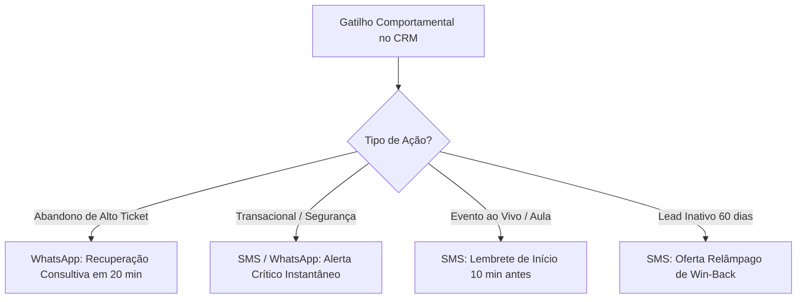

# SMS e WhatsApp no Marketing de Ciclo de Vida: Permissão, Cadência, Custos e Templates

> Conceito adaptado de `promovaweb/inboundfy` (skill `growth-sms`, AGPL-3.0), redigido em prosa original e ampliado para a realidade brasileira (Meta Cloud API, LGPD e regras operacionais de telecomunicações).

Enquanto o e-mail atua como uma caixa de correspondência assíncrona para conteúdos aprofundados e nutrição contínua, os canais de mensageria direta (SMS e WhatsApp) funcionam como notificações de bolso imediatas. A taxa de abertura em canais diretos ultrapassa 90% nos primeiros dez minutos, mas essa mesma visibilidade traz um custo: o espaço pessoal do usuário é sagrado, e disparos intrusivos geram bloqueios rápidos, denúncias e desgaste irreparável da marca.

Este guia define as regras operacionais, os fluxos recomendados, a governança de permissão e a estrutura de mensagens para integrar SMS e WhatsApp às esteiras de ciclo de vida.

---

## 1. Particularidades do Canal de Mensageria vs. E-mail

| Dimensão | E-mail Marketing | SMS | WhatsApp (Meta Cloud API) |
| :--- | :--- | :--- | :--- |
| **Tempo até Leitura** | Horas ou dias | Menos de 5 minutos | Menos de 3 minutos |
| **Taxa de Abertura Típica** | 20% a 35% | 90% a 98% | 95% a 99% |
| **Custo Marginal** | Próximo de zero (plano fixo de CRM) | Pago por mensagem disparada | Pago por conversa (janela de 24 horas) |
| **Risco de Rejeição** | Arquivamento ou descadastro silencioso | Bloqueio imediato de número | Denúncia de spam (pode banir a conta) |
| **Formato Ideal** | Narrativas longas, design, múltiplos links | Texto puro até 160 caracteres + 1 link | Texto conversacional, botões de ação e mídia |
| **Regulação Central** | LGPD e filtros de provedores (Spamhaus) | LGPD e regras Anatel/operadoras | LGPD e Termos de Serviço da Meta |

---

## 2. Conformidade Regulatória e LGPD

No Brasil, a Lei Geral de Proteção de Dados (LGPD) e o Código de Defesa do Consumidor exigem rigor absoluto para envio de mensagens privadas:

### 2.1. Opt-in Explícito e Separado por Canal
- **Nunca assuma autorização cruzada**: Um usuário que informou o telefone ao baixar um e-book **não** deu autorização para receber promoções via WhatsApp.
- O formulário de captura deve conter um consentimento claro: *"Aceito receber atualizações e notificações importantes pelo WhatsApp"*. A caixa de seleção não pode vir pré-marcada.
- Registre a origem, a data, o horário e o IP da captura no CRM para auditoria.

### 2.2. Opt-out Descomplicado em 1 Toque
- **SMS**: Toda mensagem promocional deve conter instrução clara de saída: *"Responda PARE para sair"* ou um link curto para cancelamento.
- **WhatsApp**: Configure respostas automáticas no webhook do CRM para palavras como `PARAR`, `SAIR`, `CANCELAR` ou `NÃO QUERO`. Quando recebidas, a tag `CANAL_OPTOUT_WHATSAPP` deve ser aplicada imediatamente, retirando o contato de qualquer lista ativa em menos de 60 segundos.

### 2.3. Janela de Horário Permitida
- Disparos promocionais só podem ocorrer entre **08:00 e 20:00** (horário do destinatário) em dias úteis, e entre **09:00 e 18:00** aos sábados.
- É terminantemente proibido enviar mensagens comerciais aos domingos e feriados nacionais. Mensagens transacionais emergenciais (ex: código de autenticação 2FA ou aviso de segurança) são as únicas isentas dessa restrição.

---

## 3. As 4 Jornadas Recomendadas para Mensageria Direta



### 3.1. Recuperação de Checkout de Alto Valor (WhatsApp Híbrido)
- **Quando usar**: Pedidos ou propostas abandonadas com valor relevante (ex: acima de R$ 300,00 ou planos anuais).
- **Momento**: Disparo entre 15 e 30 minutos após a detecção do abandono no CRM.
- **Abordagem**: Suporte humano consultivo, nunca pressão agressiva de vendas.
- **Estrutura**:
  ```
  Olá, [Primeiro Nome]! Vi que você estava finalizando a sua inscrição no [Produto/Plano], mas o processo não foi concluído.
  
  Aconteceu algum erro com a página de pagamento ou com a forma de parcelamento?
  
  Se precisar de ajuda para concluir, estou à disposição por aqui. Ou se preferir continuar agora, segue o link seguro com seus dados salvos: [Link Curto com UTM]
  ```

### 3.2. Notificação Transacional Crítica
- **Quando usar**: Códigos de verificação (2FA), confirmação de pagamento aprovado e código de rastreamento de entregas físicas.
- **Canal recomendado**: SMS (garante entrega em aparelhos sem conexão de dados móveis) ou WhatsApp Utility Template.
- **Estrutura (SMS)**:
  ```
  [Nome da Marca]: Seu pedido #[Número] foi aprovado com sucesso! Acompanhe a entrega pelo link: [Link Curto]. Suporte: [Telefone]
  ```

### 3.3. Alerta de Início Imediato (Webinars e Aulas ao Vivo)
- **Quando usar**: Transmissões ao vivo, mentorias ou eventos de lançamento com hora marcada.
- **Momento**: 10 a 15 minutos antes do início da transmissão.
- **Estrutura (SMS - máx 160 caracteres)**:
  ```
  [Nome], estamos ao vivo agora na aula sobre [Tema]! Acesse a transmissão direto pelo link: [Link Curto]. Não haverá replay aberto.
  ```

### 3.4. Reativação de Contatos Frios (Win-Back por SMS)
- **Quando usar**: Leads que não abriram nenhum e-mail nos últimos 60 a 90 dias, mas mantêm o telefone validado.
- **Momento**: Disparo único em dia de semana às 11:30 ou 17:30.
- **Estrutura (SMS)**:
  ```
  [Nome], sentimos sua falta! Liberamos um cupom de 20% OFF para reativar seu acesso ao [Produto] nas proximas 24h. Use [CUPOM] em: [Link Curto]
  ```

---

## 4. Regras Técnicas e Limites de Redação

### 4.1. Limites do SMS (GSM-7 vs. UCS-2)
- Uma mensagem padrão em codificação GSM 7-bit suporta até **160 caracteres**.
- **Atenção aos caracteres especiais**: Acentos (`á`, `ç`, `õ`), emojis (`🚀`, `👉`) ou quebras de linha especiais forçam a conversão para codificação UCS-2, reduzindo o limite para apenas **70 caracteres por mensagem**, dobrando o custo do envio.
- Sempre prefira texto puro e limpo em SMS. Utilize encurtadores de links próprios (ex: `link.suamarca.com/x123`) com parâmetros UTM completos.

### 4.2. Regras de Templates no WhatsApp (Meta Cloud API)
- Mensagens iniciadas pela empresa fora da janela de 24 horas devem obrigatoriamente usar **Templates HSM** pré-aprovados pela Meta.
- Classifique os templates corretamente na plataforma da Meta (Marketing, Utility ou Authentication). Submeter templates promocionais na categoria Utility gera rejeição ou aumento da taxa de cobrança por mensagem incorreta.
- Mantenha a pontuação de qualidade do número (*Phone Number Quality Rating*) em nível verde. Se a taxa de denúncias subir, a Meta reduz o limite de mensagens diárias (Tier de 1k, 10k, 100k ou Ilimitado).

---

## 5. Governança de Frequência e Tags no CRM

Para evitar a saturação dos contatos, configure travas automáticas no seu software de CRM (ActiveCampaign, HubSpot, Customer.io):

1. **Teto de Disparos Promocionais**:
   - WhatsApp: Máximo de **2 mensagens promocionais por mês** por contato.
   - SMS: Máximo de **3 mensagens promocionais por mês** por contato.
2. **Taxonomia de Tags de Mensageria**:
   - `CANAL_OPTIN_SMS` — Contato confirmou permissão para SMS.
   - `CANAL_OPTIN_WHATSAPP` — Contato confirmou permissão para WhatsApp.
   - `CANAL_OPTOUT_SMS` — Contato solicitou descadastro de SMS.
   - `CANAL_OPTOUT_WHATSAPP` — Contato solicitou descadastro de WhatsApp.
   - `STATUS_WHATSAPP_CONVERSA_ABERTA` — Contato está em atendimento com operador humano (suspende todas as automações para evitar sobreposição de mensagens).
