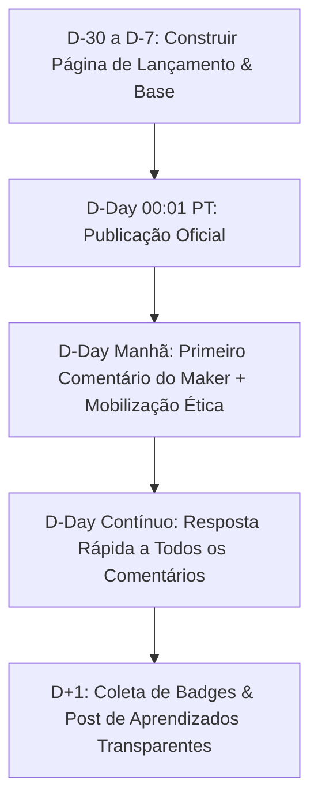

# Aquisição e Autoridade em Diretórios de Software e Marketplaces: Product Hunt, G2, Capterra e Review Loops

> Conceito adaptado de `promovaweb/inboundfy` (skill `growth-diretorios`, AGPL-3.0), redigido em prosa original com foco em SaaS B2B, ferramentas digitais e captação de demanda qualificada.

Diretórios de software e plataformas de avaliação de usuários desempenham um papel duplo fundamental na estratégia de crescimento de produtos digitais:
1. **Captura de Demanda Qualificada de Fundo de Funil**: Compradores corporativos que pesquisam no G2, Capterra ou AlternativeTo já têm dor identificada, orçamento reservado e estão comparando alternativas ativamente.
2. **Autoridade e Prova Social Externa**: Selos de avaliação (*badges* como "High Performer" ou "Top 10") e notas acima de 4.5 estrelas em plataformas independentes aumentam as taxas de conversão de landing pages e reduzem o ciclo de fechamento em vendas consultivas.

Este playbook estabelece o kit de cadastro, a estratégia de lançamento no Product Hunt e o processo contínuo de coleta ética de avaliações.

---

## 1. Mapeamento de Diretórios por Objetivo Estratégico

| Categoria | Plataformas Principais | Objetivo Primário | Perfil de Usuário |
| :--- | :--- | :--- | :--- |
| **Lançamentos & Tração Inicial** | Product Hunt, BetaList | Pico inicial de tráfego, feedback de early adopters, backlinks fortes | Desenvolvedores, fundadores, entusiastas de tecnologia |
| **B2B & Enterprise Reviews** | G2, Capterra, Software Advice, TrustRadius | Captação de leads qualificados em decisão de compra, geração de relatórios | Compradores corporativos, gerentes de TI, líderes de produto |
| **SEO Comparativo Orgânico** | AlternativeTo, Slant, SourceForge | Ranquear para buscas do tipo "alternativa ao [concorrente líder]" | Usuários frustrados com ferramentas estabelecidas buscando opções mais ágeis ou acessíveis |
| **Mercado Brasileiro / Local** | B2B Stack, Reclame Aqui (reputação) | Validação de credibilidade para empresas e compradores locais no Brasil | PMEs brasileiras, compradores locais |

---

## 2. O Kit Padrão de Cadastro (Submission Kit)

Antes de iniciar submissões em qualquer plataforma, organize e padronize os ativos digitais da marca em uma pasta única para garantir consistência visual e semântica:

### 2.1. Textos e Metadados
- **Nome Oficial do Produto**: Padronizado, sem adjetivos promocionais embutidos (ex: *"Plataforma X"*, e não *"Plataforma X - O Melhor CRM do Mundo"*).
- **Tagline Principal (máximo 60 caracteres)**: Uma frase concisa explicando o benefício central. Ex: *"Automatize relatórios de marketing em menos de 2 minutos"*.
- **Descrição Curta (máximo 250 caracteres)**: Resumo direto do que a ferramenta resolve, para quem se destina e a principal integração.
- **Descrição Completa (500 a 1.500 palavras)**: Estruturada em tópicos:
  - O problema central do mercado.
  - As 4 a 6 principais funcionalidades com prints correspondentes.
  - Casos de uso típicos por função (ex: para agências, para times internos).
  - Tabela clara de integrações suportadas (ex: Slack, Zapier, Webhooks).
  - Tiers de preço ou política de teste gratuito / freemium.
- **URLs com Rastreamento Próprio**: Nunca aponte para a home sem parâmetros. Utilize sempre:
  `https://suaempresa.com/?utm_source=[diretorio]&utm_medium=directory&utm_campaign=listing`

### 2.2. Pacote de Ativos Visuais
- **Ícone e Logo**: PNG transparente quadrado (512x512 px) e vetor SVG.
- **Screenshots da Interface**: 4 a 6 capturas em resolução 1920x1080 px (16:9), sempre com mockups limpos e anotações visuais (*callouts*) destacando o valor da funcionalidade, evitando telas poluídas com dados vazios.
- **Vídeo de Demonstração (Demo Video)**: 60 a 90 segundos sem introduções corporativas longas. Mostre o software em ação nos primeiros 5 segundos e encerre com o resultado final gerado.

---

## 3. Playbook de Lançamento no Product Hunt

O Product Hunt premia preparação e engajamento genuíno da comunidade. Um lançamento bem-sucedido pode gerar milhares de novos cadastros e posicionar a empresa entre os produtos do dia.



### Cronograma de Ações:
1. **D-30 a D-7 (Aquecimento)**:
   - Crie uma página "Coming Soon" no Product Hunt para coletar seguidores interessados.
   - Decida entre submeter como *Maker* autônomo ou convidar um *Hunter* relevante na comunidade. Lançar como próprio criador hoje tem o mesmo peso algorítmico e transmite autenticidade.
2. **D-Day (O Dia do Lançamento)**:
   - **Horário de Publicação**: Publique exatamente às **00:01 PT** (horário do Pacífico), garantindo as 24 horas completas de votação.
   - **O Primeiro Comentário (*Maker Comment*)**: Poste imediatamente nos primeiros minutos contando por que você construiu o produto, que dor pessoal enfrentava e oferecendo uma condição especial (ou teste estendido) para a comunidade do Product Hunt.
   - **Regra Anti-Desclassificação**: **NUNCA peça votos diretamente** (*"Votem em nós"* ou links diretos com pedido de upvote em massa). O algoritmo do Product Hunt detecta padrões de votação artificial e penaliza o ranking ou desclassifica o produto. Em vez disso, peça feedback sincero: *"Acabamos de lançar no Product Hunt! Adoraríamos ouvir suas críticas e sugestões sobre o produto: [Link da página]"*.
   - **Velocidade de Resposta**: Responda a **100% dos comentários** feitos na página nas primeiras 4 horas. Discussões ativas mantêm o produto no topo da seção de destaques.
3. **D+1 (Pós-Lançamento)**:
   - Se conquistar uma posição no pódio (Top 1, Top 2 ou Top 3 do dia), incorpore o badge oficial no rodapé ou na dobra de cabeçalho do site.
   - Publique um post em redes sociais (LinkedIn, X) compartilhando métricas reais e aprendizados com transparência.

---

## 4. O Motor Contínuo de Reviews no G2 e Capterra

Manter avaliações atualizadas e consistentes é um trabalho contínuo. Perfis sem avaliações recentes nos últimos 6 meses perdem visibilidade nos quadrantes de recomendação.

### 4.1. Quando Solicitar uma Avaliação ao Cliente
Nunca envie um pedido de avaliação genérico para toda a base de e-mails de uma vez. Dispare convites apenas em momentos de **alta satisfação comprovada**:
- Cliente deu nota **9 ou 10 em pesquisa de NPS**.
- Usuário completou com sucesso um marco de ativação ou atingiu uma meta dentro do software.
- Cliente acabou de elogiar o suporte em um chamado encerrado.

### 4.2. Estrutura do E-mail de Solicitação Ética
Envie um e-mail simples, em texto puro, assinado por uma pessoa real (o fundador ou o responsável pelo relacionamento):

```markdown
Assunto: Uma pergunta rápida sobre sua experiência com o [Produto], [Nome]

Olá, [Nome]!

Vi que você e seu time conseguiram [alcançar marco/resultado recente no produto]. Ficamos muito felizes em ver essa evolução por aí.

Como somos uma empresa focada em aprimorar a ferramenta com base no uso real, sua opinião nos ajuda demais a entender o que estamos fazendo certo e o que ainda precisamos melhorar.

Você teria 3 minutos para deixar uma avaliação sincera sobre nós no G2?

👉 [Link Direto para Formulário de Review]

A plataforma é 100% independente e seu relato ajuda outros profissionais que enfrentam os mesmos desafios a tomarem uma boa decisão.

Muito obrigado pelo apoio de sempre,
[Nome do Fundador / Head de Produto]
```

### 4.3. Regras de Compliance de Plataformas
- **Proibição de Avaliações Internas**: Funcionários, sócios ou prestadores de serviço da empresa são terminantemente proibidos de publicar avaliações. G2 e Capterra cruzam contas corporativas do LinkedIn e aplicam punições severas caso identifiquem conflito de interesse.
- **Incentivos Oficiais**: Caso deseje oferecer um brinde ou cartão-presente (ex: vale-compras de R$ 50 para os primeiros 20 que avaliarem), utilize exclusivamente os programas oficiais de incentivo gerenciados pelo próprio G2 ou Capterra. O incentivo nunca pode ser condicionado a uma nota positiva: o usuário recebe a recompensa independentemente de avaliar com 1 ou 5 estrelas.

---

## 5. Rastreamento e Aproveitamento de Badges

- **Monitoramento de Menções**: Configure alertas no Google Alerts e monitore o AlternativeTo semanalmente para checar novos concorrentes que listam seu produto como referência.
- **Inserção de Badges de Prova Social**:
  - Na página de preços (*Pricing Page*), logo abaixo dos planos.
  - Próximo ao botão de CTA principal da Landing Page (*"Avaliado com 4.8/5 no G2"*).
  - Na assinatura de e-mail de vendas e em propostas comerciais de fechamento B2B.
