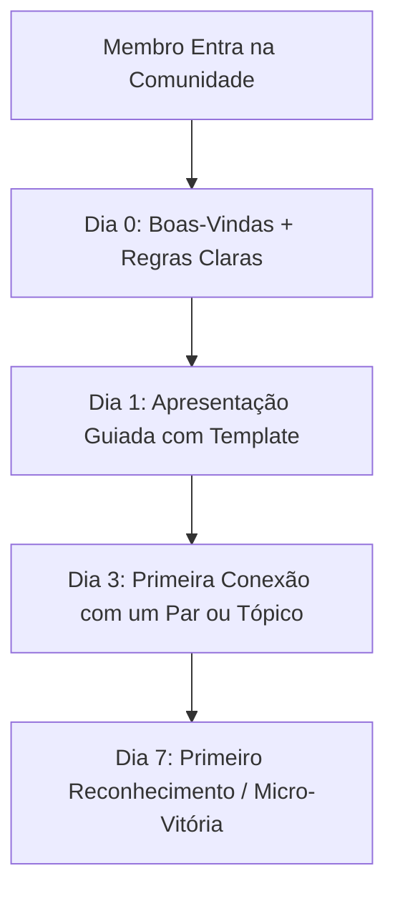

# Gestão de Comunidades Proprietárias: Onboarding, Rituais de Engajamento, Moderação e Métricas

> Conceito adaptado de `promovaweb/inboundfy` (skill `growth-comunidade`, AGPL-3.0), redigido em prosa original e ampliado para arquiteturas modernas de comunidades em WhatsApp Communities, Discord, Slack e plataformas proprietárias (Circle/Skool).

Audiência é um grupo de pessoas que escuta a sua marca. Comunidade é um grupo de pessoas que conversa entre si com o apoio da sua marca. Construir uma comunidade proprietária é uma das alavancas mais fortes de retenção e defesa de mercado (*moat*), pois transforma clientes em defensores e reduz o custo de aquisição (CAC) por meio de indicações espontâneas.

No entanto, a grande maioria das comunidades de empresas morre nas primeiras semanas por se tornarem murais de autopromoção corporativa ou salas vazias onde ninguém sabe como interagir.

Este manual estabelece as práticas para estruturar, acolher, engajar e moderar comunidades ativas e sustentáveis.

---

## 1. Escolha da Plataforma pelo Perfil da Comunidade

| Plataforma | Melhor Caso de Uso | Fricção de Entrada | Nível de Interação P2P | Moderação e Estrutura |
| :--- | :--- | :--- | :--- | :--- |
| **WhatsApp Communities** | Cursos, clientes locais, e-commerce, público amplo | Mínima (todos já usam) | Altíssima no curto prazo | Básica (risco de poluição se mal gerida) |
| **Discord** | Desenvolvedores, IA, Web3, creators, games | Média (exige familiaridade) | Excelente em canais temáticos | Avançada (cargos, bots automáticos, canais de voz) |
| **Slack** | Comunidades profissionais B2B, networking executivo | Baixa a média (ambiente corporativo) | Focada em tópicos de trabalho | Boa (hilos, integrações com ferramentas) |
| **Circle / Skool** | Academias de conhecimento, mentorias, ecossistemas pagos | Média (login próprio) | Estruturada em fórum assíncrono | Máxima (gamificação, módulos de aula, controle de membros) |

---

## 2. O Funil de Acolhimento e Onboarding (Os Primeiros 7 Dias)

O destino de um novo membro é decidido nas primeiras 72 horas. Se ele entra e se sente invisível, a probabilidade de se tornar um participante inativo (*lurker*) permanente ultrapassa 85%.



### Dia 0 — Boas-Vindas sem Sobrecarga
- Envie uma mensagem privada ou destaque um post fixo contendo apenas **3 informações**:
  1. O propósito central da comunidade (por que este grupo existe).
  2. As 3 regras fundamentais de convivência.
  3. O link para o canal ou tópico de apresentações.
- Evite manuais extensos de 10 páginas no primeiro dia.

### Dia 1 — Apresentação Guiada (Template Fixo)
- Não peça apenas *"Diga olá"*. Forneça um formulário simples de preenchimento para diminuir a vergonha:
  ```markdown
  👋 Olá a todos!
  - Meu nome e de onde falo: [Nome / Cidade]
  - No que trabalho hoje: [Empresa ou Projeto]
  - Meu maior desafio atual: [Área onde busca ajuda]
  - Um assunto em que posso contribuir com o grupo: [Habilidade ou experiência]
  ```
- O moderador ou líder deve responder à apresentação nas primeiras 4 horas, fazendo uma ponte com outro membro que tenha interesses afins.

### Dia 3 — O Empurrão de Participação
- Marque o novo membro em uma discussão recente que toque exatamente no desafio que ele mencionou na apresentação.
- O objetivo é fazê-lo publicar seu **primeiro comentário substantivo**.

### Dia 7 — A Micro-Vitória
- Destaque os novos membros que completaram a primeira semana ou que ajudaram outro participante no resumo semanal da comunidade.

---

## 3. Rituais Cíclicos de Engajamento

Comunidades não se sustentam com espontaneidade pura; elas precisam de **previsibilidade rítmica**. O líder deve instituir rotinas claras que o membro espera todas as semanas:

| Dia da Semana | Ritual Estratégico | Como Executar |
| :--- | :--- | :--- |
| **Segunda-feira** | **Metas e Foco da Semana** | Post interativo convidando os membros a declararem 1 prioridade inegociável da semana. |
| **Quarta-feira** | **Desafio Técnico / Teardown / AMA** | Análise ao vivo ou em texto de um problema real enviado por um membro da comunidade. |
| **Sexta-feira** | **Vitrine de Conquistas e Vitórias** | Espaço aberto para comemorar marcos alcançados, projetos lançados ou resultados obtidos. |
| **Mensal** | **Encontro Virtual / Mesa Redonda (Call)** | 60 minutos de troca prática com pauta fechada e microfone aberto para os participantes. |

---

## 4. Governança, Diretrizes e Moderação

Uma comunidade aberta sem regras rígidas de convivência degrada rapidamente em um grupo de autopromoção desordenada.

### 4.1. Regra Zero: Proibição Estrita de Prospecção Não Solicitada
- Prospecção fria ou abordagem comercial em mensagem privada para outros membros sem autorização prévia resulta em **banimento imediato sem aviso prévio**. Isso protege a privacidade e o valor percebido do espaço.

### 4.2. Matriz de Sanções em 3 Passos

```
Grau 1 (Infração Leve - ex: postou dúvida no canal errado ou link sem contexto):
→ Aviso em mensagem privada + remoção do conteúdo + indicação do canal correto.

Grau 2 (Infração Média - ex: debate desrespeitoso, autopromoção fora do espaço permitido):
→ Advertência formal pública + bloqueio temporário de envio por 24 horas.

Grau 3 (Infração Grave - ex: ofensas, spam em massa, venda direta por DM, vazamento de dados):
→ Banimento permanente imediato + revogação de acessos.
```

### 4.3. Como Tratar a Autopromoção
- Não proíba completamente que os membros mostrem seu trabalho, pois isso gera frustração. Em vez disso, **crie um canal ou dia dedicado** (ex: *"Canal #vitrine-e-projetos"* ou a *"Sexta da Vitrine"*).
- Exija que qualquer post de projeto venha acompanhado dos aprendizados ou desafios técnicos, e não apenas de um link cru de venda.

---

## 5. Métricas de Saúde da Comunidade

Evite medir a saúde da comunidade pelo número bruto de cadastrados. Monitore estes indicadores essenciais:

1. **Índice P2P (Peer-to-Peer Ratio)**:
   - Percentual de dúvidas e conversas respondidas por outros membros **sem intervenção da equipe da marca**.
   - **Meta saudável**: $> 70\%$. Se a equipe da empresa precisa responder a 80% das mensagens, o grupo não é uma comunidade, é um canal de suporte ao cliente disfarçado.
2. **DAU / MAU (Daily Active Users sobre Monthly Active Users)**:
   - Proporção de membros que interagem diariamente.
   - **Benchmark saudável**: Entre $15\%$ e $30\%$ em comunidades profissionais.
3. **Taxa de Retenção de Membros em 90 Dias (D90)**:
   - Percentual de membros que continuam lendo ou comentando após 3 meses da entrada.
