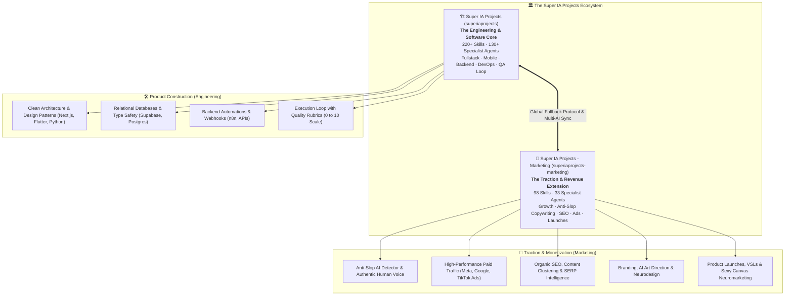

<div align="center">
  <picture>
    <source media="(prefers-color-scheme: dark)" srcset="assets/logo.png">
    
  </picture>
  <h1>Super IA Projects - Marketing (<code>superiaprojects-marketing</code>)</h1>
  <p><strong>The Autonomous Marketing & Growth Engineering Framework</strong></p>
  <p>33 Specialist Agents, 98 Modular Skills, 114 Workflows, Human Anti-Slop Engine & Brand Architecture.</p>

  <p>
    <a href="https://www.futuromercado.com.br"></a>
    <a href="https://instagram.com/felipelbahia"></a>
    <a href="mailto:felipe@futuromercado.com.br"></a>
    <a href="LICENSE"></a>
    
    
  </p>

  <p>
    <a href="README.md">🇧🇷 Versão em Português</a> | <strong>English</strong>
  </p>
</div>

---

> **Authorship:** Created and maintained by **Felipe Bahia** ([Futuro Mercado](https://www.futuromercado.com.br)).  
> **Version:** `v1.0.0` · **Last Updated:** November 1, 2026  
> The official extension focused on **Marketing, Growth, Copywriting, SEO, and Ads** of the [**Super IA Projects**](https://github.com/Felipelbahia/superiaprojects) ecosystem. Engineered for frictionless execution across **Claude Code**, **Google Antigravity**, and **Cursor**.

---

## ⚡ Why Super IA Projects - Marketing?

Marketing production with autonomous AI agents often suffers from chronic failure modes: predictable text laden with robotic clichés (*AI slop*), brand tone drift, lack of conversion funnel rigor, and disconnect across multiple marketing channels.

**Super IA Projects - Marketing** solves this by providing an industrial-grade intelligence architecture:

- 🛡️ **Mandatory Anti-Slop Engine:** Every piece of copy is filtered against robotic AI clichés (*"delve"*, *"crucial"*, *"game-changer"*, *"testament"*, *"in today's landscape"*) before output generation.
- 🏷️ **Isolated Brand Architecture (`_brands/`):** Strict business context (Brand Voice, Personas/ICPs, Content Pillars, and Style Guide). Agents never operate in a vacuum.
- 🎯 **33 Domain Specialist Agents:** AI Art Direction, Conversion Copywriting, Paid Traffic (Meta/Google), Technical SEO, PR/Press, Sexy Canvas Neuromarketing, B2B Sales, and Growth.
- 🧩 **98 Modular Procedural Skills across 17 Verticals:** Practical methodologies, statistical calculation scripts (A/B testing, funnel analysis, cohort retention), and high-retention frameworks.
- ⚡ **114 Executable Workflows:** Fast `/slash` commands for Claude Code and Cursor (campaign planning, carousels, sales pages, video scripts, and tone audits).
- 🔄 **Multi-AI Dual Rules Parity:** 100% identical rules automatically maintained between `CLAUDE.md`, `GEMINI.md`, and `.cursorrules`.

---

## 📦 What's Included

<!-- kit-counts:start -->
**33 agents** · **98 skills** · **114 workflows** · **15 scripts inside skills** (generated by `.agent/scripts/sync_entrypoints.py --write-docs`)
<!-- kit-counts:end -->

### 🤖 33 Specialist Agents (`.agent/agents/`)
Domain personas that automatically activate based on request intent:
- **Branding & Visual:** `@art-director` (Art direction, neurodesign, and 3 creative routes), `@brand-voice-guardian` (Brand tone guardian and anti-slop audit).
- **Content & Copywriting:** `@content-creator`, `@copywriter`, `@audiovisual-producer` (High-retention scripts and VSLs).
- **Paid Media & Performance:** `@paid-traffic-specialist` (Meta Ads, Google Ads, TikTok Ads, ROAS optimization).
- **Social Media & PR:** `@social-media-strategist`, `@pr-specialist` (Journalist pitching, press releases, media relations).
- **Sales & RevOps:** `@b2b-sales-director` (Complex sales, MEDDIC methodology), `@email-wizard` (Cold emails, nurturing flows).
- **Strategy & Growth:** `@marketing-strategist`, `@growth-specialist`, `@conversion-optimizer` (CRO), `@sexy-canvas-strategist` (Neuromarketing and human desires), `@persona-builder`, `@researcher`, `@analytics-specialist`.

### 🧩 98 Modular Skills Across 17 Verticals (`.agent/skills/`)
| Vertical | Domain Focus | Example Skills |
| :--- | :--- | :--- |
| **`brand-*`** | Identity & Brand Building | `brand-builder`, `brand-voice-messaging`, `brand-visual-direction`, `brand-design-system` |
| **`copy-*`** | Persuasion & Conversion | `copy-conversao`, `copy-landing-page`, `copy-vsl`, `copy-hooks-video-curto`, `copy-saas` |
| **`ads-*`** | Paid Traffic & Performance Ads | `ads-meta`, `ads-google`, `ads-criativos`, `ads-multiplataforma`, `ads-analise-de-desempenho` |
| **`social-*`** | Social Media & Distribution | `social-estrategia`, `social-carrossel`, `social-linkedin`, `social-direcao-de-arte-ia` |
| **`seo-*`** | Organic Search & Authority | `seo-on-page`, `seo-tecnico`, `seo-palavras-chave`, `seo-conteudo`, `seo-schema-markup` |
| **`email-*`** | CRM & Email Automation | `email-copy`, `email-automacao`, `email-newsletter`, `email-entregabilidade` |
| **`vendas-*`** | B2B Sales & Outbound Prospecting | `vendas-cold-email`, `vendas-materiais-de-venda`, `vendas-pipeline`, `vendas-prospeccao-de-leads` |
| **`growth-*`** | Rapid Experimentation & Metrics | `growth-testes-ab`, `growth-retencao-e-churn`, `growth-frameworks`, `growth-experimentos-gtm` |
| **`revenue-*`** | Positioning & Product Launches | `revenue-campanhas`, `revenue-sexy-canvas`, `revenue-gtm-e-posicionamento`, `revenue-lancamento` |
| **`persona-*`** | Customer Discovery & ICPs | `persona-icp`, `persona-descoberta-de-clientes` |
| **`audiovisual-*`** | Rich Media, Decks & Audio | `audiovisual-pitch-deck`, `audiovisual-slidev`, `audiovisual-podcast-e-audio`, `audiovisual-agentes-de-voz` |
| **`site-*`** | Conversion Pages & Web Architecture | `site-cro`, `site-interface-de-conversao`, `site-arquitetura`, `site-tailwind-design-system` |
| **`data-*`** | Attribution & Marketing Analytics | `data-funil-e-coortes`, `data-atribuicao-e-relatorios`, `data-web-ga4` |
| **`geral-*`** | Quality & Governance | `geral-anti-slop`, `geral-arquitetura-de-projeto`, `geral-conformidade-lgpd` |

---

## 🚀 Quickstart & Installation

### 1-Command Installation:

```bash
git clone https://github.com/Felipelbahia/superiaprojects-marketing.git
cd superiaprojects-marketing
./install.sh
```

The `./install.sh` script:
1. Validates your **Python 3** environment.
2. Initializes `CLAUDE.md` from the agnostic `CLAUDE.example.md` template.
3. Automatically sets up relative symlinks for **Claude Code** (`.claude/`) and **Cursor** (`.cursor/`).
4. Generates the interactive visual catalog at `.agent/catalog.html`.

---

## 📋 Daily Workflow

### 1. Set Up Your Brand in `_brands/`
Duplicate the ready-to-use template:
```bash
cp -r _brands/brand-template _brands/my-brand
```
Fill out `brand-voice.md`, `personas.md`, `content-pillars.md`, and `style-guide.md`.

### 2. Autonomous Agent Routing
You never need to memorize commands. The system analyzes your request and pairs the optimal specialist personas:
```markdown
You: "Create a 7-slide carousel for Instagram debunking A/B testing myths for brand my-brand"
AI: 🤖 Applying knowledge of @art-director + @content-creator + @brand-voice-guardian (Anti-Slop Active)...
```

### 3. Socratic Gate for Complex Requests
For large campaigns, product launches, or positioning overhauls, the assistant initiates the **Socratic Gate**, asking targeted questions one at a time before generating production copy.

### 4. Canonical Prompt Templates (`prompts-template/`)
Tested, copy-paste prompts ready in `prompts-template/`:
- `01-campanha-completa-do-zero.md`: End-to-end conversion campaign planning.
- `02-producao-de-conteudo-anti-slop.md`: High-retention social posts, carousels, and long-form articles.
- `03-pesquisa-e-benchmarking-competitivo.md`: Competitor scraping and SERP discovery via Firecrawl.
- `04-auditoria-de-marca-e-persona.md`: Persona refinement and Sexy Canvas neuromarketing matrix.
- `05-lancamento-e-copywriting-conversao.md`: High-converting sales letters, landing pages, and launch emails.

---

## 🔌 Recommended MCP Servers

The ecosystem integrates with Model Context Protocol (MCP) servers for real-time market intelligence:

- **`firecrawl`**: Web scraping, competitor analysis, and clean Markdown SERP extraction.
- **`notion`**: Syncing briefings, documentation, and editorial calendars.
- **`context7`**: Official, versioned technical documentation for media and automation libraries.
- **`stitch`**: UI prototyping and conversion-optimized Landing Page layouts.
- **`chrome-devtools`**: Core Web Vitals (CWV) and page speed audits for sales pages.

👉 *See the [**Setup Guide (SETUP.md)**](SETUP.md) for full configuration details and [`mcp.example.json`](mcp.example.json).*

---

## 🌐 The Dynamic Duo: Relation to Super IA Projects

**Super IA Projects - Marketing** (`superiaprojects-marketing`) and [**Super IA Projects (`superiaprojects`)**](https://github.com/Felipelbahia/superiaprojects) form an integrated architecture engineered by **Felipe Bahia ([Futuro Mercado](https://www.futuromercado.com.br))**: they represent **the two hemispheres of the same brain** for creators and teams building and scaling businesses with artificial intelligence.

### 🏛️ Structure & Ecosystem Architecture

The ecosystem is built upon two complementary pillars:

1. **Super IA Projects:**  
   The **Software Engineering, Governance, and Standards** core. It acts as the *Operating System* for your AI coding agents, providing the scaffolding engine (`project-initializer`), strict QA execution loop (`execution-loop`), dual-rules parity (`CLAUDE.md` / `GEMINI.md`), and over 220 technical skills (Next.js, Flutter, Python, Supabase, Docker, APIs, and automated testing).
   
2. **Super IA Projects - Marketing:**  
   The official **Traction, Growth, and Monetization** extension. It delivers the conversion engine, acquisition strategies (Google/Meta/TikTok Ads), human anti-slop copy pipeline, neuromarketing (Sexy Canvas), technical SEO, and PR distribution.



---

### 🧩 Why This Combination is Unmatched

- **Engineering without Marketing** leads to technically flawless products that nobody ever hears about or purchases.
- **Marketing without Engineering** leads to exaggerated promises, fragile software, and instant customer churn.
- **The Synergy of Both:** empowers a single founder or lean team to ship production-grade software end-to-end and immediately launch an enterprise-grade acquisition, branding, and go-to-market funnel.

---

### 📊 Technical Comparison Between Repositories

| Dimension | [Super IA Projects (`superiaprojects`)](https://github.com/Felipelbahia/superiaprojects) | [Super IA Projects - Marketing (`superiaprojects-marketing`)](https://github.com/Felipelbahia/superiaprojects-marketing) |
| :--- | :--- | :--- |
| **Ecosystem Role** | **Core Engineering Engine** (Standards & Scaffolding) | **Vertical Traction Extension** (Marketing & Revenue Hub) |
| **Core Question** | *"How do we build bulletproof, scalable software?"* | *"How do we position, attract customers, and maximize revenue?"* |
| **Knowledge Base** | 220+ Skills, 130+ Agents, 110+ Workflows | 98 Skills, 33 Agents, 114 Workflows |
| **Tech Focus** | TypeScript, Python, Dart/Flutter, React, Docker, Postgres | Copywriting, Performance Ads, SEO, Brand Voice, PR, CRM |
| **Quality Engine** | **Execution Loop:** *Spec → Plan → Code → QA (0 to 10)* | **Anti-Slop Engine:** *Socratic Gate → Brand Voice → Human Review* |
| **GitHub Repository** | [`Felipelbahia/superiaprojects`](https://github.com/Felipelbahia/superiaprojects) | [`Felipelbahia/superiaprojects-marketing`](https://github.com/Felipelbahia/superiaprojects-marketing) |

---

### 🔄 Integrated Daily Workflow (Fallback Hierarchy)

When both repositories are cloned on your machine, any AI agent (**Claude Code**, **Google Antigravity**, or **Cursor**) resolves software and commercial requests transparently:

```text
Level 1 (Active Project)       --> .agent/skills/ (local project specific rules)
Level 2 (Super IA Projects)    --> ~/superiaprojects (engineering, architecture, QA, and standards)
Level 3 (Super IA Marketing)   --> ~/superiaprojects-marketing (growth, campaigns, ads, and copy)
```

#### How to Link Both Hubs Locally
Define the environment variables in your global shell profile or project rule files:

```bash
# Path to the core engineering repository
export SUPER_IA_PROJECTS_PATH="$HOME/superiaprojects"

# Path to the marketing extension
export MARKETING_HUB_PATH="$HOME/superiaprojects-marketing"
```

Whenever you run prompts in your terminal:
- *"Add Supabase auth and integration tests"* ➔ The agent pulls skills from **Super IA Projects**.
- *"Draft the high-converting landing page copy and launch email sequence"* ➔ The agent pulls skills from **Super IA Projects - Marketing**.

---

## 🤝 Contributing

Interested in contributing new marketing skills, ad templates, or agent personas? Check our [Contributing Guide (CONTRIBUTING.md)](CONTRIBUTING.md) to understand procedural skill authoring and acceptance rubrics.

---

## 🙏 Credits & Acknowledgments

- **[`obra/superpowers`](https://github.com/obra/superpowers)** by **Jesse Vincent**: Inspiration for modular skills and agent bootstrapping philosophy.
- **Antigravity Kit** by **Vudovn**: Early agent concepts and workflow templates.
- **Futuro Mercado**: High-performance marketing architecture, anti-slop engine, and technical consolidation.

---

## 📬 Contact & Community

- **Author:** Felipe Bahia
- **Company:** [Futuro Mercado](https://www.futuromercado.com.br)
- **Email:** [felipe@futuromercado.com.br](mailto:felipe@futuromercado.com.br)
- **Instagram:** [@felipelbahia](https://instagram.com/felipelbahia)

---

## 📄 License

Distributed under the **MIT** License. See [LICENSE](LICENSE) for details.
