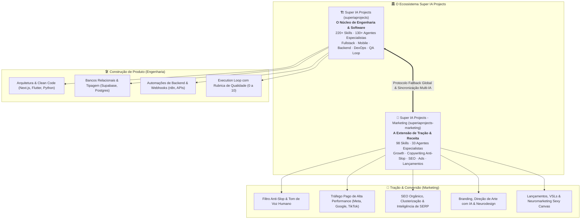

<div align="center">
  <picture>
    <source media="(prefers-color-scheme: dark)" srcset="assets/logo.png">
    
  </picture>
  <h1>Super IA Projects - Marketing (<code>superiaprojects-marketing</code>)</h1>
  <p><strong>The Autonomous Marketing & Growth Engineering Framework</strong></p>
  <p>33 Specialist Agents, 98 Modular Skills, 114 Workflows, Human Anti-Slop Engine & Brand Architecture.</p>

  <p>
    <a href="https://www.futuromercado.com.br"></a>
    <a href="https://instagram.com/felipelbahia"></a>
    <a href="mailto:felipe@futuromercado.com.br"></a>
    <a href="LICENSE"></a>
    
    
  </p>

  <p>
    <strong>Português</strong> | <a href="README.en.md">🇺🇸 Read in English</a>
  </p>
</div>

---

> **Autoria:** Criado e mantido por **Felipe Bahia** ([Futuro Mercado](https://www.futuromercado.com.br)).  
> **Versão:** `v1.0.0` · **Última Atualização:** 01 de Novembro de 2026  
> Extensão oficial focada em **Marketing, Growth, Copywriting, SEO e Ads** do ecossistema [**Super IA Projects**](https://github.com/Felipelbahia/superiaprojects). Projetado para execução fluida em **Claude Code**, **Google Antigravity** e **Cursor**.

---

## ⚡ Por que o Super IA Projects - Marketing?

A produção de marketing com agentes autônomos de IA frequentemente sofre de problemas crônicos: textos previsíveis e cheios de clichês robóticos (*AI slop*), inconsistência com o tom de voz da marca, falta de esteira estruturada de conversão e desconexão entre múltiplos canais.

O **Super IA Projects - Marketing** resolve isso fornecendo uma arquitetura industrial de inteligência:

- 🛡️ **Filtro Anti-Slop Mandatório:** Todo e qualquer texto passa por um crivo rigoroso de linguagem natural que elimina chavões artificiais (*"portanto"*, *"revolucionário"*, *"no cenário atual"*, *"mergulhe nesta jornada"*) antes de ser entregue.
- 🏷️ **Arquitetura de Marca Isolada (`_brands/`):** Contexto estrito por negócio (Tom de Voz, Personas/ICPs, Pilares Editoriais e Guia de Estilo). O agente nunca escreve no vácuo.
- 🎯 **33 Agentes Especialistas de Domínio:** Direção de Arte com IA, Copywriting de Conversão, Tráfego Pago (Meta/Google), SEO Técnico, PR/Imprensa, Neuromarketing Sexy Canvas, B2B Sales e Growth.
- 🧩 **98 Skills Procedurais em 17 Verticais:** Metodologias práticas, scripts de cálculo estatístico (Testes A/B, Funil, Coortes) e frameworks de redação de alta retenção.
- ⚡ **114 Workflows Executáveis:** Comandos rápidos `/slash` para Claude Code e Cursor (planejamento de campanhas, carrosséis, LPs, roteiros de vídeo e auditorias).
- 🔄 **Paridade Dual Multi-IA:** Regras 100% idênticas sincronizadas automaticamente entre `CLAUDE.md`, `GEMINI.md` e `.cursorrules`.

---

## 📦 O que está incluído

<!-- kit-counts:start -->
**33 agents** · **98 skills** · **114 workflows** · **15 scripts inside skills** (generated by `.agent/scripts/sync_entrypoints.py --write-docs`)
<!-- kit-counts:end -->

### 🤖 33 Agentes Especialistas (`.agent/agents/`)
Personas focadas em verticais de marketing que atuam silenciosamente conforme a demanda:
- **Branding & Visual:** `@art-director` (Direção de arte, neurodesign e 3 vias criativas), `@brand-voice-guardian` (Guardião do tom de voz e anti-slop).
- **Conteúdo & Copywriting:** `@content-creator`, `@copywriter`, `@audiovisual-producer` (Roteiros de alta retenção e VSLs).
- **Mídia Paga & Performance:** `@paid-traffic-specialist` (Meta Ads, Google Ads, TikTok Ads, ROAS).
- **Social Media & PR:** `@social-media-strategist`, `@pr-specialist` (Pitches de imprensa e relacionamento com jornalistas).
- **Vendas & RevOps:** `@b2b-sales-director` (Vendas complexas, MEDDIC), `@email-wizard` (Cold emails e nutrição).
- **Estratégia & Growth:** `@marketing-strategist`, `@growth-specialist`, `@conversion-optimizer` (CRO), `@sexy-canvas-strategist` (Neuromarketing e desejos humanos), `@persona-builder`, `@researcher`, `@analytics-specialist`.

### 🧩 98 Skills Modulares em 17 Verticais (`.agent/skills/`)
| Vertical | Foco de Atuação | Exemplos de Skills |
| :--- | :--- | :--- |
| **`brand-*`** | Identidade e Construção de Marca | `brand-builder`, `brand-voice-messaging`, `brand-visual-direction`, `brand-design-system` |
| **`copy-*`** | Persuasão e Conversão | `copy-conversao`, `copy-landing-page`, `copy-vsl`, `copy-hooks-video-curto`, `copy-saas` |
| **`ads-*`** | Tráfego Pago & Mídia de Performance | `ads-meta`, `ads-google`, `ads-criativos`, `ads-multiplataforma`, `ads-analise-de-desempenho` |
| **`social-*`** | Mídias Sociais & Distribuição | `social-estrategia`, `social-carrossel`, `social-linkedin`, `social-direcao-de-arte-ia` |
| **`seo-*`** | Busca Orgânica & Autoridade | `seo-on-page`, `seo-tecnico`, `seo-palavras-chave`, `seo-conteudo`, `seo-schema-markup` |
| **`email-*`** | CRM & Automação de Email | `email-copy`, `email-automacao`, `email-newsletter`, `email-entregabilidade` |
| **`vendas-*`** | Vendas B2B & Prospecção Outbound | `vendas-cold-email`, `vendas-materiais-de-venda`, `vendas-pipeline`, `vendas-prospeccao-de-leads` |
| **`growth-*`** | Experimentação Rápida & Métricas | `growth-testes-ab`, `growth-retencao-e-churn`, `growth-frameworks`, `growth-experimentos-gtm` |
| **`revenue-*`** | Posicionamento & Lançamentos | `revenue-campanhas`, `revenue-sexy-canvas`, `revenue-gtm-e-posicionamento`, `revenue-lancamento` |
| **`persona-*`** | Mapeamento de Clientes & ICPs | `persona-icp`, `persona-descoberta-de-clientes` |
| **`audiovisual-*`** | Mídia Rica, Apresentações & Áudio | `audiovisual-pitch-deck`, `audiovisual-slidev`, `audiovisual-podcast-e-audio`, `audiovisual-agentes-de-voz` |
| **`site-*`** | Páginas de Conversão & Web | `site-cro`, `site-interface-de-conversao`, `site-arquitetura`, `site-tailwind-design-system` |
| **`data-*`** | Atribuição & Análise de Dados | `data-funil-e-coortes`, `data-atribuicao-e-relatorios`, `data-web-ga4` |
| **`geral-*`** | Governança & Qualidade | `geral-anti-slop`, `geral-arquitetura-de-projeto`, `geral-conformidade-lgpd` |

---

## 🚀 Quickstart & Instalação

### Instalação em 1 Comando:

```bash
git clone https://github.com/Felipelbahia/superiaprojects-marketing.git
cd superiaprojects-marketing
./install.sh
```

O script `./install.sh`:
1. Valida o ambiente **Python 3**.
2. Cria o arquivo `CLAUDE.md` a partir do template `CLAUDE.example.md`.
3. Sincroniza e cria os links simbólicos necessários para **Claude Code** (`.claude/`) e **Cursor** (`.cursor/`).
4. Gera o catálogo interativo completo em `.agent/catalog.html`.

---

## 📋 Como usar no dia a dia

### 1. Configure sua Marca em `_brands/`
Crie ou edite a sua marca a partir do modelo pronto:
```bash
cp -r _brands/brand-template _brands/minha-marca
```
Preencha `brand-voice.md`, `personas.md`, `content-pillars.md` e `style-guide.md`.

### 2. O Roteamento Automático de Agentes
Você não precisa se preocupar em chamar manualmente cada especialista. O assistente analisa o pedido e aplica o agente correto:
```markdown
Você: "Crie um carrossel de 7 slides para o Instagram desmistificando testes A/B para a marca minha-marca"
IA: 🤖 Aplicando conhecimento de @art-director + @content-creator + @brand-voice-guardian (Anti-Slop Ativo)...
```

### 3. Socratic Gate para Demandas Complexas
Em lançamentos, campanhas inteiras ou estratégias de tráfego, o assistente ativa o **Socratic Gate**, fazendo uma pergunta por vez para alinhar público, canal e objetivos de conversão antes de escrever.

### 4. Prompts Canônicos Prontos (`prompts-template/`)
Dentro de `prompts-template/`, você encontra roteiros de alta performance para copiar e colar:
- `01-campanha-completa-do-zero.md`: Estruturação de campanhas completas de conversão.
- `02-producao-de-conteudo-anti-slop.md`: Produção de posts, carrosséis e artigos com retenção máxima.
- `03-pesquisa-e-benchmarking-competitivo.md`: Varredura de concorrentes e SERP via Firecrawl.
- `04-auditoria-de-marca-e-persona.md`: Refinamento de personas e matriz de desejos Sexy Canvas.
- `05-lancamento-e-copywriting-conversao.md`: Redação persuasiva para páginas de vendas e emails.

---

## 🔌 Ferramentas Recomendadas: Servidores MCP

O ecossistema se integra nativamente a servidores MCP para leitura profunda de mercado:

- **`firecrawl`**: Web scraping de concorrentes, análise de páginas e extração de SERP em Markdown.
- **`notion`**: Sincronização de briefings, documentações e calendários editoriais.
- **`context7`**: Documentação técnica atualizada de bibliotecas de mídia e automação.
- **`stitch`**: Prototipagem e telas de Landing Pages de alta conversão.
- **`chrome-devtools`**: Auditoria de Core Web Vitals e atrito em páginas de vendas.

👉 *Consulte o [**Guia Completo de Setup (SETUP.md)**](SETUP.md) para configurações passo a passo e modelos prontos em [`mcp.example.json`](mcp.example.json).*

---

## 🌐 A Dupla Dinâmica: Relação com o Super IA Projects

O **Super IA Projects - Marketing** (`superiaprojects-marketing`) e o [**Super IA Projects (`superiaprojects`)**](https://github.com/Felipelbahia/superiaprojects) formam uma arquitetura integrada desenhada por **Felipe Bahia ([Futuro Mercado](https://www.futuromercado.com.br))**: eles são **os dois hemisférios de um mesmo cérebro** para quem constrói e escala negócios com inteligência artificial.

### 🏛️ Estrutura & Arquitetura do Ecossistema

O ecossistema é dividido em dois pilares complementares:

1. **Super IA Projects:**  
   O núcleo de **Engenharia de Software, Governança e Boas Práticas**. Ele atua como o *Sistema Operacional* dos seus agentes, contendo o protocolo de scaffolding (`project-initializer`), o loop de qualidade e QA (`execution-loop`), paridade dual de regras (`CLAUDE.md` / `GEMINI.md`) e mais de 220 skills de desenvolvimento (Next.js, Flutter, Python, Supabase, Docker, APIs e testes).
   
2. **Super IA Projects - Marketing:**  
   A extensão oficial de **Tração, Crescimento e Monetização**. Ele fornece o motor de conversão, estratégias de aquisição (Google/Meta/TikTok Ads), esteira de conteúdo anti-slop, neuromarketing (Sexy Canvas), SEO técnico e assessoria de imprensa.



---

### 🧩 Por Que a Combinação é Imbatível?

- **Engenharia sem Marketing** gera produtos tecnicamente perfeitos que ninguém conhece ou compra.
- **Marketing sem Engenharia** gera promessas exageradas, produtos frágeis e churn imediato.
- **A União dos Dois:** permite a uma pessoa ou equipe enxuta criar a aplicação de ponta a ponta e imediatamente orquestrar a sua estratégia de go-to-market, aquisição e vendas no mesmo nível das maiores tech companies.

---

### 📊 Comparativo Técnico entre os Projetos

| Dimensão | [Super IA Projects (`superiaprojects`)](https://github.com/Felipelbahia/superiaprojects) | [Super IA Projects - Marketing (`superiaprojects-marketing`)](https://github.com/Felipelbahia/superiaprojects-marketing) |
| :--- | :--- | :--- |
| **Papel no Ecossistema** | **Núcleo Central de Engenharia** (Base de Padrões) | **Extensão Vertical de Tração & Crescimento** (Hub de Marketing) |
| **Pergunta Central** | *"Como construir um software estável, escalável e blindado?"* | *"Como posicionar, atrair clientes, converter vendas e reter receita?"* |
| **Volume de Conhecimento** | 220+ Skills, 130+ Agentes, 110+ Workflows | 98 Skills, 33 Agentes, 114 Workflows |
| **Foco Tecnológico** | TypeScript, Python, Dart/Flutter, React, Docker, Postgres | Copywriting, Performance Ads, SEO, Brand Voice, PR, CRM |
| **Metodologia de Qualidade** | **Execution Loop:** *Spec → Plan → Code → QA (0 a 10)* | **Anti-Slop Engine:** *Socratic Gate → Brand Voice → Human Review* |
| **Repositório GitHub** | [`Felipelbahia/superiaprojects`](https://github.com/Felipelbahia/superiaprojects) | [`Felipelbahia/superiaprojects-marketing`](https://github.com/Felipelbahia/superiaprojects-marketing) |

---

### 🔄 Operação Integrada no Dia a Dia (Hierarquia Fallback)

Quando você configura ambos os projetos na sua máquina, qualquer agente de IA (**Claude Code**, **Google Antigravity** ou **Cursor**) resolve demandas técnicas e comerciais com busca em cascata:

```text
1º Nível (Projeto Ativo)      --> .agent/skills/ (regras específicas do projeto local)
2º Nível (Super IA Projects)   --> ~/superiaprojects (engenharia, arquitetura, testes e padrões)
3º Nível (Super IA Marketing)  --> ~/superiaprojects-marketing (growth, campanhas, ads e copy)
```

#### Como Conectar os Dois Hubs na Sua Máquina
Basta declarar as variáveis de caminho nos arquivos de regras dos seus projetos ou no seu perfil global:

```bash
# Apontamento para o repositório central de engenharia
export SUPER_IA_PROJECTS_PATH="$HOME/superiaprojects"

# Apontamento para a extensão oficial de marketing
export MARKETING_HUB_PATH="$HOME/superiaprojects-marketing"
```

Com isso, ao pedir no terminal do seu projeto:
- *"Adicione autenticação via Supabase e testes unitários"* ➔ O agente puxa as skills do **Super IA Projects**.
- *"Crie a copy da landing page e a sequência de e-mails de lançamento"* ➔ O agente puxa as skills do **Super IA Projects - Marketing**.

---

## 🤝 Como Contribuir

Quer adicionar novas skills, templates de anúncios ou agentes de marketing? Veja o nosso [Guia de Contribuição (CONTRIBUTING.md)](CONTRIBUTING.md) para conhecer a metodologia de documentação procedural e critérios de aceite.

---

## 🙏 Créditos & Agradecimentos

- **[`obra/superpowers`](https://github.com/obra/superpowers)** por **Jesse Vincent**: Inspiração na filosofia de skills modulares e bootstrapping de agentes.
- **Antigravity Kit** por **Vudovn**: Base conceitual de agentes autônomos.
- **Futuro Mercado**: Arquitetura de marketing de alta performance, esteira anti-slop e consolidação técnica.

---

## 📬 Contato & Comunidade

- **Autor:** Felipe Bahia
- **Empresa:** [Futuro Mercado](https://www.futuromercado.com.br)
- **Email:** [felipe@futuromercado.com.br](mailto:felipe@futuromercado.com.br)
- **Instagram:** [@felipelbahia](https://instagram.com/felipelbahia)

---

## 📄 Licença

Distribuído sob a licença **MIT**. Consulte o arquivo [LICENSE](LICENSE) para mais detalhes.
