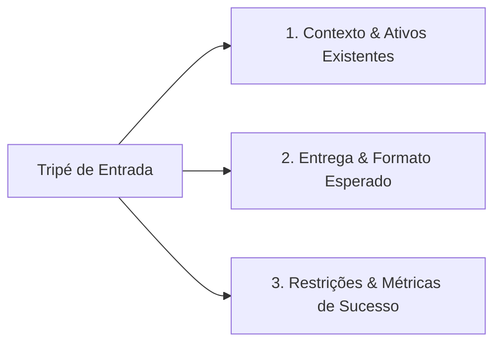

# Guia de Uso do Hub: Exemplos Práticos de Pedidos e Portas de Entrada Ponta a Ponta

> Conceito adaptado de `promovaweb/inboundfy` (documentos `18-exemplos-de-pedidos.md`, `11-areas-de-trabalho.md` e fluxos `14-17`, sob licença AGPL-3.0), redigido em prosa original e calibrado para a arquitetura multi-agente do `0 Mkt`.

O ecossistema `0 Mkt` reúne 99 skills especializadas, 114 workflows executáveis e 33 agentes especialistas. Ter um acervo amplo, no entanto, só gera valor se o usuário souber exatamente **qual frase escrever no chat** para acionar a competência correta sem atrito.

Este guia orienta a formulação de pedidos de alta precisão, ensina a desarmar solicitações vagas e estabelece o mapa de encadeamento dos 4 grandes fluxos operacionais ponta a ponta do marketing.

---

## 1. Anatomia de um Bom Pedido (O Tripé de Entrada)

A IA não lê pensamentos nem adivinha o contexto do seu negócio. Pedidos de alto rendimento no `0 Mkt` fornecem ou acionam o **Tripé de Entrada**:



| Elemento | O que informar | Exemplo Ruim (Vago) | Exemplo Bom (Acionável) |
| :--- | :--- | :--- | :--- |
| **1. Contexto & Ativos** | Links, rascunhos, dados reais, marca ativa em `_brands/<marca>/` ou materiais prévios | *"Escreva um post sobre nosso produto."* | *"Para a marca [Marca], com base no rascunho de transcrição anexo em `scratchpad/aula.md`..."* |
| **2. Entrega & Formato** | Canal exato, estrutura desejada, quantidade de opções e destino no mapa | *"Preciso de uma copy de vendas."* | *"Escreva 2 opções de página de vendas longa (formato Conrado Adolpho) salvando em `content/<marca>/copy/`..."* |
| **3. Restrições & Números** | Limites de caracteres, preço, público-alvo prioritário, palavras proibidas e prazo | *"Faça um anúncio curto e convincente."* | *"Crie 3 anúncios de Meta Ads para público frio, focando na dor X, com ticket de R$ 997 e sem promessas milagrosas de dinheiro fácil."* |

> **A Regra de Ouro do Socratic Gate:** Se o seu pedido omitir um desses três pilares, o assistente **irá parar e perguntar** antes de produzir texto (conforme a regra 4 do `AGENTS.md` e a regra de marca 1.1). Fornecer os dados na primeira mensagem pula a etapa de perguntas e inicia a execução imediatamente.

---

## 2. Roteamento Inteligente e Desambiguação

### 2.1. Quando Usar o Especialista Direto vs. Orquestrador
- **Mono-Domínio (Tarefa Única e Focada):** Quando você precisa de uma entrega estrita em um único canal (ex: *"escrever um artigo de blog"*, *"revisar o robots.txt"*, *"criar sequência de e-mails"*), mencione a skill ou o agente direto (`@copy-redacao-publicitaria`, `/conteudo-post-de-blog`, `@seo-otimizacao-de-busca`).
- **Multi-Domínio (Estratégia Ampla e Vários Canais):** Quando a demanda envolve múltiplos canais simultâneos (ex: lançamento, reposicionamento, criação de campanha integrada), invoque o orquestrador geral (`@revenue-orquestracao-de-estrategia` ou o workflow `/revenue-plano-de-lancamento`).
- **Briefing Pronto:** Se você já tem o briefing preenchido e aprovado, acione diretamente a skill produtora correspondente, pulando a ideação.

### 2.2. Como Desarmar Pedidos Vagos: O Protocolo de Desambiguação
Pedidos genéricos como *"Preciso vender mais"* ou *"Melhore meu marketing"* paralisam a execução. O assistente diagnostica e desmembra a demanda em 4 frentes de corte:

```
Pedido Vago: "Preciso vender mais no meu negócio digital."
                                │
   ┌────────────────────────────┼────────────────────────────┐
   ▼                            ▼                            ▼
1. Gargalo de Tráfego?      2. Gargalo de Página?       3. Gargalo de Oferta?
   (Pessoas não chegam)         (Chegam e não convertem)    (Acham caro/sem valor)
   → Acionar: ads-google,       → Acionar: site-cro,        → Acionar: revenue-oferta,
     ads-meta, seo-on-page        copy-landing-page           revenue-preco
```

---

## 3. Catálogo de Pedidos Reais por Sintoma e Área

Consulte esta tabela para encontrar a formulação exata de prompt para cada desafio operacional:

| Área | Desafio ou Sintoma Real | Prompt Recomendado no Chat | Recurso Acionado | Output Esperado no Mapa |
| :--- | :--- | :--- | :--- | :--- |
| **Conteúdo** | Rascunho confuso de palestra ou ideias soltas de áudio | *"Transforme o dump de anotações em anexo em um post estruturado de blog em tom conversacional para a marca [Marca]."* | Skill `conteudo-post-de-blog` + `/geral-anti-slop` | `content/{marca}/blog/AAAA-MM-DD - Nome/draft.md` |
| **Conteúdo** | Transcrição longa que precisa virar múltiplos canais sem repetição mecânica | *"Saneie a transcrição bruta do arquivo X e monte a matriz de reaproveitamento 1-para-muitos para LinkedIn, carrossel e e-mail."* | Skill `conteudo-reaproveitamento` | `content/{marca}/estrategia/AAAA-MM-DD - Matriz/` |
| **Copywriting** | Landing page com taxa de conversão abaixo de 2% | *"Audite a copy da landing page atual em [URL/Arquivo] contra as 8 etapas clássicas de persuasão e reescreva a dobra superior e o CTA."* | Skill `copy-landing-page` + `@site-otimizacao-de-conversao` | `content/{marca}/copy/AAAA-MM-DD - Otimizacao LP/` |
| **Copywriting** | Roteiro de vídeo de vendas para infoproduto ou SaaS | *"Escreva o roteiro slide a slide para uma VSL de 12 minutos do produto X (ticket R$ 497), estruturado em 8 partes e com quebra de objeções."* | Skill `copy-vsl` | `content/{marca}/video/AAAA-MM-DD - VSL Produto X/` |
| **SEO & GEO** | Queda brusca de tráfego orgânico após migração de site | *"Audite os redirecionamentos 301, canonicals e sitemap XML pós-migração a partir do relatório em anexo; temos credenciais ativas do Search Console."* | Agente `@seo-otimizacao-de-busca` + `seo-tecnico` | `content/{marca}/inteligencia/estudos/auditoria-seo.md` |
| **SEO & GEO** | Otimização para mecanismos de busca por Inteligência Artificial (AEO/GEO) | *"Revise nossa página-pilar de [Tema] para responder às intenções de busca do Perplexity e SearchGPT com marcação Schema JSON-LD completa."* | Skill `seo-geo` + `seo-schema-markup` | `content/{marca}/blog/AAAA-MM-DD - Otimizacao AEO/` |
| **Social Media** | Alimentar Instagram e LinkedIn com autoridade técnica | *"Crie o roteiro slide a slide de um carrossel visual 4:5 sobre [Tema], com gancho forte na capa, densidade técnica e CTA para salvar."* | Skill `social-carrossel` + `@brand-direcao-de-arte` | `content/{marca}/social/AAAA-MM-DD - Carrossel/` |
| **Social Media** | Estratégia de comunidade no WhatsApp sem virar grupo de spam | *"Desenhe o plano de acolhimento dos primeiros 7 dias e o calendário de rituais semanais para a comunidade de clientes da marca [Marca]."* | Ref `comunidade-e-rituais.md` em `social-estrategia` | `content/{marca}/estrategia/plano-comunidade.md` |
| **Growth & Mídia** | Lançamento em diretórios de software internacionais | *"Monte o submission kit completo (taglines, descrições em 3 tamanhos, briefing de screenshots e UTMs) para cadastrarmos nosso SaaS no Product Hunt e G2."* | Ref `diretorios-e-marketplaces.md` em `growth-frameworks` | `content/{marca}/estrategia/campanhas/submission-kit/` |
| **Growth & Mídia** | Automação de recuperação de carrinho por SMS e WhatsApp | *"Estruture a esteira de recuperação de checkout abandonado combinando e-mail em 1h, WhatsApp consultivo em 20 min e SMS de última chamada."* | Ref `sms-whatsapp-marketing.md` em `email-automacao` | `content/{marca}/estrategia/campanhas/esteira-recuperacao/` |
| **Vendas B2B** | Prospecção ativa de contas de alto ticket | *"Gere uma lista de critérios de qualificação ICP e escreva uma cadência de cold email em 4 toques para Diretores de TI, sem clichês de vendas."* | Workflow `/vendas-cold-email` + `vendas-direcao-b2b` | `content/{marca}/vendas/AAAA-MM-DD - Cadencia TI/` |
| **Dados & Analytics** | Fechamento executivo de resultados de marketing | *"Gere o relatório executivo mensal consolidando investimento, CPA, CAC por canal, taxa de conversão do funil e grau de confiança dos dados."* | Workflow `/data-relatorio-executivo` + `data-revisao-mensal` | `content/{marca}/inteligencia/estudos/relatorio-mensal.md` |
| **PR & Imprensa** | Pauta relevante para emplacar matéria na mídia | *"Desenvolva 3 ângulos de pauta noticiosa baseados nos dados proprietários do nosso estudo de mercado e redija o pitch para jornalistas de negócios."* | Agente `@pr-relacoes-publicas` + `pr-assessoria-de-imprensa` | `content/{marca}/imprensa/AAAA-MM-DD - Pauta Estudo/` |
| **Branding & Marca** | Definição de tom de voz e pilares editoriais do zero | *"Inicie o protocolo de Brand Builder para a marca [Nova Marca], cobrindo Essência, Posicionamento, Personas e Tom de Voz com o filtro anti-slop."* | Skill `brand-builder` + `brand-voice-messaging` | `_brands/{marca}/brand-voice.md`, `personas.md` |

---

## 4. Portas de Entrada dos 4 Grandes Fluxos Ponta a Ponta

Quando o trabalho exige uma cadeia coordenada de entregas, execute os passos na ordem indicada respeitando as entradas e saídas do mapa de destinos:

```mermaid
graph TD
    subgraph FLUXO 1: LANÇAMENTO
        L1[1. Plano Geral: revenue-plano-de-lancamento] --> L2[2. Checklist: revenue-checklist-de-lancamento-de-campanha]
        L2 --> L3[3. Campanhas: ads-google / ads-meta]
        L3 --> L4[4. Mensuração: data-web-ga4]
    end

    subgraph FLUXO 2: RECUPERAÇÃO DE SEO
        S1[1. Auditoria Técnica: seo-tecnico + site-arquitetura] --> S2[2. Conteúdo On-Page: seo-on-page + schema]
        S2 --> S3[3. Autoridade: seo-autoridade-e-backlinks]
        S3 --> S4[4. Rotina: seo-checklist-semanal]
    end

    subgraph FLUXO 3: MÁQUINA DE VENDAS B2B
        V1[1. Prospecção: vendas-prospeccao-de-leads] --> V2[2. Abordagem: vendas-cold-email]
        V2 --> V3[3. Material: vendas-materiais-de-venda]
        V3 --> V4[4. Pipeline: vendas-pipeline + vendas-direcao-b2b]
    end

    subgraph FLUXO 4: INTELIGÊNCIA DE DADOS
        D1[1. Tracking: data-web-ga4 + GTM] --> D2[2. Modelagem: data-atribuicao-e-relatorios]
        D2 --> D3[3. Experimentação: growth-testes-ab]
        D3 --> D4[4. Relatório Executivo: data-relatorio-executivo]
    end
```



### 4.1. Fluxo 1: Lançamento de Produto ou Campanha Integrada
- **Objetivo:** Orquestrar o ciclo completo de lançamento, da tese comercial à mensuração.
- **Passo 1 (Estratégia e Cronograma):** Rodar workflow `/revenue-plano-de-lancamento` para definir metas financeiras, fases (Aquecimento, Abertura, Encerramento) e oferta irresistível.
- **Passo 2 (Auditoria Prévia de Prontidão):** Rodar `/revenue-checklist-de-lancamento-de-campanha` para validar links, gateways, e-mails de confirmação e pixels.
- **Passo 3 (Tráfego Pago & Mensageria):** Configurar contas via `ads-google`, `ads-meta` e esteiras de SMS/WhatsApp em `email-automacao`.
- **Passo 4 (Rastreamento em Tempo Real):** Validar eventos de conversão no GA4 via `data-web-ga4`.
- **Destino no Mapa:** `content/{marca}/estrategia/campanhas/AAAA-MM-DD - Nome da Campanha/`

### 4.2. Fluxo 2: Diagnóstico e Recuperação de SEO de Site Parado
- **Objetivo:** Identificar gargalos técnicos de indexação, otimizar páginas prioritárias e restabelecer o crescimento orgânico.
- **Passo 1 (Auditoria de Infraestrutura):** Rodar `seo-tecnico` e `site-arquitetura` para inspecionar Core Web Vitals, robots.txt, sitemaps e arquitetura de URLs.
- **Passo 2 (Conteúdo & Semântica):** Aplicar `seo-on-page` e `seo-schema-markup` nas páginas prioritárias de maior potencial de conversão.
- **Passo 3 (Autoridade Externa):** Traçar plano de link building e citações em diretórios via `seo-autoridade-e-backlinks` e `growth-frameworks`.
- **Passo 4 (Governança Semanal):** Rodar `/seo-checklist-semanal` para monitorar erros de rastreamento no Search Console.
- **Destino no Mapa:** `content/{marca}/inteligencia/estudos/` e `content/{marca}/blog/`

### 4.3. Fluxo 3: Máquina de Prospecção e Vendas B2B
- **Objetivo:** Construir um motor previsível de geração de reuniões comerciais qualificadas para tickets altos.
- **Passo 1 (Mapeamento de Contas e ICP):** Rodar `/vendas-prospeccao-de-leads` para definir filtros de segmento, cargo, tamanho de empresa e sinais de compra.
- **Passo 2 (Cadência de Abordagem Outbound):** Rodar `/vendas-cold-email` estruturando sequência de 4 mensagens focadas nas dores operacionais do decisor.
- **Passo 3 (Kit Comercial de Apoio):** Construir decks de apresentação, one-pagers e matriz de resposta a objeções via `vendas-materiais-de-venda`.
- **Passo 4 (Governança de Oportunidades):** Monitorar avanço de etapas de pipeline no CRM com `vendas-pipeline` e o agente `@vendas-direcao-b2b`.
- **Destino no Mapa:** `content/{marca}/vendas/AAAA-MM-DD - Nome da Demanda/`

### 4.4. Fluxo 4: Medição, Atribuição e Inteligência de Dados
- **Objetivo:** Estabelecer a verdade única sobre retorno sobre investimento em marketing, sem métricas vaidosas ou simuladas.
- **Passo 1 (Coleta Segura):** Implementar e auditar eventos do dataLayer e Consent Mode via `data-web-ga4`.
- **Passo 2 (Modelagem de Atribuição):** Rodar `data-atribuicao-e-relatorios` comparando primeiro clique, último clique e atribuição orientada a dados, declarando o nível de confiança estatística.
- **Passo 3 (Otimização Contínua):** Desenhar testes A/B via `/growth-teste-ab` para hipóteses que superem a significância mínima de amostra.
- **Passo 4 (Consolidação da Diretoria):** Gerar o relatório executivo periódico via `/data-relatorio-executivo` e `/data-revisao-mensal`.
- **Destino no Mapa:** `content/{marca}/inteligencia/estudos/` e `content/{marca}/reports/`
